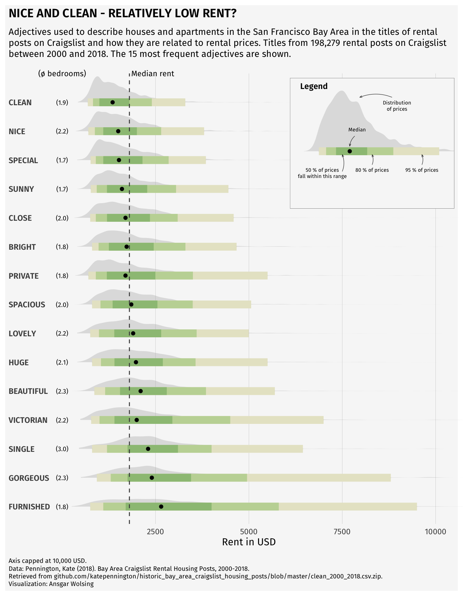

# What is Computational Social Science?

We begin by exploring the meaning of "Computational Social Science," and how it relates to data science, and social science more broadly. This field has changed tremendously in the last few decades, so we'll try to orient ourselves to its history and current directions. We will load R and R Studio onto our computers and start to explore these tools. 

__Monday Readings:__

* [Bit By Bit. 1: Introduction.](https://www.bitbybitbook.com/en/1st-ed/introduction/)

* [Lazer, David; Pentland, Alex; Adamic, Lada; et al. 2009. Science. Computational Social Science.](https://www.science.org/doi/10.1126/science.1167742)

* _Optional:_ [Edelmann, Achim; Wolff, Tom; Montagne, Danielle; Bail, Christopher A. 2020. Annual Review of Sociology. Computational Social Science and Sociology.](https://www.annualreviews.org/content/journals/10.1146/annurev-soc-121919-054621)

__Wednesday Readings:__

* No readings, but consider viewing [Installing R and RStudio](https://sicss.io/overview/installing-r-and-rstudio)


## Some Definitions

What is social science? What is data science? Why combine these?

**Social science** typically refers to the disciplines that study social life (mainly anthropology, economics, political science, psychology, and sociology). This class focuses mostly on the computational research and methods used by sociologists. However, many of these same theories and tools are useful across disciplines. 

**Data science** refers to statistical and computational methods for dealing with data (often large data). It is the study of working with data, whether these are counts or texts or any other form that can be captured by machines, usually with the purpose of drawing inferences and producing visualizations or other findings.   

For our purposes, [computational social science](https://sicss.io/overview/introduction-to-computational-social-science) lies at the intersection of social science and data science. Computational sociology is one of the disciplines that makes up computational social science. 

One difference between computational social scientists and social scientists (or data scientists) is that computational social scientists often use a combination of many types of data. __Custom made data__ refers to traditional sources of information on populations: surveys, censuses, interviews, and so on. __Ready made data__ refers to information that exists for non-research purposes: company or government records, text from public websites, metrics from an app, and so on. By combining these types of data, the computational social scientist can do research at speeds, scales, and on populations that previously would have been impossible. 

This course provides an introduction to computational sociology, for a few reasons. First, there are massive challenges for societies everywhere, and it is important that we understand them. Second, data science skills are increasingly needed to communicate across fields and domains. Third, the tools from data science may actually help us to understand and communicate the variegated influences of changing societies across the globe. 


## Getting Started with R (or Python)

We can do some data science by hand, but statistical tools can help make our lives easier. Software such as R or Python are useful for efficiently analyzing cleaning data, analyzing data, and visualizing results. While you probably _could_ make the plot of apartment description adjectives below by hand, it would take a _really_ long time. Once you know R, you'll be able to recreate this graph [relatively easily](https://r-graph-gallery.com/web-ridgeline-plot-with-inside-plot-and-annotations.html). (As a side note, notice what this image is conveying: how apartments of different prices are described differently in San Francisco - but more on that later.)

```{r cherryblossoms, echo = FALSE}



```

You can install R [here](https://cran.r-project.org/). Just click on the appropriate link (Mac/Windows/Linux) and follow the instructions. Even if you've installed R previously, you may be able to update your version by re-installing it.

Next, you're going to want to install RStudio [here](https://posit.co/download/rstudio-desktop/). Again, you'll have to select the right version for your machine. RStudio is the preferred integrated development environment (IDE) for most R users. 

We will focus most of this course on examples using R and RStudio, but there are other good alternatives for doing data science out there! I'll just note a few: 

In terms of programming, Python is an extremely popular and flexible option. It was designed and is used mostly by computer scientists, whereas R is mostly used by statisticians. The two languages therefore have lots of subtle differences in the way that one uses them, although, today it is possible to do most tasks in either. You can find instructions to see if your computer has Python installed (and download it if it does not) [here](https://www.python.org/downloads/).

In terms of IDEs, Anaconda is commonly used with Python. You can install Anaconda [here](https://docs.anaconda.com/free/anaconda/install/index.html). Anaconda gives you the option to utilize many programs, including RStudio and Jupyter Notebooks, which are another great way to share code and analysis. 

Lastly, a relative _newcomer_ in the social data science scene is a programming language called [Julia](https://julialang.org/). Currently, there seems to be a lot of enthusiasm about Julia due to its speed, intuitiveness, and the ability to incorporate other languages in Julia code as well. Julia allegedly combines the statistical prowess of R with the flexibility of Python. We won't code in Julia in this class, but this is something to keep an eye on if you continue to do data science! [This video](https://www.youtube.com/watch?v=oTUmW8dWZws) might be a good place to start if you want to learn more.

## Working in Base R

Now that you have your script open and a header written, it's time to try some lines of code. We can begin with numbers and simple arithmetic. Notice that we use `*` for multiplication, and `/` for division. 

```{r base}
# what does R do with numbers?
2
3

# what if we try adding or multiplying?
4+3
53*2
90*4/5

```

These cases all return a singular number, but sometimes we want series of numbers or characters. These are called arrays or vectors. We can make these by using `c()`. 

```{r vectors}
# what if we put all the previous results together?
c(2, 3, 4+3, 53*2, 90*4/5)

```

In R, we can also assign values to labels. This will be useful as we begin to work with more and more data. To do so, we use `<-`. This is a bit different than other languages, such as Python, which simply use `=`. For the most part, you can use `=` in R and it will not change your output, but there are a few cases where it could matter. 

```{r assign values, echo = TRUE}

# assign "sum" to the sum of a few numbers
penguin <- c(2, 3, 4+3, 53*2, 90*4/5)

# now take a look at the result
penguin

```

In the previous code, each output starts with a `[1]`. Why is this? It is to show that our output has one row. We could also represent these same data as a $5 \cdot 1$ matrix:

```{r matrix}
# what if we put all the previous results together?
matrix(c(2, 3, 4+3, 53*2, 90*4/5),
       nrow = 5)

```

Another form that R handles are lists! We won't use lists extensively, but these can be helpful in cases where we have multiple vectors, especially if they are differing lengths. 

```{r lists}

list(c(2, 3, 4+3),
     53*2,
     90*4/5)

```

It is worth noting that all of the data that we have entered so far are _numeric_. Other common data types include _character_, _logical_, and _integer_. You can try manipulating your data with functions like `as.character()`. For instance, what happens when you run `as.logical(1)` and `as.logical(0)`?


## Opening RStudio

Everything that we've done up to this point can be done using what's called "Base R." This is the simplest version of R, if you have some experience with computer science, it's kind of like the terminal prompt. While we _can_ continue to use Base R, it's much easier to use RStudio, which provides an integrated development environment (IDE) for working in R. RStudio has point-and-click options, and helps us to organize our code in various ways.  

When you open RStudio, you'll have the option to start a **new project**. I recommend creating a project just for this class. You'll be asked to place the project in a directory (can be new or existing). I recommend putting it in a folder just for this class (e.g. C:/Users/tyler/Documents/Soc128D/).

To start coding, you are going to want to create a new script. The script is essentially your instructions for what R should do. You can also run these directly in the command line (to the bottom of the screen with the > symbol), but it's better to run them from the script so that you can save and edit your commands.

At the top of the script, create a header like the one below. This will help keep scripts organized as you make more of them. It's also a good idea to save your script with a simple but descriptive name (e.g. "week1.R"). Notice all the `#` signs. These simply tell R that the text following them are notes rather than instructions. In a well-written script, there should be lots of `#` with notes explaining what the code is doing! The goal is to make it easy for your reader to understand. 

```{r header}
#####################################################
## title: a new R script!
## author: you!
## purpose: to try out R
## date: today's date
#####################################################

# you can start coding below

```


Next, we'll try using a **function**. You can think about a function as a recipe. If you were telling someone how to make pancakes, you could go through each step of mixing eggs, milk, flour, and so on, or you could just say "follow this recipe" and give them the entire list of instructions. R knows some recipes/functions already. If we want to sum all the components in a vector, we don't have to tell R to do each step, we can just tell it to do the `sum()` function:

```{r function}

# let's have R sum the numbers
sum(c(2, 3, 4+3, 53*2, 90*4/5))

```


As an exercise, you can try writing your own function. 

```{r function2}
# we'll call our function 'addition'
addition <- function(x, y){
  return(x+y)
}


```

Let's see if it worked:

```{r function3}
addition(2, 2)

```

It worked! But why? When we assigned the action `x+y` to the function `addition`, we are telling R that given an `x` and a `y` inside `addition`'s parentheses, we want R to perform this task. Try writing a few functions on your own! The syntax is very important, so change this around a bit until you have an idea about what works and what doesn't. 

A quick note here - if you are ever unsure of exactly what a function does, you can use the `?` command to access the help page. For instance, `?as.integer` tells us what arguments this function takes, and what output it will provide us with. 

Another important action that we can perform in R or any other coding language is the **loop**. Let's say that we want R to perform an action repetitively, rather than just once. For example, maybe we want to print each of 10 numbers. 

```{r loop}
# try printing each of the first 10 numbers
for(i in 1:10){
  print(i)
}

```

Using this example of a sequence from 1 to 10, we can observe what happens when we try to manipulate a vector. 

```{r vector}

# vector with 1-10
ten <- c(1:10)

# try adding one
ten + 1

```

Finally, we'll just take a brief look at using **apply**. Specifically, we look at _sapply_, which applies a function over a list or vector. In this case, we get the same result as above, so the `sapply` method actually makes our code a bit more complicated. But it's a good idea to remember this option, because it will be useful as our functions get more complicated. 

```{r apply}

# apply function that adds one to each integer from 1-10
sapply(ten, function(x) x + 1)

```

A note on coding: when we learn to write code, we are learning a _language_! We will start by writing small bits, and there will be lots of moments when we don't understand our computer (or it does not understand us, or both). This is all ok. 

What _is_ important is that we clearly annotate our coding decisions so that our code can be legible to both humans and machines. So use the `#` sign often!! 

I'll also note here a theme that we will see recur throughout the class - data science is often done _ad hoc_, using whatever methods or tools make sense at the time (rather than a rigid or formal process). There is no right or wrong way to learn how to code, but some ways are better than others. As we progress through our coding exercises, try to keep principles of the R language in mind (e.g. what is a loop? what is a vector? etc.), but don't be afraid to do some experimentation of your own!


## Packages

R, much like Python and Julia, is a free and open source software. Anyone can write their own functions and share them with other users, which is a huge benefit. _How do we get their functions?_ We need to install them through __packages__. For instance, we can install the `dplyr` package - which contains lots of useful functions for manipulating data - as follows:

```{r packages, eval = FALSE}

# install our first package
install.packages("dplyr")

```


Next, we `library` the package to have it ready to use. 


```{r library, message = FALSE}
# library the package (so its ready to use)
library(dplyr)


```

As you might guess, there are also some drawbacks to open source software: because the functions come from individual users rather than a corporation ("bottom up" rather than "top down"), packages can be messy or have overlapping or confusing language. By choosing which packages are in our library we limit the functions available to us at any given time, saving computing space and avoiding potential conflicts. We notice above that the `dplyr`  package _masked_ objects from other packages (in this case, functions) such as `filter`, `lag`, `intersect`, `setdiff`, `setequal`, and `union`. (You might get a slightly different message). This just means that all of these functions will assume you want the `dplyr` version. We don't need to worry about this too much now, but it's good to know where your packages come from. If you start typing `filter` into your console, you should see `filter {dplyr}`, indicating that `filter` is coming from the `dplyr` package.


## R Markdown

Up to now, we have used base R, and R scripts to run code. But if we are writing documents with _text and data analysis_, as is often the case in social science research, it is clunky to do these in separate programs. Luckily for us, R can do both! We do that with an R Markdown file. 

To start your first R Markdown file, open RStudio, then click File -> New File -> R Markdown... You can give your file a title and add your name. We will start with a "document," rather than "presentation" or any of the other options. In the Output section, you can click "PDF."

Great! In your new file, you can see "chunks" of R code (which work similarly to R scrips or any other R code), interspersed with chunks of text. When you hit "knit," your document will create a .pdf file!

You can add additional chunks by typing three \` characters, followed by \{, `r` `chunkname`, \}, and (on the next line), three more \` characters. There should be some examples in your file. 

Be sure that each chunk has a different chunkname. You can modify options in these chunks (like `echo = TRUE` or `echo = FALSE`) depending on what you want to show (code, results, both, neither, etc.). A wonderful guide for starting with RMarkdown is [here](https://ourcodingclub.github.io/tutorials/rmarkdown/).


## Problem Set 1

Due: April 5, 2026

Recommended Resources: 

[Installing R and RStudio](https://sicss.io/overview/installing-r-and-rstudio) (note that the site for downloading R Studio in this video is outdated).

[Getting Started with R Markdown](https://ourcodingclub.github.io/tutorials/rmarkdown/)

[R Markdown Section from R for Data Science](https://r4ds.had.co.nz/r-markdown.html).

A note: this homework will be a bit different than the other in that I will accept many forms of submission. Future assignments should be turned in as PDF or HTML files generated from R Markdown or Jupyter Notebook files. 

Prior to beginning: Install R and RStudio on your computer. Open RStudio, start a new project, and start a new script called "HW1_yourname.R" or something similar. Give your script a heading like the following: 

```{r header2}
#####################################################
## title: first problem set!
## author: you!
## purpose: to try out R
## date: today's date
#####################################################

# you can start coding below

```

I highly recommend using RMarkdown to do the following problem set. A template is available on Canvas in the Files folder.  


1. Add the following code to the script, and run it:

```{r hwcode}

vec <- c(1:20)

```

Try writing a function that multiplies each number in `vec` by 2. Label this as a new vector. You can display the output with `print()` (add the name of your output vector in the parentheses). 

2. Let's put the two vectors together in a dataframe! For this, you are going to want to install and library the `dplyr` package. You can use the `bind_cols()` function to combine the two vectors. Then print the dataframe!


```{r answer, echo = FALSE, message = FALSE}
library(dplyr)

mult_2 <- function(x){
  new_x <- x*2
  
  return(new_x)
}

# create new vec
new_vec <- mult_2(vec)

# put in dataframe
df <- bind_cols(vec, new_vec)

```

3. Now, name the two columns in the dataframe `x` and `y`, and create a plot using the data! You can try the following first:

```{r plotexample}

# plot your dataframe 
# note that you will have to define df
# in this case, df is the binded columns of vec and vec multiplied by 2

names(df) <- c("x", "y")

plot(df$x, df$y)

```

Next, can you use `ggplot()` from the `ggplot2` package to make a more beautiful plot?


4. __Creating Custom Made Data__. Collect a few points of data on a social issue (that are not personally identifiable). For instance, the number of classes in three Stanford departments, or some general information about cars in nearby parking lots. It doesn't need to be large! 3 rows x 3 columns is sufficient. Create a dataframe with these data in R, called `df`, and run the `print(df)` command to display the dataframe. Be sure that your data does not infringe on anyone's privacy. 

5. __Re-purposing Ready Made Data__. Run the following script: `data()`. It will show you a list of pre-built datasets in R. Choose one of these datasets and describe it (in words, how is it organized, what are the variables, and so on). Do you think it would be useful in a social science study (perhaps combined with other data)? If so, what kind of study? 

