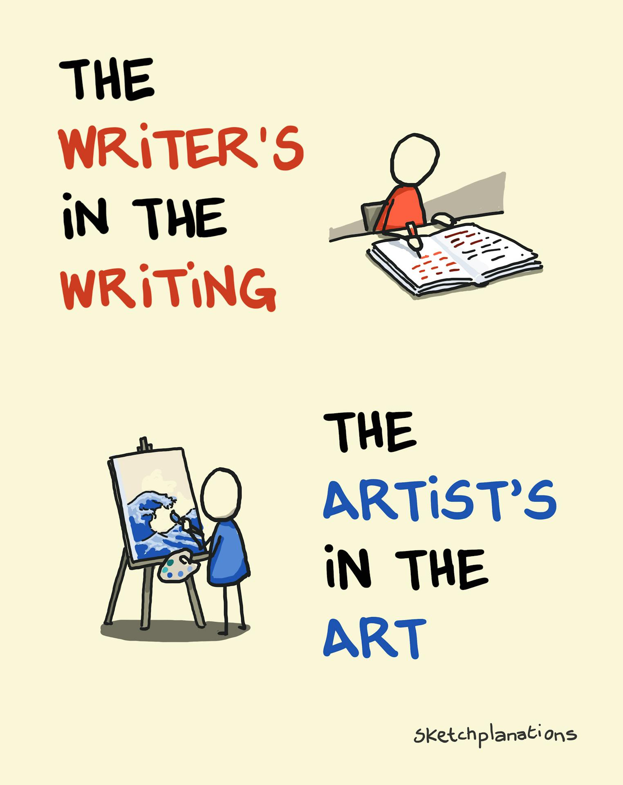
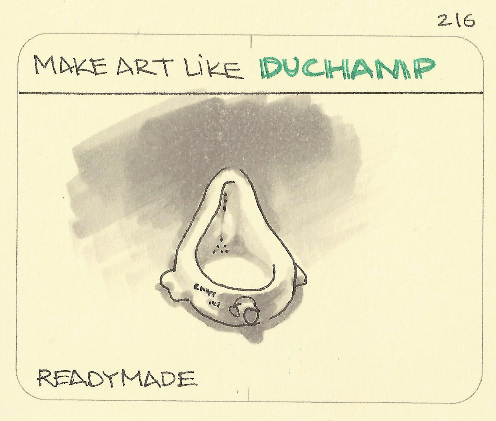
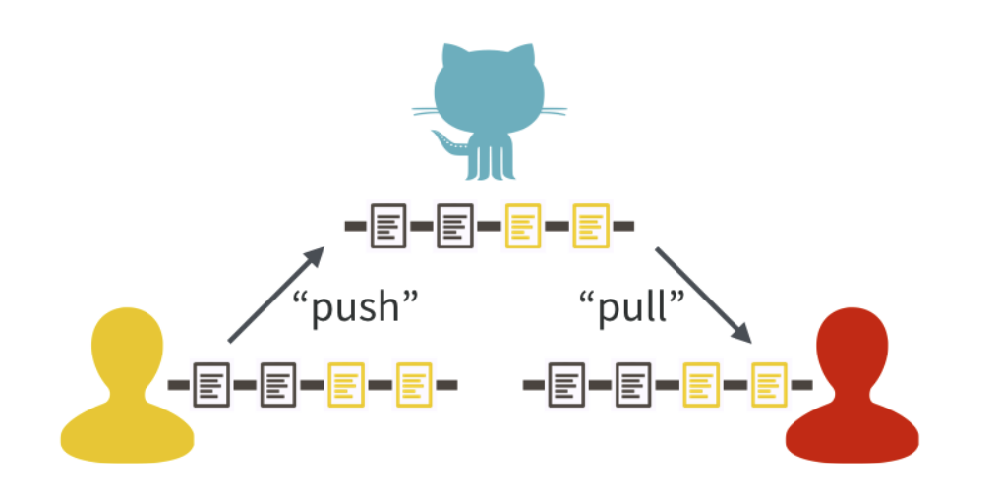
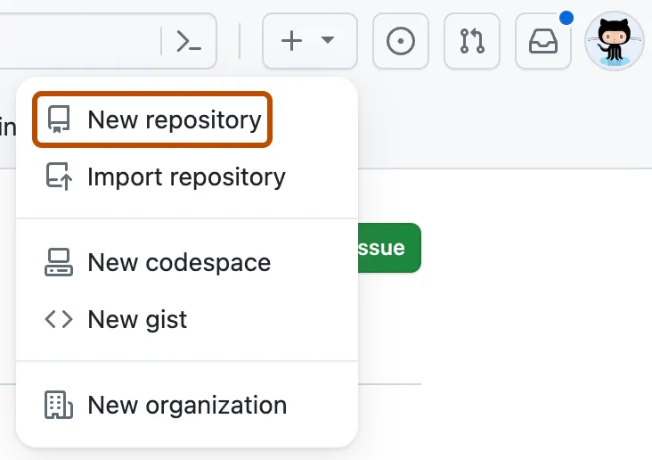
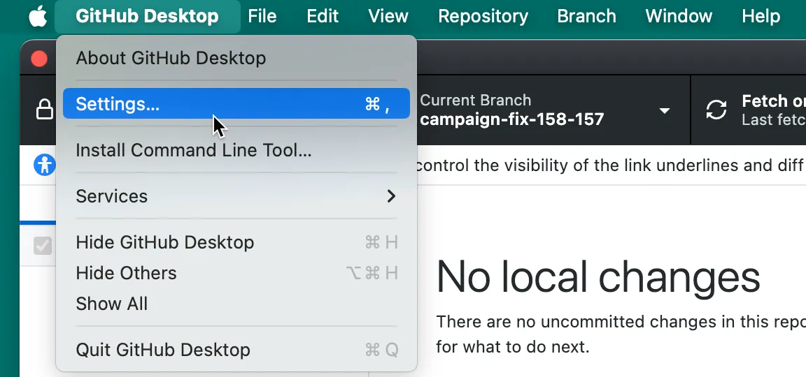
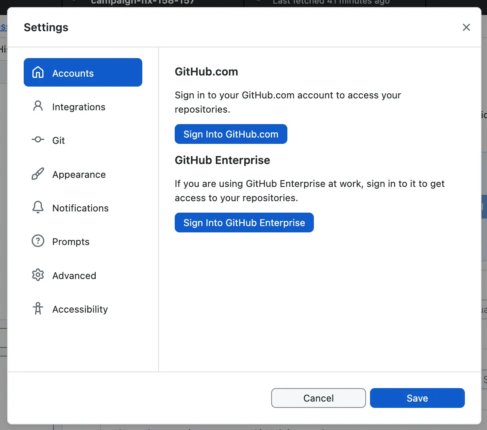
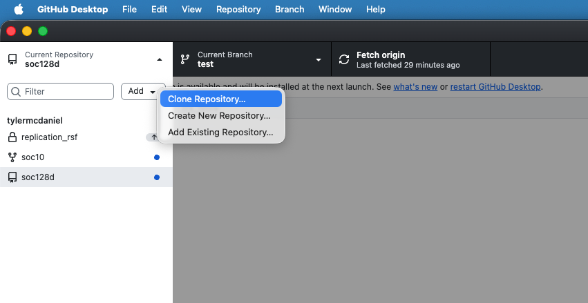

# Let's "Git" Going: Code, Collaboration, and Version Controls

This week, we'll jump into a workflow for computational social science. We will first begin to explore some computational methods for gathering data. Before we dive into analyses, we'll think about some good practices for doing research. While these might seem cumbersome or clunky initially, they will help us collaborate with others, fix our own mistakes, and save us time and energy down the road. 

__Monday Readings:__ 

* [Excuse me, do you have a moment to talk about version control?](https://peerj.com/preprints/3159v2/)

* [Bit By Bit: Social Research in the Digital Age. Observing Behavior.](https://www.bitbybitbook.com/en/1st-ed/observing-behavior/)

* _Optional_: [How Pew Research Center uses git and GitHub for version control](https://www.pewresearch.org/decoded/2022/08/01/how-pew-research-center-uses-git-and-github-for-version-control/)


__Wednesday Readings:__ 

* [Bit By Bit: Social Research in the Digital Age. Creating Mass Collaboration.](https://www.bitbybitbook.com/en/1st-ed/creating-mass-collaboration/)

* _Optional_: [Data Visualization: A Practical Introduction. Preface.](https://socviz.co/)

* _Optional:_ [Data Visualization: A Practical Introduction. 1: Look at Data.](https://socviz.co/01-look-at-data.html)

* _Optional:_ [Data Visualization: A Practical Introduction. 2: Get Started.](https://socviz.co/02-intro.html)

* _Optional_: [A layman’s introduction to Git](https://webtuu.com/blog/04/a-laymans-introduction-to-git)


## Collecting Social Science Data

Last week, we learned about _custom made_ and _ready made_ data. Recall the difference: custom-made data are when the researcher gathers data specifically for their research study. 

For __custom made__ data, we could think about the graphic below, where the writer or artist are producing their craft for a very specific goal.  

```{r custommdade, echo = FALSE, out.width="50%", fig.cap = "Source: Sketchplanations.com."}



```

Perhaps we could add a third line: "the researcher's in the research." What would this look like in the research setting? Can you think of cases where researchers design specially-crafted data, theories, and methods for their work?

```{r readymade, echo = FALSE, out.width="50%", fig.cap = "Source: Sketchplanations.com."}



```

__Readymade__ data, on the other hand, describe cases when the researcher uses existing data. Salganik gave the example of Duchamp using a urinal (above) as art. What examples can you think of when researchers have pulled data from other sources (designed for non-research purposes) and used them to study social issues in new ways?

This week, we'll try collecting data of both types. 


## Collaborative Social Science

Increasingly, social science, and data science more broadly, happens with _teams of researchers_. For example, [this paper](https://www.pnas.org/doi/full/10.1073/pnas.1915006117) has 112 authors! When working with a team of researchers, it becomes more important to organize the research process, such that each team member has the correct version of data, can share their updates efficiently, and can undo changes or access different versions of files when necessary.

As Salganik notes in chapter 6 of _Bit By Bit_, there are many ways in which computational tools open up possibilities for building collaborative datasets. Let's look at a few of these examples. 

1. __Human computation__ is useful when a task is large enough that it is untenable for a single researcher (or research group). It also helps if this task is not difficult, and maybe even fun:
An example of this is _Galaxy Zoo_. Researchers were interested in categorizing galaxy types, but lacked the time to do so on large scales. _However_, they were able to train members of the public to categorize the galaxies quickly. Ultimately, more than 100,000 volunteers coded more than 40,000,000 classifications. These classifications were useful for scientists in discovering new types of galaxies and in understanding the universe. This project worked because it was _hard for computers_, but _easy for humans_ to classify the galaxies. 

2. __Open Calls__ are cases where the solution to a problem is unknown (for researchers), but may be known by someone out there (or some combination of people). _The Netflix Call_ is an example of an open call. In 2006, Netflix wanted to improve their customer recommendation system, but lacked a clear vision of what might be important in recommending movies to people. What they had, however, was a vision for soliciting a recommendation system: they put out an open call for solutions that could beat their existing algorithm, evaluated using a large dataset of movie ratings with holdout data (i.e. some of the dataset was put aside in order to evaluate the proposals). The key to the success of the Netflix call was that _solutions were easier to check than to generate_. 

3. __Distributed data collection__ is a third type of collaboration. In distributed data collection, volunteer participants become data collectors, usually because the task is interesting or enjoyable beyond its research purpose. _E-bird_ is an example of distributed data collection. Here, birders volunteer information on birds that they see in the wild, and upload them to a database that helps ornithologists track migration patterns. Distributed data collection works well because data are extrely difficult for researchers to access (ornithologists can't be in all places at all times, and even video devices may have limitations), but simple and fun for volunteers to participate in.


What makes these types of collaboration work well? 


## Version Controls

We've all probably seen version controls or version history in our lives before. Tracked Changes in Microsoft Word or edits to Google Drive documents are examples. 


__Git__ is a version control system. 


__GitHub__ is a way to share your version history online with collaborators. 

A central feature to GitHub is it's features to _push_ and _pull_ changes. Users can modify code (or data) on their own devices and, when ready, push them to a central repository. Collaborators can then pull these changes and see the latest version of the repository as they work on other pieces. If you're thinking, "this sounds a lot like Google Docs," you're absolutely right! That is another type of version control. What sets Git and GitHub apart is their additional features. For example, with GitHub, one can set up multiple _branches_ of a document in order to test different approaches. They can then merge branches together in ways that do not overwrite changes. If you collaborate with others, you will learn the specifics of how these programs work. For now, _what's important is recognizing that version control systems attempt to solve problems related to sharing code and data "up" and "down" project levels between users_. 


```{r pushpull, echo = FALSE, fig.cap = "Source: Bryan, 2017"}



```

You might have seen this logo somewhere:

```{r logo1, echo = FALSE, out.width="50%"}


```

What is it? An octocat, or something between a cat and an octopus. Allegedly, it represents "octopus merges," or joins between three or more branches of a project. Anyway, we diverge ...

Stanford offers [Cardinal Cloud GitHub](https://uit.stanford.edu/service/github) as a way to (1) access premium features and (2) share work easily within Stanford research teams. A similar option is also available for [GitLab](https://uit.stanford.edu/developers#section_3855). For the purposes of our class, everything can be done using the public GitHub. However, if you are interested in collaborating with others using non-public data, you may want to use one of the aforementioned resources, or a GitHub private repository. If you'd like to use one of these options for the entire class, you are more than welcome to. 


## In Class Exercise

Consider the following situation: your team is using the _data_ we developed last week to investigate an _outcome of interest_. However, time is limited, and you want to maximize efficiency in this collaboration. 


Let's say you want to help a school make their attendance tracking more efficient. The following documents are some examples of attendance notes taken by teachers that are passed on to the principal. Once a month, the principal sends attendance information to the district. 

Teacher  | Student | Date | Attendance
:-----|:------- |:--------|:---------|
Mr. Joe | Tomas       | 3/4/2026 | Present | 
Mr. Joe | Malik     | 3/5/2026 | Present | 
Mr. Joe | Suzanna   | 3/4/2026 | Present  | 


Teacher  | Student | Date | Attendance
:-----|:------- |:--------|:---------|
Ms. Angie | Tomas       | 3/4/2026| Present | 
Ms. Angie | Tomas     | 3/6/2026 | Absent | 
Substitute | Tomas   | 3/6/2026 | ?  | 

Teacher  | Student | Date | Attendance
:-----|:------- |:--------|:---------|
Mr. Rich | Christina       | 3/5/2026 | Here | 
Mr. Rich | Malik     | 3/5/2026 | Not Here | 
Mr. Rich | Suzanna   | 3/5/2026 | Here  | 


Consider the following questions: 

1. What are some possible inefficiencies and/or problems with the current system?

2. How could existing problems be addressed?

3. Design a flowchart detailing a better attendance tracking system. 

4. What happens in the following scenarios?
- A teacher catches a mistake in an attendance sheet after the principal has already recorded it. 
- The principal needs to request an additional category, vaccination status, to all the teachers. 
- A teacher's assistant has been keeping two versions of attendance (one if the student was there for the entire class, another if the student was there for any of the class), because he isn't sure about the school's attendance policy. Now he wants to turn the data in to his teacher/supervisor. 
- A principal notices missing attendance days from one teacher, and wants them to add the information and check the prior two weeks. 


## Gitting Started

You can access GitHub [here](https://github.com/). I also recommend downloading GitHub Desktop [here](https://desktop.github.com/download/). Alternative options include [GitKraken](https://www.gitkraken.com/) - if you try this and like it, you are welcome to use it for the remainder of class!

Once you have opened GitHub, let's try a simple exercise. You can create your first repository by following the instructions [here](https://docs.github.com/en/repositories/creating-and-managing-repositories/creating-a-new-repository).

```{r newrepo, echo = FALSE, out.width="50%"}



```

Now, open GitHub Desktop! Some information on getting started with GitHub Desktop is [here](https://docs.github.com/en/desktop/overview/getting-started-with-github-desktop). 

```{r github_settings, echo = FALSE, out.width="50%"}



```


```{r github_signin, echo = FALSE, out.width="50%"}



```

Let's try to _clone_ the repository to your local machine. You can do this by following the instructions [here](https://docs.github.com/en/repositories/creating-and-managing-repositories/cloning-a-repository). 

```{r clonerepo, echo = FALSE, out.width="50%"}



```

You can then make changes! For instance, you may want to create a new __branch__ (Branch -> New Branch...) of the repository to test out new changes. You can save these changes by __committing__ them. If you want to suggest these changes to another user's repository, you can add a __pull request__ (Branch -> Create Pull Request).  

## Gathering Online Data

In last week's problem set, we experimented with building our own data (using the `data.frame()` function) and R's pre-packaged datasets (using the `data()` function). Now, we will learn how to gather data using a cannonical example of computational social science data: Google Trends. 

In _Bit By Bit_, Salganik notes ten characteristics of big data: 

1. Big
2. Always-on
3. Non-reactive
4. Incomplete
5. Inaccessible
6. Non-representative
7. Drifting
8. Algorithmically confounded
9. Dirty
10. Sensitive

As we begin our first foray into online data gathering, keep these characteristics in mind.  

Let's start with pulling data from the Google Trends API. You might have used the [Google Trends Interface](https://trends.google.com/trends?geo=US&hl=en-US) directly before. Lucky for us, there's an R package that can pull this information directly into our environment. 

```{r googletrends, warning = FALSE, message = FALSE}

library(gtrendsR)

```

Great, now let's look at a couple trends. We'll start with the frequency that people are searching for "data science" and "social science."

```{r googlehurricanewildfire, eval = FALSE}

data_social <- gtrends(c("data science", "social science"), 
                  geo = c("US"))

```

Notice that this returns a list of multiple dataframes and terms. We can explore these by typing `data_social$`. Also note the different parameters that we can set. When we specify `c()`, this is a simple way to define a one-dimensional vector of numerical or text entries. There are other options that we didn't specify here, which are evaluated at their default levels. For example, the default time period for these trends is "today+5-y", which means the last 5 years (you can see this by running `?gtrendsR`). 

The package comes with a built-in capability for plotting time trends. We can look at these trends with the following code:

```{r load gtrends env, echo = FALSE}
load("gtrends2.RData")
```

```{r googlehurricanewildfire2}

plot(data_social)

```


What do you notice about the popularity of these terms over time?


We might want to search over a longer time period. How would we do so? With any function, the `?` command is helpful for learning the settings that we can modify. When we run `?gtrends`, we see that there is a time setting. To change this, we could modify the code below to include `time = "all"`:


```{r googleclimatechange, eval = FALSE}


data_social_all <- gtrends(c("data science", "social science"), 
                  geo = c("US"), time = "all")

```

When we plot this, we see a vastly different picture: 


```{r googleclimatechange2, eval = TRUE}


plot(data_social_all)

```


Next, we might want to use Google Trends to evaluate searches for ideas across space For example, we can examine searches for "data science" in different states.


```{r googlespace, eval = FALSE}

data_geo <- gtrends(c("data science"), 
                  geo = c("US-CA", "US-NY", "US-FL"), time = "all")

```

Notice that we can specify states within the U.S. We can also specify Metropolitan Statistical Areas (MSAs) if we want to. When we plot these time trends, the different states appear in different colors. 


```{r googleclimatechange3, echo = FALSE}

plot(data_geo)

```

In all three states (California, Florida, and New York), searches for data science increase after 2015, but the rates differ substantially. We see that Florida searches for "data science" remain at a lower level than the other two states, and that around 2021-2022, "data science" searches from California dropped, before picking up again. Any ideas for why these differences exist? On your own, I encourage you to play around a bit more with the other parameters in the `gtrends()` function and see if you can find any interesting phenomena. 


__Note__: You may experience an error if you run to many queries (or search for too large of a dataset) using `googletrends` or other APIs. If this happens, you usually need to just wait a while (ranging from a minute to a day) and try again. 


__Additional note__: There are two ways to complete problem set 2: 

1. (Preferred) Install GitHub Desktop, and after you complete question 1, __clone__ your repo to a folder in your local machine (we will go over this in class). Then complete the problem set using your local R Markdown document (in the folder you created) with R Studio, and committing changes with GitHub Desktop. 

2. (If you encounter errors with GitHub Desktop, this method may be simpler) After you complete question 1, _download_ the file "Week2PSetTemplate.Rmd" from GitHub Online onto your local machine. Complete each question using RStudio. After each question, when you need to __commit__ the file, manually copy your changes to the .Rmd file and paste them to the same document on GitHub Online (we will also cover this in class).  


## Problem Set 2

Note: for Problem Set 2, you will turn in three items: your .Rmd file, your .pdf file, and a link to your github file. 

1. On GitHub, create a new __repository__ called "soc10problemsets" (or something similar). Then upload the "Week2PSetTemplate.Rmd" file (you can download it here [here](https://github.com/Soc10Spring2026/soc10problemsets_templates)). Make Tyler (`tylermcdaniel`) and Yao (`yao-mxu`) "collaborators" in this repository so we can see your work (Settings -> Collaborators -> Add People). Add your name and the date to the top of the file, save your changes, and __commit__ them. (note: You can do this online, but I recommend using GitHub Desktop!).

2. In the space below, try running the first code chunk, and fix the error. On your local file, __commit__ the file to your GitHub.  

3. Add your own data to a collaboration! In the markdown file, add to the small dataframe with some potential data sources for further social science research. Add one or more resources to this list. __Commit__ your changes. 

4. Using the `gtrendsR` R package, download data on a term of your choosing. Show a plot of the search term over time, and then plot it over different geographies. Discuss how each of Salganik's 10 characteristics of computational data apply (or don't apply). __Commit__ your changes. 

5. List the three types of collaboration that Salganik names. When can each work well, and what are potential downsides? List one new idea for a collaborative data project in each category. __Commit__ your changes. 


