# Data Visualization Techniques

Data visualization is an important, and sometimes overlooked, aspect of social science. This week, we go back to the visualization techniques of Du Bois, which remind us that data science long predates the current era of ``big data." 

__Monday Readings:__

* [Data Visualization: A Practical Introduction. 3: Make a Plot.](https://socviz.co/03-ggplot-basics.html)

* [Battle-Baptiste, Whitney; Rusert, Britt. 2018. Princeton Architectural Press. W. E. B. du Bois's Data Portraits : Visualizing Black America.](https://ebookcentral.proquest.com/lib/stanford-ebooks/detail.action?docID=5515147)

* _Optional:_ [Tackett, Maria; Çetinkaya-Rundel, Mine. 2023. Chance. Analyzing and Recreating Data Visualizations of W.E.B. Du Bois.](https://www-tandfonline-com.stanford.idm.oclc.org/doi/full/10.1080/09332480.2023.2179279#references-Section)

* _Optional:_ Try the [Education Opportunity Explorer](https://edopportunity.org/opportunity/explorer/)


__Wednesday Readings:__

* [Data Visualization: A Practical Introduction. 4: Show the Right Numbers.](https://socviz.co/04-group-facet-transform.html)

* [Data Visualization: A Practical Introduction. 5: Graph Tables, Add Labels, Make Notes.](https://socviz.co/05-more-on-geoms.html)


## Why Visualization?

We look at data for a reason. A well-designed visualization can make it easy to see important patterns and trends that might not pop out in tables. Visualization is also a good way to explore our data, or to look for potential issues or mistakes. 

W.E.B. Du Bois is credited with some of the most famous visualizations in the field of sociology. With researchers at Atlanta University, Du Bois communicated the state of Black Americans to the world at the 1900 Paris Exhibition through a series of graphs documenting racial the economic, social, and demographic conditions of Black citizens. The purpose behind these plots made them impactful. But the artistic elements make them unforgettable.   

## Data Science By Hand?

To be a computational social scientist, one must learn to _think_ like a data scientist and a social scientist. This means considering what your data represent, and what you want to communicate with these data. The data can be millions and millions of observations, or just a few. They might be digital traces, survey results, or hand-written notes. Our goal is simply to look for the truth in our data, and to communicate this as clearly as possible. 

We begin with a classic example from statistics and epidemiology. John Snow, a London doctor, investigated an outbreak of cholera in London's Soho district in 1854. By analyzing where deaths were occurring in relation to the town's water sources, he was able to pinpoint the source of epidemic, and help the city end it. Below is a map of the city's water sources at the time. A fuller map can be viewed [here](https://www.arcgis.com/apps/mapviewer/index.html?webmap=16a719ed81524ef2ad86b57f6918712f), and more information on the cholera outbreak can be found [here](https://www.ncbi.nlm.nih.gov/pmc/articles/PMC7150208/).

```{r cholera, echo=FALSE}

```


We next turn to another classic example of data visualization. The following graphic is a representation of Napoleon's "March on Moscow" from 1812-1813. It was created in 1869 by Charles Minard, and it is one of the most popular data visualizations out there, even being called "[the best graphic ever produced](https://www.datavis.ca/papers/jebs.pdf)" (you can decide whether you agree or not). [Tufte](https://www.edwardtufte.com/tufte/books_vdqi) interprets the chart as an anti-war message, as it clearly shows the massive loss of lives during this campaign.


```{r minard, echo = FALSE}
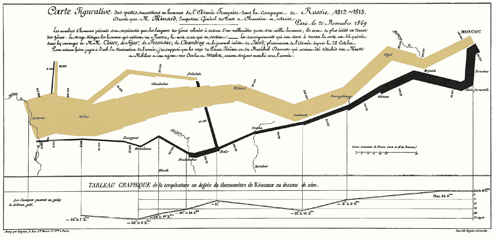

```


Next, we consider a couple examples the sociologist W.E.B. Du Bois. The 1900 Paris Exhibition was a world fair that showcased humanity's progress, challenges and possibilities at the turn of the millennium. A building was dedicated to issues of "social economy." Du Bois described his goal at this exhibition as follows: 

> "In this exhibit there are, of course, the usual paraphenalia for catching the eye — photographs, models, industrial work, and pictures. But it does not stop here; beneath all this is a carefully thought-out plan, according to which the exhibitors have tried to show: (a) The history of the American Negro. (b) His present condition. (c) His education. (d) His literature."

<font size = 2> -- The American Negro at Paris. American Monthly Review of Reviews 22:5 (November 1900): 576. </font>

In the first, the geography of residence by race and class is shown for a McIntosh County in Georgia. This highlights the social station of Black residents outside the town of Daren, as well as their proximity to White residents. We can compare this to [demographic dot maps](https://all-of-us.benschmidt.org/) from recent years. 

```{r photos, echo = FALSE}
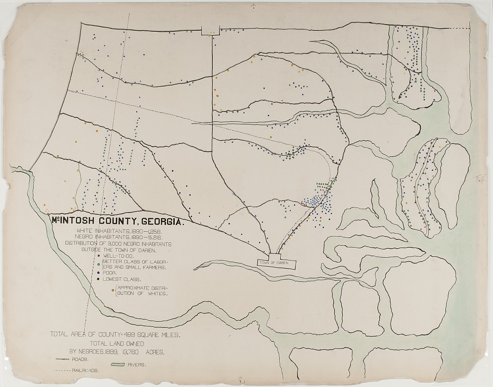

```

The second image shows taxable property for Black Americans in an exceptionally creative way. This shows growth in assets between 1875-1890, with little change afterward. 

``` {r photos2, echo = FALSE}

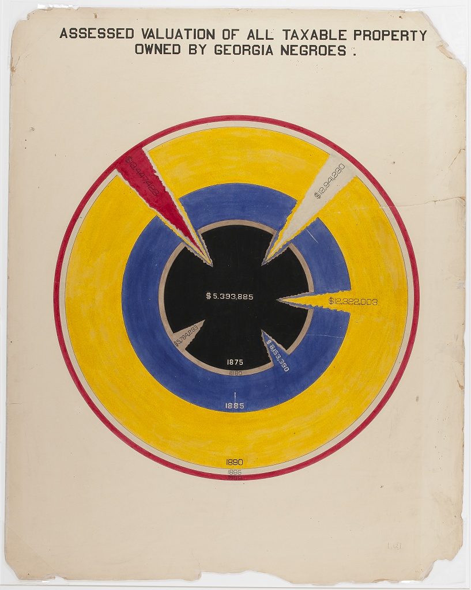


```


Considering all these examples together, we notice that each data scientist had a distinct **purpose**. Snow sought to convey the relationship between water service and cholera deaths. Minard showed the casualties of war. Du Bois illustrated the conditions of Black Americans in the U.S. to the rest of the world. It's useful to remember, no matter how complicated your data are, the best data scientists are often able to reduce this information to a simple message. 


## Elements of Visualization

As we can see from the preceding charts, data visualization is as much an art form as it is a science. In other words, _there is no single formula for a good graphic, but some are better than others_. So what exactly makes some stand out, while others fade away?

### Color

One element to consider is color. How is color used? Sometimes color alone can tell a story, as is the case in the following example of Air Quality data: 

```{r aqi, echo = FALSE, out.width="75%", fig.cap = "Source: EPA"}
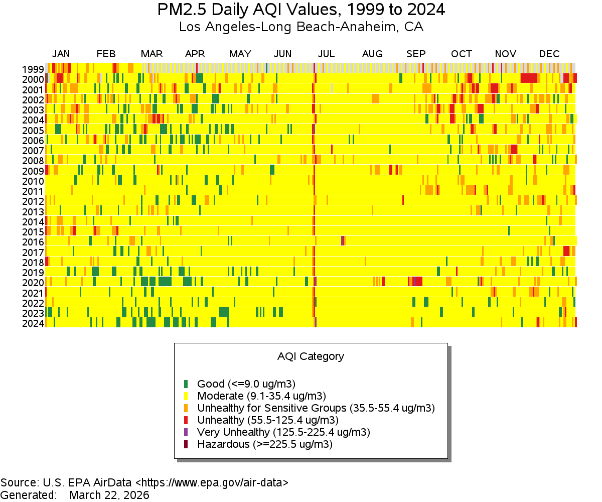
```

As a side note, what do you think is happening with the red line down the middle?

On the other hand, sometimes color scales are less clear. What do you think of the following example?

```{r costofliving, echo = FALSE, out.width="75%", fig.cap = "Source: The Economist"}

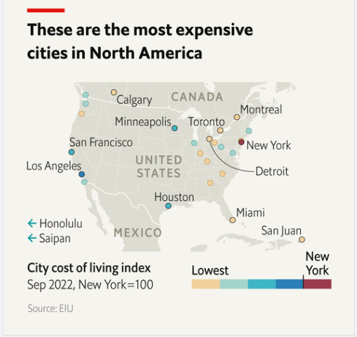

```

### Scale

Scale is going to matter a lot in your charts. Scale doesn't have to be _boring_: Think about Minard's example above, and how it demonstrates the size of Napoleon's army at different points in their campaign. Think of how DuBois' work also demonstrates scale. In the chart below, DuBois draws readers in using a spiral design. Rather than showing a simple bar chart, the work invites the reader to explore comparisons and come to their own conclusions. 

```{r dubois6, echo = FALSE, out.width="50%"}

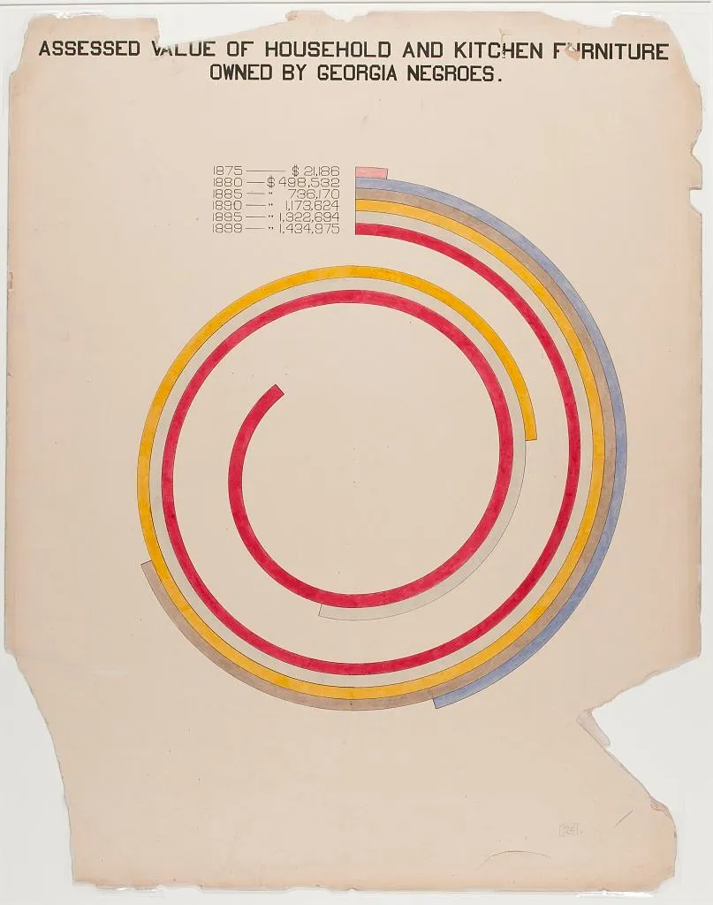

```

A more deceptive chart might try to _obscure_ differences in scale across units. What do you think about the axes on the chart below?

```{r axes, echo = FALSE, out.width= "75%", fig.cap = "Source: Federal Reserve Bank of St. Louis"}

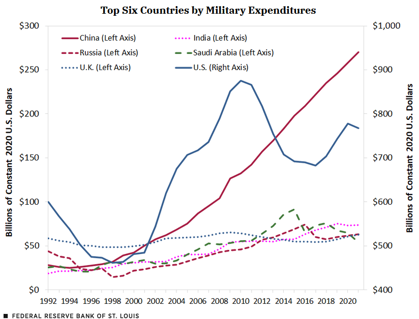

```

### Labels

Labeling can be overlooked, but having clear and efficient labels is a great way to capture readers' attention. Here, Brookings uses simple but effective labels to highlight differences in search interest across various AI coding agents: 


```{r brookings, echo = FALSE, out.width="75%", fig.cap = "Source: Brookings, 2026"}

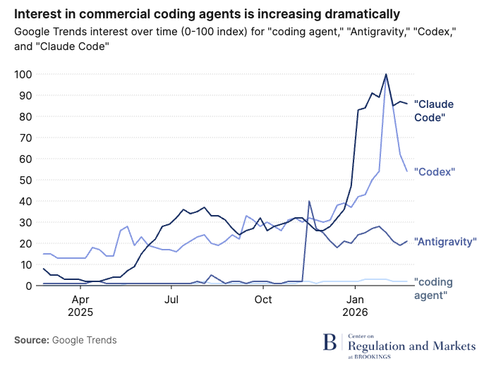

```

For a less-captivating example, see the following chart (used as an example in [Healy, 2017](https://socviz.co/01-look-at-data.html)).

```{r labelling, echo = FALSE, out.width="75%", fig.cap = "Source: Healy, 2017"}

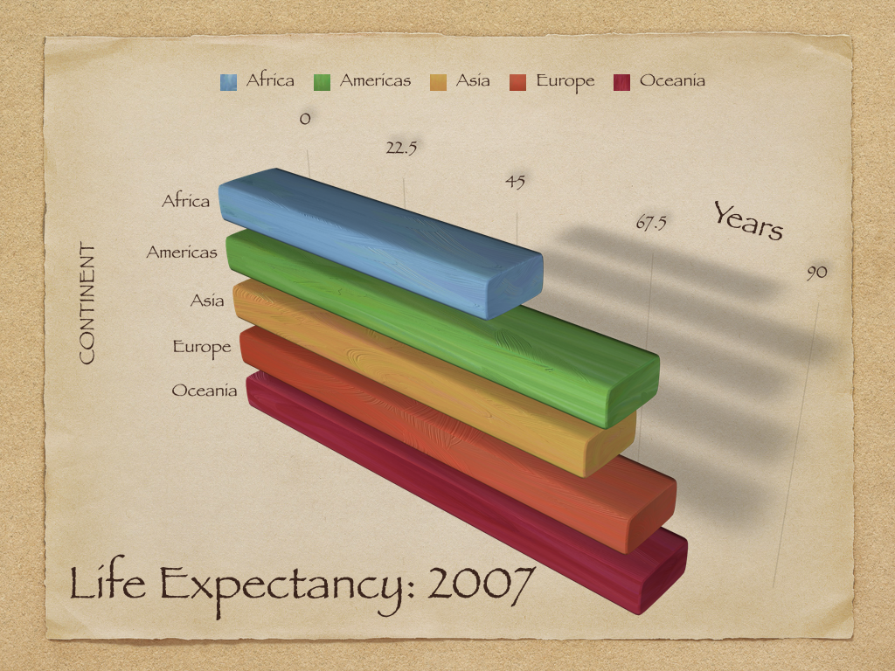
```


### Comparisons

At the end of the day, colors, scale, and labels are all tools to clue readers into making certain __comparisons__ in your data. In the above examples, these elements both _elucidated_ and _obscured_ key comparisons. Sometimes a combination of these elements makes comparisons especially easy or difficult. For example, the figure below shows centers the reader's attention on differences in vocabulary across language learner levels _and_ across native and non-native speakers. 


```{r comparisons0, echo = FALSE, out.width="75%", fig.cap = "Source: "}

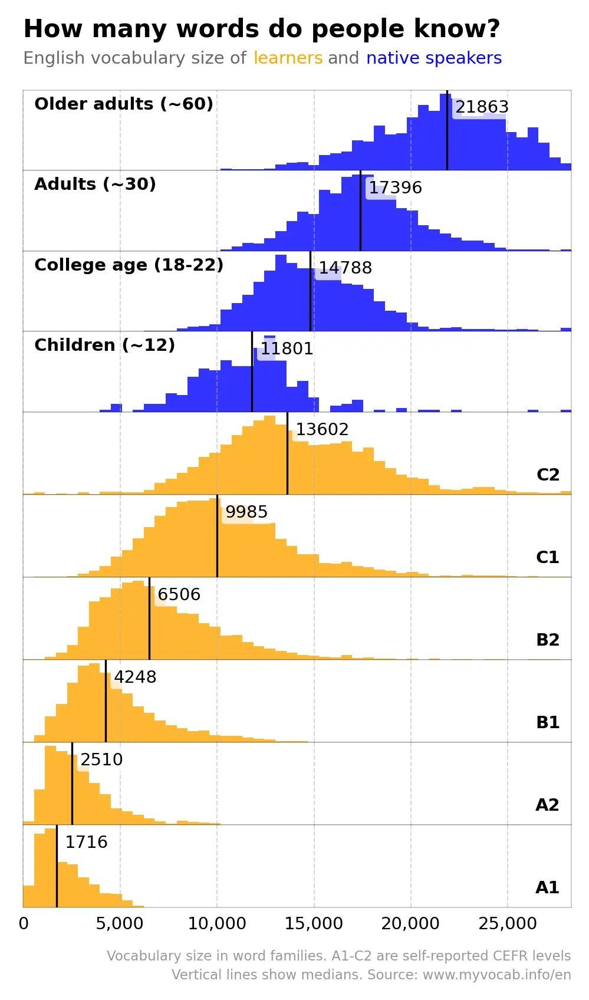
```

On the other hand, in the following chart, the combination of colors, size, and the way that they are stacked on top of each other make it very difficult to compare units. 


```{r comparisons, echo = FALSE, out.width="75%", fig.cap = "Source: Healy, 2017"}

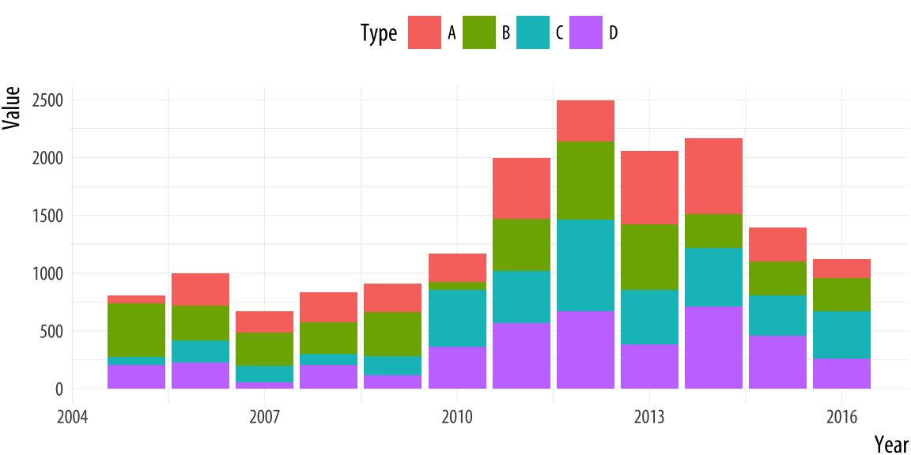
```


## The Grammar of Graphics

We have dipped our toes in some plotting techniques in `R` already (we used `plot()` and `ggplot()` in the first week, and last week we plotted `gtrends` data). But now we'll dive in headfirst. What are the different ways to plot in R, and how should we use them?

We'll begin with our most basic plotting function, `plot()`. The first week, we explored how we could plot something like two vectors. 

```{r plot, echo = TRUE}

# create points
x_points <- c(1,2,3)

y_points <- c(6, 5, 4)

# plot the x and y coordinates
plot(x_points, y_points)


```

There are many ways to make this chart look better. For instance, we can add colors, and change labels: 

```{r plot2, echo = TRUE}

# plot the x and y coordinates
plot(x_points, y_points, 
     col = c("red", "blue", "green"),
     xlab = "X", ylab = "Y")


```

There is much more we could do with the basic plot function, and I encourage you to explore these options if they interest you. However, most R users prefer a different method of plotting, using `ggplot2`. The "gg" in "ggplot2" or "ggplot" stands for _grammar of graphics_. [This book](https://link.springer.com/book/10.1007/0-387-28695-0) is useful if you want to learn more about the philosophy of the grammar of graphics. The authors note that graphics are more than charts, and that _object oriented design_, or a system of rules through which objects communicate with each other within a programming language (like R), is used to create beautiful graphics. Using `ggplot`, we can easily add and remove layers of information, to make sleek and scientific plots. We can start with a blank canvas by running `ggplot()`: 

```{r ggplot, echo = TRUE}

library(ggplot2)

ggplot()


```


Then, we can add the points above, and more features. `ggplot` expects data in a dataframe, so we first create a dataframe for our observations. We will also add a third variable, since in social science research we would often have multiple variables of interest. 

```{r ggplot2, echo = TRUE}

# create a dataframe for our points
df <-data.frame("x" = x_points,
                "y" = y_points, 
                "value" = c("first", "second", "third"))

```


```{r ggplot3}

# plot the data
ggplot(data = df, mapping = aes(x = x, y = y))+
  geom_point(aes(col = value))
  


```

Now that we've learned a little bit about ggplot2, let's try it with some real data. We can use the `gapminder` data by running the following commands (you may also need to install the `gapminder` package):

```{r gapminder}

library(gapminder)
gapminder

```

Then, let's plot it with `ggplot`! 

```{r gapminder2}

# create the plot
ggplot(data = gapminder,
            mapping = aes(x = gdpPercap, y = lifeExp))+
  geom_point()

```

We could make the same plot slightly differently (as explained in [Healy, 2017](https://socviz.co/02-intro.html)): we could _assign_ our `ggplot` object to `p` (or any label), and then add layers (or information about the aesthetics). Often in R, there are multiple ways to get to the same result. In different circumstances, some could make more sense than others. For example, if we wanted to reuse `p` below, in a lot of different plots, then we wouldn't have to type it out each time.

```{r gapminder3, eval = FALSE}

# create the plot
p <- ggplot(data = gapminder,
            mapping = aes(x = gdpPercap, y = lifeExp))

# plot it
p + geom_point()

```

In `ggplot`, the name for features like colors, x and y coordinates, sizes, and more is _aesthetic mappings, or aesthetics_. Let's explore these. First, we can manually specify these features within each layer, as we do in `geom_point` below:

```{r gapminder4, eval = TRUE}

# create the plot
ggplot()+
  geom_point(data = gapminder,
        mapping = aes(x = gdpPercap, y = lifeExp),
        col = "purple", size = 3, alpha = 0.5)


```

Alternatively, we could specify our aesthetics in the `ggplot()` (base) layer, and have the other layers pull from these data. Try running the code below. What happens? 


```{r gapminder5, eval = FALSE}

# create the plot
ggplot(data = gapminder,
        mapping = aes(x = gdpPercap, y = lifeExp,
        col = "purple", size = 3, alpha = 0.5))+
  geom_point()


```

When we specify settings within the `aes` command, these need to correspond to variables. We can try this again, with color varying across continents and size varying across populations. 


```{r gapminder6, eval = TRUE}

# create the plot
ggplot(data = gapminder,
        mapping = aes(x = gdpPercap, y = lifeExp,
        col = continent, size = pop))+
  geom_point()


```

Try experimenting with these settings on your own. Which are better to add within `aes`, and which are better to set within `geom_point`?


We can set color scales using arguments that begin with `scale_color_ ...` (and similar arguments for other aesthetics like `fill`, `alpha`, or `size`). Let's try scaling some of these on our own:


```{r gapminder7, eval = TRUE}

# create the plot
ggplot(data = gapminder,
        mapping = aes(x = gdpPercap, y = lifeExp,
        col = continent, size = pop))+
  geom_point()+
  scale_color_manual(values = c("red2", "orange", "green4", "turquoise3", 
                                "beige", "lavender", "purple4"))+
  scale_size_continuous(range = c(0.5, 6))


```

We can set options like `theme_minimal()`, or `theme()` (with specifications inside) to further modify the plot. Try some of these on your own! And `facet` options allow us to specify multiple plots, for example, one per each year: 

```{r gapminder8, eval = TRUE}

# create the plot
ggplot(data = gapminder,
        mapping = aes(x = gdpPercap, y = lifeExp,
        col = continent, size = pop))+
  geom_point()+
  scale_color_manual(values = c("red2", "orange", "green4", "turquoise3", 
                                "beige", "lavender", "purple4"))+
  scale_size_continuous(range = c(0.5, 6))+
  theme_minimal()+
  facet_wrap(~year)


```

Resources like [this cheat sheet](https://rstudio.github.io/cheatsheets/data-visualization.pdf) and other [ggplot2 docs](https://ggplot2.tidyverse.org/index.html) have lots of information on all the settings you can customize. Returning to some of the "by hand" data visualizations, there is often a way to create anything you want using ggplot! Don't use standard settings just because they are pre-loaded. With these docs, we can clean up our visualization a bit more: 


```{r gapminder9, eval = TRUE}

# create the plot
ggplot(data = gapminder,
        mapping = aes(x = gdpPercap, y = lifeExp,
        col = continent, size = pop))+
  geom_point()+
  scale_color_manual(values = c("red2", "orange", "green4", "turquoise3", 
                                "beige", "lavender", "purple4"))+
  scale_size_continuous(range = c(0.5, 6))+
  theme_minimal()+
  labs(size = "Population", col = "Continent", x = "GDP Per Capita", y = "Life Expectancy (Years)")+
  scale_x_continuous(breaks = c(30000, 90000))+
  facet_wrap(~year)


```

## Preparing Data for Visualization

While some data, like `gapminder` may come in forms that we can easily analyze, most of the data that we work with will need to be cleaned. To do so, it is necessary that we understand a bit more about how to work with data in R. Most of the time, we'll be working with *dataframes*, which are $m \cdot n$ objects with $m$ rows (typically observations) and $n$ columns (typically variables). We'll start by creating a simple dataframe. We'll call our variables "year" and "pop," although of course these are just fake population numbers.

```{r df}
# create a dataframe (note that : returns a sequence between the numbers, by 1)
df <- data.frame(year = 2000:2020, pop = 40:60)

# look at the first 6 rows
head(df)

```

Great! Let's say, however, that our populations are in millions, and we want them in numbers of people. We can write a function to do this, and implement it in our dataframe.


```{r fixtemps, warning = FALSE, message = FALSE}
library(dplyr)

# function to get from millions to people
millions_to_people <- function(m){
  p <- m/1000000
  return(p)
}

# run function to create new variable
df %>%
  mutate(pop_p = millions_to_people(pop)) %>%
  head() 

```

There's a lot going in there. First, `mutate()` is how one would normally create or modify variables within the `dplyr` framework in R. This is generally what we will use to do so. 

Second, **what was going on with the %>%?** The code that we just ran is equivalent to `head(mutate(pop_p = millions_to_people(pop)))`. You can try running them both yourself. So why make it more complicated? For this small example, it doesn't really matter. But, as we run more and more complicated code, we will probably want to run multiple functions on a dataframe (or vector, or something else) at once. It can get confusing to nest these within the function commands. For example:

```{r nest, eval = FALSE}
fourth_function(third_function(second_function(first_function(x))))
```

So instead, we opt for the `dplyr` method, which is written as follows:
```{r dplyrnest, eval = FALSE}

x %>%
  first_function() %>% 
  second_function() %>% 
  third_function() %>%
  fourth_function()

```

This approach is usually a bit easier for the reader to understand. That being said, dplyr is specific to R, so if you use other languages it may be important to learn other standards of communicating code. As always, remember that our code is language, and that there are multiple ways to communicate most statements, but that we want to make our code as easily interpretable as possible.

Why `%>%`? This is what is called a **pipe**. It pipes whatever is before the `%>%` into the function that follows `%>%`. This concept is vital to our coding, so let's make sure that we understand how this is working.

```{r pipes}
# first, let's write a simple function
add_2 <- function(x){
  return(x+2)
}

# check that it is working
add_2(5)

# now try the pipe method
5 %>% add_2()

# try adding 2, twice
5 %>%
  add_2() %>%
  add_2()

```

Most of the time, we will be applying functions to vectors and dataframes, rather than individual numbers, as we did in the first example. So let's go take another look at our dataframe. 

```{r df2, warning = FALSE, message = FALSE}

# take a look at the first 6 rows, again
head(df)

```

Oh no! The column we created, temp_f, has disappeared ... what happened? When we ran the earlier function, we _temporarily_ created a new variable within df, but we did not permanently change df. So how would we permanently change df? There are a couple ways.

```{r magrittr, message = FALSE}
library(magrittr)

# first, we can assign the mutated dataframe to itself
df <- df %>%
  mutate(pop_p = millions_to_people(pop))

# second, we can use the magrittr pipe to do it all at once
df %<>%
  mutate(pop_p = millions_to_people(pop))

# check that either of these methods worked (we didn't really need to run them both)
head(df)

```

Notice the **magrittr pipe**, `%<>%`. This is generally what I will use when performing operations on a dataframe, and I recommend that you do so as well! As a side note, there is another pipe, `|>`, which is another version of `%>%`, and is mostly functionally equivalent. However, sometimes the magrittr pipe only works with `%>%`! For this reason, we will mostly use `%>%` and `%<>%` in this class, but you are free to try other things in your code. New versions of these operations are common, so there may be other ways to do this that I am unaware of! The goal is to stay flexible and understand the rationale behind these commands. I recommend trying all these out now to make sure you are comfortable with them. 

## Plotting Exercise

Recall our discussions on collaborative data last week. One example of crow-sourced data (distributed data collection) is Wikipedia. Let's say we wanted to gather some information from Wikipedia. Next week, we will gather these data with _web scraping_. For now, we can download the data using the following code: 

```{r downloadwikipedia, message = FALSE}

library(readr)
library(RCurl)

# input url from github
url <- getURL("https://raw.githubusercontent.com/tylermcdaniel/css/main/Data/ca_dem_table.csv")

# download wikipedia data (from github)
ca_dem_table <- read_csv(url)


```

Let's plot our data!

```{r yearcounts, warning = FALSE, message = FALSE}

# first, we can plot a histogram of disaster years
ggplot(ca_dem_table, aes(x = Race, y = `2000_num`))+
  geom_bar(position = "dodge", stat = "identity",
           aes(fill = Race))+
  labs(x = "2020_num")

```


We notice that the labels are a bit messy. We could turn these off using `axis.ticks.x = element_blank()`. 

```{r yearcounts2, warning = FALSE, message = FALSE}

# first, we can plot a histogram of disaster years
ggplot(ca_dem_table, aes(x = Race, y =  `2000_num`))+
  geom_bar(position = "dodge", stat = "identity",
           aes(fill = Race))+
  labs(x = "", y = "Population")+
  theme_linedraw()+
  theme(axis.text.x = element_blank(),
        axis.ticks.x = element_blank())

```


Our data are currently in __wide__ format, meaning _our units of analysis (races/ethnicities) have just one observation each_. All of our variables are columns. 

For plotting with `ggplot2`, it is often useful if our data are in __long__ format, meaning we want _just one column (variable) for each of our dimensions of variation (such as year, number/percent)_.  

Let's try to make our data long format. We can use the `magrittr` pipe, `%<>%`, to permanently modify our data. For instance, we can use the `magrittr` pipe and `pivot_longer` as follows:


```{r pivotlonger, warning=FALSE, message = FALSE}
library(tidyr)

# pivot longer
ca_dem_table %<>%
  pivot_longer(cols = -c(Race),
               names_to = "Name",
               values_to = "Value")

```


Now we can make a plot like the following. Do you notice any redundancies?


```{r longplot}

# now try with long data
ggplot(ca_dem_table, aes(x = Race, y =  Value))+
  geom_bar(position = "dodge", stat = "identity",
           aes(fill = Race))+
  labs(x = "", y = "Population")+
  theme_linedraw()+
  theme(axis.text.x = element_blank(),
        axis.ticks.x = element_blank())+
  facet_wrap(~Name, scales = "free")

```

We could use the `filter` function to reduce our dataset to specific variables of interest. For example, maybe we just want to look at Native American/Alasakan Native and Native Hawaiian/Pacific Islander populations over time. 


```{r longplot2}

# reduce our data to only population estimates (not percentages)
ca_dem_table %<>%
  filter(Name == "2000_num" | Name == "2010_num" | Name == "2020_num")

# now let's reduce to Native American / Hawaiian/PI groups
ca_dem_table %<>%
  filter(Race == "Native American or Alaska Native alone (NH)" | 
           Race == "Native Hawaiian or Pacific Islander alone (NH)")


# now try with long data
ggplot(ca_dem_table, aes(x = Race, y =  Value))+
  geom_bar(position = "dodge", stat = "identity",
           aes(fill = Race))+
  labs(x = "", y = "Population")+
  theme_linedraw()+
  theme(axis.text.x = element_blank(),
        axis.ticks.x = element_blank(),
        legend.position = "bottom")+
  scale_fill_manual(values = c("lightblue", "darkgreen"))+
  facet_wrap(~Name)

```

Notice certain changes, like moving the legend to the bottom and keeping the y axis constant across all three frames. How did these happen? From this chart, we learn from this plot that one of these groups (Native American/Alaskan Native) is experiencing a declining population in California, whereas the other (Native Hawaiian/Pacific Islander) is growing. We might consider how the social and economic conditions in California facilitate in- or out-migration for different groups. These trends have implications for racial/ethnic justice efforts in California and more broadly. Could we produce DuBois-style visualizations of the state of California for various ethnic/racial groups? In the problem set, we will explore questions like this. 

## Problem Set 3

Recommended Resources: [The ggplot2 graph gallery](https://r-graph-gallery.com/).

1. Start a new document, problemset3.Rmd, in your soc10problemsets repository. (You can download a template [here](https://github.com/Soc10Spring2026/soc10problemsets_templates), but be sure to save it in your own soc10problemsets repo). Change your name in the header. Load the `gapminder` data using `library(gapminder)`. Create a simple plot with two of the variables. __Commit__ your changes. 

2. Now, modify your plot! For each change that you make, explain your decision, in terms of the visual elements. __Commit__ your changes. 

3. Use the code provided to load data on racial compositions in California. Then create your own visualization! Try to make it different than what is done above. Is there anything that you want to change, but are unable to? Describe what you want to communicate with these data. __Commit__ your changes. 

4. Return to a dataset you have worked with in this class already (for example, hand-collected data, data using the `data()` function. The `gtrendsR` data could also work but may need some cleaning/manipulation). Use `ggplot()` to plot this data in a new way. Describe whether the viewer learns anything new from seeing the data in this way. __Commit__ your changes.  

5. Find a data visualization in the wild! It could be in the news, from an academic article, or somewhere else. Include an image of it using the `knitr::include_graphics("")` function. Describe its positive and negative aspects. __Commit__ your changes. 


