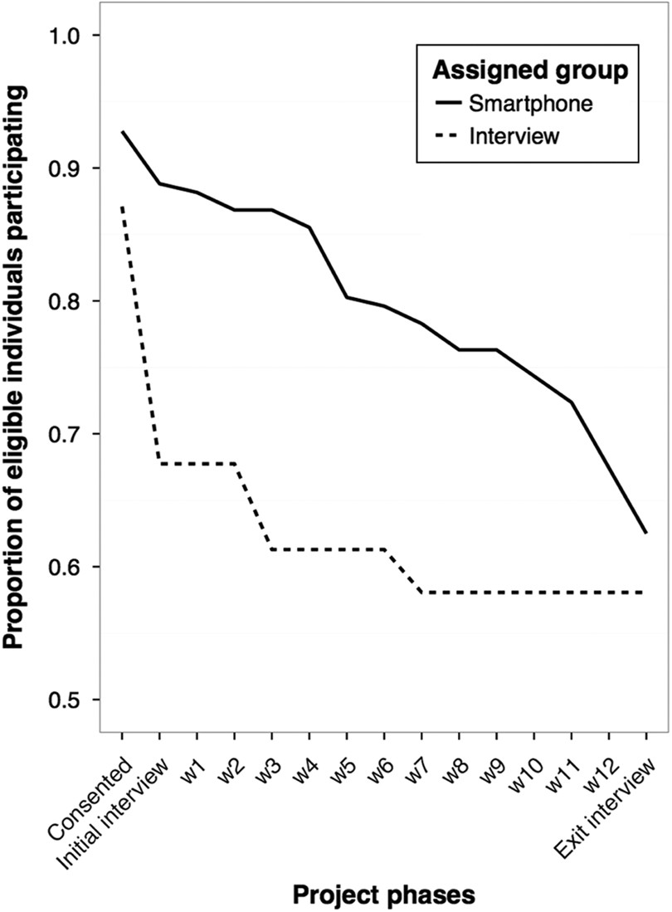
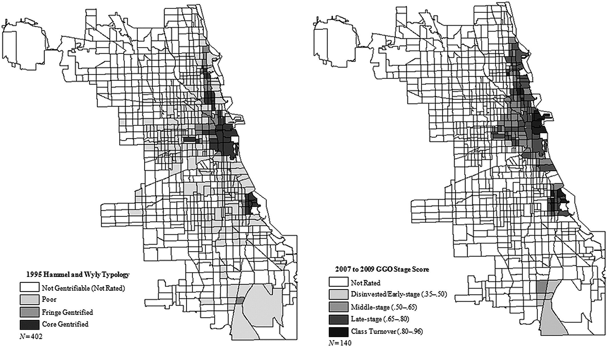
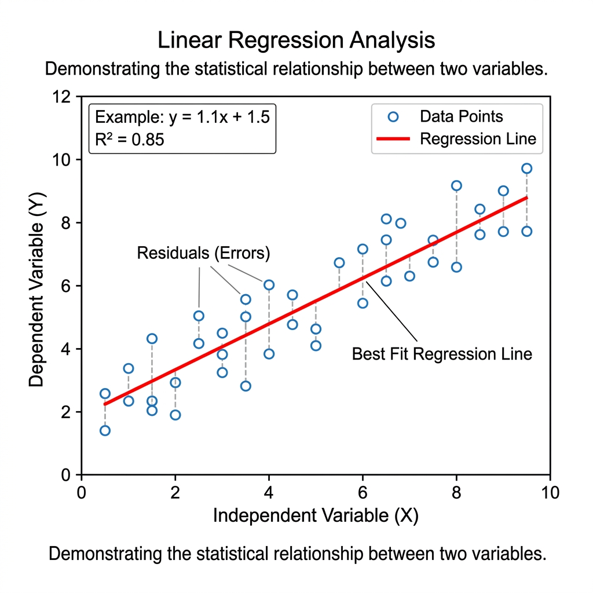

# Gathering and Modeling Data

Up to this point, we have mostly focused on _describing_ our data. What if we want to say more about the _processes_ unfolding? In this week, we look at data gathering and modelling. We will first examine some data collection methods such as web scraping and APIs. We will then examine linear and non-linear models, their benefits, and some potential drawbacks. 

__Monday Readings:__

* [Bit by Bit: Social Research in the Digital Age. Asking Questions](https://www.bitbybitbook.com/en/1st-ed/asking-questions/)

* _Optional:_ [Hwang, Jackelyn; Sampson, Robert. 2014. American Sociological Review. Divergent Pathways of Gentrification: Racial Inequality and the Social Order of Renewal in Chicago Neighborhoods.](https://journals.sagepub.com/doi/abs/10.1177/0003122414535774)

* _Optional:_ [Sugie, Naomie. 2016. Sociological Research & Methods. Utilizing Smartphones to Study Disadvantaged and Hard-to-Reach Groups.](https://journals.sagepub.com/doi/full/10.1177/0049124115626176)

__Wednesday Readings:__

* [Data Visualization: A Practical Introduction. 6: Work With Models.](https://socviz.co/06-modeling.html)

* _Optional:_ [Gelman, Andrew; Hill, Jennifer; Vehtari, Aki. 2020. Regression and Other Stories.](https://users.aalto.fi/~ave/ROS.pdf)

* _Optional:_ [Gelman, Andrew. 2011. American Journal of Sociology. Causality and Statistical Learning.](https://sites.stat.columbia.edu/gelman/research/published/causalreview4.pdf)


## New Ways of Gathering Data 

Gathering data will always be important, but the tools that we use to gather data change. Here, we will look at some new ways of gathering data. We will look at new ways of __surveying people__ and new __types of data__. 


First, smartphones and digital surveys offer new possibilities for asking people questions. For example, [Sugie](https://journals.sagepub.com/doi/full/10.1177/0049124115626176) used a probability sample to provide 133 incarcerated men cell phones upon release from prison. She was then able to administer daily surveys to these men and ask real-time questions about well-being and employment searches. From these data, she was able to describe _how_ formerly incarcerated people look for work at a scale and in details that had not been possible before. These descriptions then could inform questions and policies around post-prison transitions in our society.   


```{r sugie, echo = FALSE, fig.cap = "Source: Sugie, 2016."}



```

In the plot above (from Sugie, 2016), we observe response rates for traditional interviews and cell phone interviews over a 12 week period. Notice the decline in responses for each, but how cell phone interviews elicit higher responses throughout the study period than traditional methods. 


New tools also offer new types of data to gather. Researchers have long studied gentrification, and debated the extent to which it occurs, who it displaces, and so on. However, they have lacked empirical tools for _measuring_ the processes that we typically associate with gentrification, like changes in urban built environments. To address this, [Hwang](https://journals.sagepub.com/doi/10.1177/0003122414535774) measured neighborhood changes using Google Street View (GSV). By looking at GSV images over different time points, she was able to directly measure gentrification over time. The study yields insights on how and where gentrification unfolds: she finds that Black and Hispanic populations make gentrification less likely, a relationship that levels off when neighborhood Black proportions reach 40% or higher. 


```{r hwang, echo = FALSE, fig.cap="Source: Hwang, 2014"}



```

In the above plot (from Hwang, 2014), estimated gentrification levels in Chicago are plotted from an older study (Hammel and Wyly, 1996, who used field surveys and census data) and for 2007-09 using the GSV data. Notice the similarities and differences. What types of changes do you think the GSV data would pick up on (or omit)?


## Application Programming Interfaces (APIs)

Application Programming Interfaces, or APIs, are a novel and common way to gather data in the age of big data. We've actually already used an API in this class: `gtrends`!

Some APIs allow us to gather data that has already been collected via traditional survey or census methods. For instance, the __tidycensus__ API allows us to easily pull data from the Decennial Census, American Community Survey, and more into R for analysis. This is not a new source of data - researchers have long studied the census to understand social issues. However, the API allows us to streamline data gathering, analysis, and even writing our manuscript (if we use markdown). 

One critical first step in working with `tidycensus` is __obtaining a Census Data API Key__. [You can get one here](https://api.census.gov/data/key_signup.html). Once you have a key, you can library `tidycensus` and `tidyverse` (this is just a collection of `tidy` packages, some of which we've worked with already like `tidyr` and `dplyr`).

```{r apis, echo = TRUE, eval = FALSE}

library(tidycensus)
library(tidyverse)

census_api_key("YOUR API KEY GOES HERE")

```

```{r apis2, echo = FALSE, message = FALSE}

library(tidycensus)
library(tidyverse)

key = "2075581078cab2d3d6165384058fe2fe0dfcf559"

census_api_key(key)

```

Now we can gather data! For example, we could use the decennial census (every 10 years) to get information on median age by state:

```{r decennial, echo = TRUE, message = FALSE}

# gather age data
age20 <- get_decennial(geography = "state", 
                       variables = "P13_001N", 
                       year = 2020,
                       sumfile = "dhc")

head(age20)

```

To see what other variables exist in the `get_decennial` or `get_acs` functions, you can download the codebook for the 2020 demographic and housing characteristic file with the following code: 

```{r codebooks, echo = TRUE, eval = FALSE}

# 2020 dhc codebook
v20 <- load_variables(2020, "dhc")


```

To see what other codebooks are available, try `?load_variables`!

We can now explore the housing data that we downloaded. For instance, we could use `ggplot()` to show the following:

```{r decennialplot, echo = TRUE, message = FALSE}

age20 %>%
  ggplot(aes(x = value, y = reorder(NAME, value))) + 
  geom_point()

```

Notice how `NAME` was reordered according to its value within the `aes()`. We can first use the following code to examine 5-year ACS variables (i.e. things that are sampled within a 5 year window for ACS). 

```{r codebooks2, echo = TRUE, eval = FALSE}

# 2020 dhc codebook
v23acs <- load_variables(2023, "acs5")


```


There are a lot of variables to sort through! If we wanted to gather "Median Household Income in the Past 12 Months (in 2023 Inflation-Adjusted Dollars)" we could use "B19013_001." Below, this is done for the state of Vermont: 


```{r acs, echo = TRUE, message = FALSE}

vt <- get_acs(geography = "county", 
              variables = c(medincome = "B19013_001"), 
              state = "VT", 
              year = 2023)

vt


```


And of course, we can plot this! 

```{r acsplot, echo = TRUE, message = FALSE}

vt %>%
  mutate(NAME = gsub(" County, Vermont", "", NAME)) %>%
  ggplot(aes(x = estimate, y = reorder(NAME, estimate))) +
  geom_errorbarh(aes(xmin = estimate - moe, xmax = estimate + moe)) +
  geom_point(color = "red", size = 3) +
  labs(title = "Household income by county in Vermont",
       subtitle = "2017-2021 American Community Survey",
       y = "",
       x = "ACS estimate (bars represent margin of error)")

```


## Web Scraping

Last class, we looked at demographic data on California's ethnic/racial compositions from [Wikipedia](https://en.wikipedia.org/wiki/Demographics_of_California). However, we didn't discuss how this data was actually gathered.

One method for gathering such data is web scraping. In the "wild west" days of the internet, sites were fairly disconnected and scraping was an acceptable way to gather information from sites. In the modern day, many sites disallow web scraping, and offer APIs as alternatives. Therefore, it is important to check that you are not violating terms of agreement in scraping websites. You can check a site's regulations by typing the website and adding "robots.txt" to the end of the url. For example, if we go to https://en.wikipedia.org/robots.txt we see that some crawlers and bots have been banned for going to fast or for other actions, but they do not list any total restrictions on scraping. 

To try scraping a Wikipedia page, we will first download and library the `rvest` package. 


```{r rvest, message = FALSE, warning = FALSE}

library(rvest)

```

Great! Now we can try reading an HTML file (the language behind a website, which tells your browser the meaning and structure of the site) into R. It will work best for us to read in a Wikipedia page with a table. Let's try a different Wikipedia page, this time on US incarceration over time. 


```{r html}

# read in html
us_inc <- read_html("https://en.wikipedia.org/wiki/Incarceration_in_the_United_States")

# take a look
us_inc

```

Hmmmm, it's not really in a readable format. But that's ok! In order to extract our table of interest, we just need to gather a little more information:

1. Go to the [page of interest](https://en.wikipedia.org/wiki/Incarceration_in_the_United_States) and find the table that we want to extract 
2. Right click the table and click inspect
3. Find the <table... element of interest in the Element pane on the right-hand side. When you hold your mouse over this text, it should highlight the entire table on the left-hand side
4. Right-click the table element, Copy -> Copy Xpath

Great, now that we have the Xpath copied we can use `rvest`'s `html_nodes()` function to extract just the html of interest. 

```{r html2}

# extract nodes of interest
us_inc_table <- html_nodes(us_inc,
                            xpath = '//*[@id="mw-content-text"]/div[2]/div[5]/table')

```

It is still in html format, but there is another function, `html_table()`, which will convert this to a dataframe. Let's try it!

```{r html3, warning = FALSE, message = FALSE}

library(dplyr)
library(magrittr)

# convert object to table
us_inc_table %<>%
  html_table()

#take another look
us_inc_table %>%
  head()

```

This looks better. But notice the `[[1]]`? This means that our table is still technically in list format, and that this is the first element of a list. We will change that below with the `as.data.frame()` function.

Also, you might be wondering, what is a tibble? According to [CRAN](https://cran.r-project.org/web/packages/tibble/vignettes/tibble.html#:~:text=There%20are%20three%20key%20differences,%2C%20subsetting%2C%20and%20recycling%20rules.), "Tibbles are a modern take on data frames. They keep the features that have stood the test of time, and drop the features that used to be convenient but are now frustrating." For our purposes, we can treat them just like dataframes. 

```{r todataframe}

# convert list to dataframe
us_inc_table %<>%
  as.data.frame()

# take another look
us_inc_table %>% 
  head()
```

Ok perfect, now we have a true dataframe. In order to look at our data, we might want to clean it up using functions like `filter()` or `slice()`. If we had additional data, we could add these with `bind_rows()`!

The first thing we want to do when we gather new data is _look at it_. We can do this either by visually inspecting the data (using the `View()` function) or by plotting it (using some of the methods from section 3). We can start by plotting the data with `ggplot()` and `geom_point()`. 

```{r incarcerationplot0, echo = TRUE}
library(ggplot2)

# plot incarceration data
ggplot(us_inc_table, aes(x = Year, y = Count))+
  geom_point()

```

Hmmm, something doesn't seem quite right ... Any guesses? If we inspect our data further, we notice that each variable has a different `class()`. 

```{r class, echo = TRUE, message = FALSE}

# examine class of variables
class(us_inc_table$Year)

class(us_inc_table$Count)

class(us_inc_table$Rate)

```

In the problem set, you will use `mutate()` and `parse_number()` to solve this problem! For now, let's look at a different variable: `Rate`. We can look at the relationship between year and incarceration rate. 

```{r incarcerationplot, echo = TRUE, message = FALSE}
library(ggplot2)

# plot incarceration data
ggplot(us_inc_table, aes(x = Year, y = Rate))+
  geom_point()

```

This looks a bit better (at least, in the data sense). Now that we have a plot, what can we say about it?


## Models

From what we have seen so far, we can answer __descriptive__ questions about mass incarceration. But we may also want to __explain__ or __predict__ changes. In other words, an initial question as we look at our data might be "what direction is the trend?" Are incarceration rates going up, down, or remaining stable? We don't need to do much analysis here to see that the trend is positive (i.e. rates are going up over time). But if we quantify this, we can answer questions like "if the trend keeps going at this rate, where will we be in 10 years?"

As social scientists, we tend to make three types of claims about our data. Here are examples of each: 

1. __Describe__: In the U.S., between 1970 and 2010, the incarceration rate increased from 161 to 731. 
2. __Explain__: As time passes, modern societies become increasingly rely on carceral solutions to social problems, and incarceration rates increase. 
3. __Predict__: In 2030, the U.S. incarceration rate will reach 1,000 (persons per 100,000). 

For the latter two items, we are going to need a _model_ of how our data works. Let's start with a simple example: in our incarceration data, we have just one data point per year. We can start by just running a line through our points. We can do so with `geom_line()`:

```{r incarcerationplot4, echo = TRUE, message = FALSE}
library(ggplot2)

ggplot(us_inc_table, aes(x = Year, y = Rate))+
  geom_point()+
  geom_line()

```

But is this useful? Well, _yes and no_. It is useful in describing the data. But it doesn't really simplify what is going on in any way. We might want a model that gives a single value for the slope (i.e. the amount that our points are increasing or decreasing over time).

We can quantify the trend using __linear regression__. If we just had two data points, we would run a line through them. However, we have a lot more than two data points. So what do we do?

If you recall from prior math classes, we can express lines with a formula like `y = mx + b`. `m` is the _slope_ and `b` is the _intercept_. In the below example, you'll see an example of this. We can formulate a line that runs through our data:

```{r linearregression, echo = FALSE, out.width="75%"}



```

Most data points will not fall directly on this line. __The distance between each data point and the line is called its residual. When choosing values for `m` and `b`, we choose values that minimize the sum of the squared residuals.__ The line that does this is called the line of "best fit." The R Squared value tells us how well our line actually fits our data (i.e. the proportion of variation that is explained by our model).


Returning to our incarceration data, we can add a linear model to our plot with the following code: 

```{r incarcerationplot2, echo = TRUE}

# add linear model
ggplot(us_inc_table, aes(x = Year, y = Rate))+
  geom_point()+
  geom_smooth(method = "lm", se = FALSE)

```

Notice we used `method = "lm"` for "linear model." If we remove this, the default option is a non-linear model, in this case, a "loess" model or local polynomial model. You might recall polynomials like quadratic and cubic models, which use squared terms or cubed terms to estimate curves. For more information on this method, you can run `?loess`. What do you notice about the fit of this model, compared to the linear model?


```{r incarcerationplot3, echo = TRUE}
library(ggplot2)

ggplot(us_inc_table, aes(x = Year, y = Rate))+
  geom_point()+
  geom_smooth(se = FALSE)

```

Our linear and non-linear models will give us different predictions for the future. For example, we can look at how the linear and polynomial models estimate incarceration trends will change over the next 15 years:

```{r incarcerationplot5, echo = TRUE, message = FALSE}

# linear model
ggplot(us_inc_table, aes(x = Year, y = Rate))+
  geom_point()+
  geom_smooth(method = "lm", se = FALSE, fullrange = TRUE)+
  lims(x = c(1940, 2040))

```

How well do you think this estimates future trends?

## Building a Model

To understand our data, we often want to _build_ a model. As with many things in R, there are multiple ways to build a model. We will build models with `tidymodels`, which offer a succinct way to split data, fit models, and make predictions. We will try these with the linear example from above. 

### Splitting the Data

Historically, social scientists have focused more on _explaining_ trends than _predicting_ them. For this reason, they have mostly used all of their data to build models. 

Data scientists, on the other hand, take a different approach to building models and predicting the future. The data scientist begins by dividing their data into __training__ and __test__ data. It is important that this division is random. We can do this with the `tidymodels` R package (you may have to install `GPfits` or another package as well, R will tell you if this is the case).


```{r tidymodels, echo = TRUE, message = FALSE}

library(tidymodels)

# split data
splits <- initial_split(us_inc_table)


```


Now we can create "training" and "test" datasets. 


```{r training}

df_train <- training(splits)

df_test <- testing(splits)


```

For our purposes, we will fit our model with these training and test sets. But depending on your goals, you may not need to split your data if you are not interested in prediction!


### Fitting a Model

In our linear model above, we represent incarceration trends with something like the following:

$Y_i = \beta_0 + \beta_1X_i$

Where $Y_i$ is our outcome variable (for example, the incarceration rate) at year $i$, $\beta_0$ is the value of our intercept, and $\beta_1$ is the value of our slope. 

There are three general steps to building tidy models (from [Kuhn and Silge, 2023](https://www.tmwr.org/)):

>1. Specify the type of model based on its mathematical structure (e.g., linear regression, random forest, KNN, etc).

>2. Specify the engine for fitting the model. Most often this reflects the software package that should be used, like Stan or glmnet. These are models in their own right, and parsnip provides consistent interfaces by using these as engines for modeling.

>3. When required, declare the mode of the model. The mode reflects the type of prediction outcome. For numeric outcomes, the mode is regression; for qualitative outcomes, it is classification. If a model algorithm can only address one type of prediction outcome, such as linear regression, the mode is already set.

We can specify the model and the engine as follows: 


```{r modelfit, echo = TRUE, message = FALSE}
library(tidymodels)

# specify the model engine
lm_model <- 
  linear_reg() %>% 
  set_engine("lm")

lm_form_fit <- lm_model %>% 
  fit(Rate ~ Year, data = df_train)


```

Try running `lm_form_fit`! What do you make of the results?

```{r modelfit2}

# look at results
lm_form_fit

```

### Making Predictions

We might be interested in making predictions from our data. The good news is that doing so is easy with `tidymodels`: 

```{r predict, echo = TRUE}

# examine predictions
predict(lm_form_fit, new_data = df_test)


```

Notice that we used `df_test` here to make predictions on our test dataset (not the data that we trained the model with). We could compare these to the true values for these points: 


```{r predict2, echo = TRUE}

# look at true values
df_test

```


However, we might want to predict _beyond_ the years in our data. We could create a new dataframe of out of sample points of future years! Let's try this for 2022-2030. 

```{r eval, echo = TRUE}

# create evaluation dataset
df_eval <- data.frame(Year = c(2022:2030),
                      Count = NA,
                      Rate = NA)


```

Now, we can make predictions for this new period. Do they seem plausible to you? Why or why not?

```{r predict3, echo = TRUE}

# examine predictions
predict(lm_form_fit, new_data = df_eval)


```


## Final Project Proposal

Final projects can be completed in groups of up to four students. The proposals can also be collaborative, but each student should turn in one. 


Proposals should answer the following questions:

1. What is your research question? Why does it matter? How does it relate to society?

2. What data will you use to answer the question? Do you have access to these data?

* The class list that we made together in Problem Set 2 is available below. 
* Ideally, you are able to show access to at least a portion of the data that you will need.
* Beyond the APIs and other data sources we have used in class, there are some great options on [Kaggle](https://www.kaggle.com/).  
* Consider conducting a survey! [All Our Ideas](https://all-our-ideas.citizens.is/domain/1) is one tool that could be useful for building such a survey. 
* See an example project on wildfires from a similar class [here](https://bookdown.org/shrishp/bookdown-demo/index.html).


3. What methods will you use to answer your research question?

* Most projects will use some of the methods that we haven't yet covered. This is great, but show that you have an idea of where you are heading!

4. What kind of product will you create? How do you want others to read or engage with your project?

* In most cases, projects will be R Markdown documents or Jupyter Notebooks, both of which can be published as websites. 


The class list of ideas for data sources:

```{r q3, echo = FALSE, message = FALSE}

# write code for question 3 here!
resources_df <- data.frame("resource name" = c("All Our Ideas"), 
                       "link" = c("https://allourideas.org/"),
                       "custom_ready" = c("custom made"),
                       "description" = c("All Our Ideas is a wiki survey that asks participants to compare two items (e.g. which is better, Stanford or Cal?) at a time. The respondents' answers are then aggregated so that each answer has a win percentage, and the surveyor can rank a large number of items. Respondents can also add their own ideas (answers) to the survey. This is useful for doing surveys on large or ambiguous questions, where the researcher might not know the best answers and it may be hard to compare all at once, but where there is a definitive underlying ranking."))

resources_df2 <- data.frame("resource name" = c("All Our Ideas", "US Census Data"), 
                       "link" = c("https://allourideas.org/", "https://data.census.gov/"),
                       "custom_ready" = c("custom made"),
                       "description" = c("All Our Ideas is a wiki survey that asks participants to compare two items (e.g. which is better, Stanford or Cal?) at a time. The respondents' answers are then aggregated so that each answer has a win percentage, and the surveyor can rank a large number of items. Respondents can also add their own ideas (answers) to the survey. This is useful for doing surveys on large or ambiguous questions, where the researcher might not know the best answers and it may be hard to compare all at once, but where there is a definitive underlying ranking."))


resources_df3 <- data.frame("resource name" = "Medicare's priciest drugs.",
                                  "link" = c("https://www.cms.gov/data-research/statistics-trends-and-reports/cms-drug-spending"),
                                  "custom_ready" = c("custom made"),
                                  "description" = c("CMS has released several information products that provide greater transparency on spending for drugs in the Medicare and Medicaid programs."))


resources_df4 <- data.frame("resource name" = c("All Our Ideas","ABC News Polls"), 
                       "link" = c("https://allourideas.org/","https://www.langerresearch.com/category/abc-news-polls/"),
                       "custom_ready" = c("custom made","ready made"),
                       "description" = c("All Our Ideas is a wiki survey that asks participants to compare two items (e.g. which is better, Stanford or Cal?) at a time. The respondents' answers are then aggregated so that each answer has a win percentage, and the surveyor can rank a large number of items. Respondents can also add their own ideas (answers) to the survey. This is useful for doing surveys on large or ambiguous questions, where the researcher might not know the best answers and it may be hard to compare all at once, but where there is a definitive underlying ranking.","ABC News Poll is a publically available archive produced by Langer Research Associates. These surveys capture public opinion polling for the ABC News Television Network from 2010-2025. Surveys cover a variety of topics from sentiments on immigration, political figures, tariffs, and more."))


resources_df5 <- data.frame("resource name" = c("All Our Ideas", "General Social Survey 2024", "IPUMS USA"), 
                           "link" = c("https://allourideas.org/", "https://gss.norc.org/get-the-data.html", "https://usa.ipums.org/usa/"),
                       "custom_ready" = c("custom made", "ready made", "ready made"),
                       "description" = c("All Our Ideas is a wiki survey that asks participants to compare two items (e.g. which is better, Stanford or Cal?) at a time. The respondents' answers are then aggregated so that each answer has a win percentage, and the surveyor can rank a large number of items. Respondents can also add their own ideas (answers) to the survey. This is useful for doing surveys on large or ambiguous questions, where the researcher might not know the best answers and it may be hard to compare all at once, but where there is a definitive underlying ranking.", 
                                         "The GSS has been a reliable source of data to help researchers, students, and journalists monitor and explain trends in American behaviors, demographics, and opinions. You'll find the complete GSS data set on this site, and can access the GSS Data Explorer to explore, analyze, extract, and share custom sets of GSS data. The 2024 GSS Cross-section continues the multi-mode design and several other new features. We encourage users review the documents below before they perform any analysis.", "The data is the U.S. CENSUS DATA FOR SOCIAL, ECONOMIC, AND HEALTH RESEARCH. IPUMS USA collects, preserves and harmonizes U.S. census microdata and provides easy access to this data with enhanced documentation. Data includes decennial censuses from 1790 to 2010 and American Community Surveys (ACS) from 2000 to the present."))


resources_df6 <- data.frame("resource name" = c("All Our Ideas", "Education and Exployment"), 
                       "link" = c("https://allourideas.org/", "https://www.bls.gov/emp/tables/unemployment-earnings-education.htm"),
                       "custom_ready" = c("custom made", "not custom made"), 
                       "description" = c("All Our Ideas is a wiki survey that asks participants to compare two items (e.g. which is better, Stanford or Cal?) at a time. The respondents' answers are then aggregated so that each answer has a win percentage, and the surveyor can rank a large number of items. Respondents can also add their own ideas (answers) to the survey. This is useful for doing surveys on large or ambiguous questions, where the researcher might not know the best answers and it may be hard to compare all at once, but where there is a definitive underlying ranking.", "Education and Employment is a data set created by the National Bureau of Labor Statistics outlining the unemployment and median earnings per educational level. As is expected, those with advanced degrees (PhD, Masters, etc have the lowest unemployment rate and highest median salary, while those with little educational experience report the opposite. This data is useful in establishing a potential relationship between education and exployment outcomes like wage/salary."))


resources_df7 <- data.frame("resource name" = c("Consumer Expenditure Survey"), 
                           "link" = c("https://www.bls.gov/cex/"), 
                           "custom_ready" = c("custom made"), 
                           "description" = c("Consumer Expenditure Surveys provide data on expenditures, income, and demographic characteristics of consumers in the United States. It is the only Federal household survey to provide data on the full range of consumers' expenditures and incomes. It can be used for poverty and consumer research."))


resources_df8 <- data.frame("resource name" = c("Roper Center"),
                          "link" = c("https://ropercenter.cornell.edu/"),
                          "custom_ready" = c("custom made"),
                          "description" = c("The Roper Center for Public Opinion Research uses survey and polling data to gatehr information about the public's uncensored view of different policies, discussions and broad topics. It is possible to register as a data provider with the Roper Center, meaning that the center also accepts data from a shared collective."))


resources_df9 <- data.frame("resource name" = c("Hate Crime Reported in the US"),
"link" = c("https://cde.ucr.cjis.gov/LATEST/webapp/#/pages/explorer/crime/hate-crime"),
"custom_ready" = c("custom made"),
"description" = c("Hate Crime Reported in the US is data on 
the number of United States offenses, United States incidents, and percent of hate crime 
in comparison to the total US population. Different bias categories are also included. 
The number of hate crime rates over time that you can look at can span from 3 months to 
10 years."))

 resources_df10 <- data.frame("resource name" = c("Pew Research Center"),
                              "link" = c("https://www.pewresearch.org/"),
                              "custom_ready" = "ready made",
                              "description" = c("Pew Research Center is a nonprofit research organization with a dedicated staff of researchers and experts in a variety of fields. Pew primarily develops their datasets through surveys; the subject of their surveys are largely based on current event issues, the questions people are asking, and gaps in reliable data. This tool is largely perceived as a reliable non-partisan resource for social science - given their brand, they aim to uphold rigorous research standards.")) 
  
resources_df11 <- data.frame("resource name" = c("All Our Ideas", "Pew Research Center"), 
                       "link" = c("https://allourideas.org/", "https://www.pewresearch.org/datasets/"),
                       "custom_ready" = c("custom made", "previously collected"),
                       "description" = c("All Our Ideas is a wiki survey that asks participants to compare two items (e.g. which is better, Stanford or Cal?) at a time. The respondents' answers are then aggregated so that each answer has a win percentage, and the surveyor can rank a large number of items. Respondents can also add their own ideas (answers) to the survey. This is useful for doing surveys on large or ambiguous questions, where the researcher might not know the best answers and it may be hard to compare all at once, but where there is a definitive underlying ranking.", "Pew Research Center collects data on a wide range of topics from healthcare, AI, politics, and social opinions and is collected primarily via survey data. These are heavily large-scale datsets ranging from the entire United States to International surveys. This is a relevant resource to use for data sources as this data source is free, features a wide variety of social science topics, and is relevant for understanding human behavior and experiances from a social context."))

resources_df12 <- data.frame("resource name" = c("Education and Income (Census)"),
"link" = c("https://www.census.gov/library/stories/2025/09/education-and-income.html"),
"custom_ready" = c("not custom"),

"description" = c("Education and Income is a U.S Census Bureau story that shows how income varies by educaitonal level. It demonstrates that higher levels of education are associated with higher earnings and differences in income outcomes across the population.")
)

resources_df13 <- data.frame("resource name" = c("All Our Ideas", "Google Trends"), 
                       "link" = c("https://allourideas.org/", "https://trends.google.com/"),
                       "custom_ready" = c("custom made", "ready made"),
                       "description" = c(
                         "All Our Ideas is a wiki survey that asks participants to compare two items (e.g. which is better, Stanford or Cal?) at a time. The respondents' answers are then aggregated so that each answer has a win percentage, and the surveyor can rank a large number of items. Respondents can also add their own ideas (answers) to the survey. This is useful for doing surveys on large or ambiguous questions, where the researcher might not know the best answers and it may be hard to compare all at once, but where there is a definitive underlying ranking.",
                         "Google Trends provides data on how often specific search terms are entered into Google over time, allowing researchers to analyze patterns in public interest and behavior. The platform aggregates search data and normalizes it so that trends can be compared across different time periods and geographic regions. Researchers can use this tool to track changes in attention, identify spikes in interest around events, and compare the popularity of multiple topics. This is especially useful for studying real-time social trends, cultural shifts, and public reactions to news or events, although it only captures behavior from people who use Google and may not fully represent the entire population."))


resources_df14 <- data.frame("resource name" = c("Wikipedia Pageviews"),
                  "link" = c("https://pageviews.wmcloud.org/"),
                  "custom_ready" = c("ready made"),
                  "description" = c("Wikipedia Pageviews has a number that allow the public to view and compare statistics for wikipedia articles. These statistics include the number of page visits, the number of edits made, the number of page visits to an article in different languages, among others. This data may be used to analyse data similar to google trends, but with of an emphasis on summery articles rather than general google searches."))

resources_df15 <- data.frame(
  "resource name" = c("Google Trends"), 
  "link" = c("https://trends.google.com/trends/"),
  "custom_ready" = c("readymade"),
  "description" = c(
    "Google Trends provides data on search behavior over time, allowing researchers to analyze public interest and trends."
  )
)

resources_df_all <- bind_rows(resources_df,
                              resources_df2,
                              resources_df3,
                              resources_df4,
                              resources_df5,
                              resources_df6,
                              resources_df7,
                              resources_df8,
                              resources_df9,
                              resources_df10,
                              resources_df11,
                              resources_df12,
                              resources_df13,
                              resources_df14,
                              resources_df15)

# remove duplicates
resources_df_all %<>%
  distinct()


library(kableExtra)

knitr::kable(
  head(resources_df_all, 50), longtable = TRUE, booktabs = TRUE,
 # caption = 'Collaborative Data Resource List'
) %>%
  kable_styling(font_size = 8) %>%
  scroll_box(width = "100%", height = "400px") %>%
  column_spec(1, width = "10cm") %>%
  column_spec(2, width = "10cm") %>%
  column_spec(3, width = "10cm") %>%
  column_spec(4, width = "40cm")


```

## Problem Set 4

Recommended Resources: [Tidy Modeling With R](https://www.tmwr.org/)

1. Start a new document, problemset4.Rmd, in your soc10problemsets repository. (You can download a template [here](https://github.com/Soc10Spring2026/soc10problemsets_templates), but be sure to save it in your own soc10problemsets repo). In the chunk below, show how you would gather data on California's ethnoracial demographics for 2020 using `tidycensus`. (Note: in the chunk below, `eval` is set to false, so you won't see any results. That is ok! Just show the code. And remove your personal key). __Commit__ your changes.

2. In Bit by Bit, Salganik describes several possibilities and challenges of survey data in the digital age. Do you think any of these have changed since 2017 (when the book was written)? Pick a new type of survey or data collection, and describe its current possibilities and limitations. __Commit__ your changes. 

3. Gather the data from [this Wikipedia page on incarceration in the US](https://en.wikipedia.org/wiki/Incarceration_in_the_United_States) (you can use the code from Section 4 of the course website to gather this). Use `mutate()`, `parse_number()` from the `readr` package, and the magrittr pipe (`%<>%`) to fix the issue with the `Count` variable. Then plot the Count variable over time with `ggplot()`. __Commit__ your changes.

4. Now model it! Add a linear model of incarceration over time to your plot. (Note: If you are unable to plot question 3 correctly, you can plot `Rate` as the outcome for this question). __Commit__ your changes.  

5. Would a linear or non-linear model be more appropriate for explaining and predicting trends in US society and incarceration? Explain the benefits and drawbacks of each. __Commit__ your changes.  

