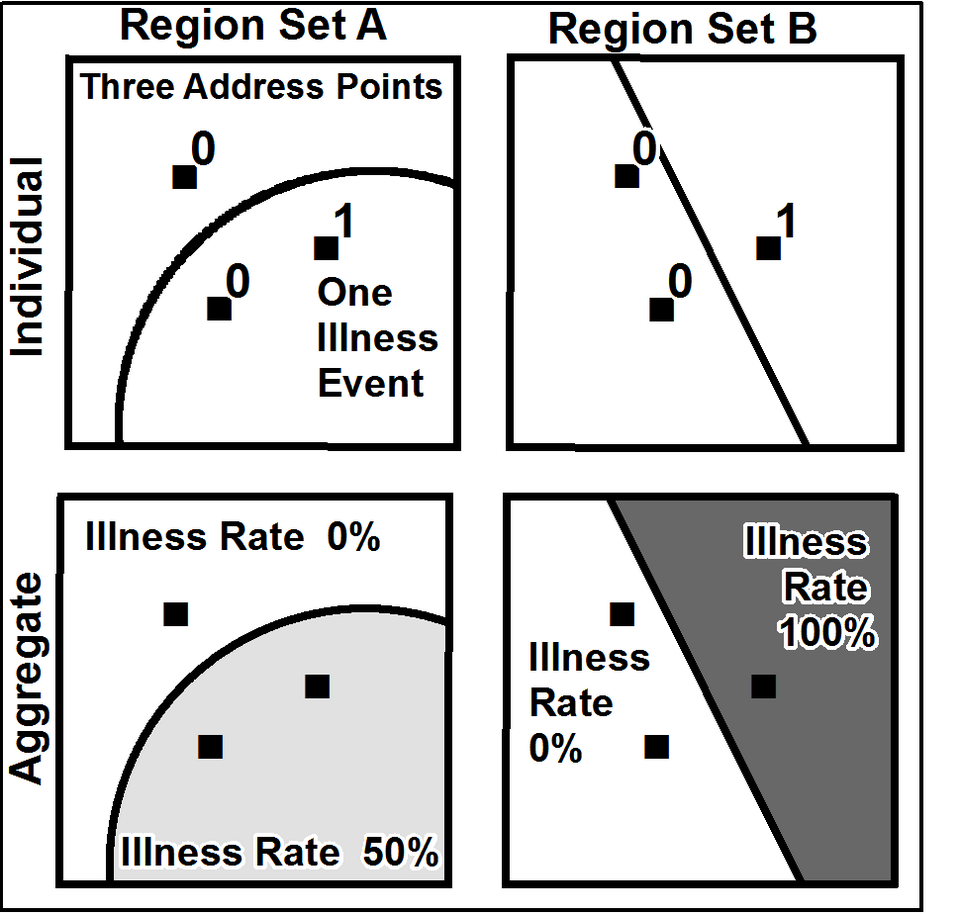
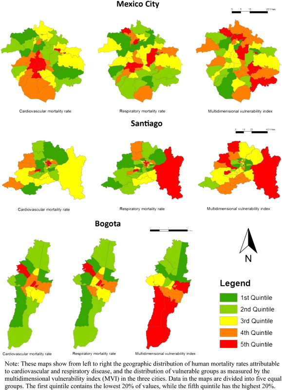
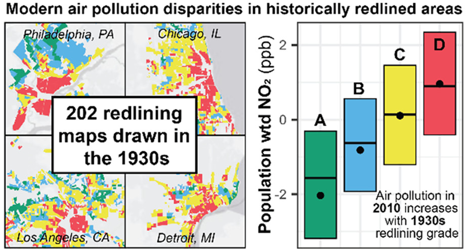

# Maps and Spatial Data

All data are located somewhere. In this week, we consider how to work with geographical information systems (GIS) and ways to communicate the spatial dimensions of our data. We will explore some tools for interactive spatial displays. 


__Monday Readings:__

* [Data Visualization: A Practical Introduction. 7: Draw Maps.](https://socviz.co/07-maps.html)

* _Optional:_ [Nilforoshan, Hamed; Looi, Wenli; Pierson, Emma; et al. 2023. Nature. Human mobility networks reveal increased segregation in large cities.](https://www.nature.com/articles/s41586-023-06757-3)

* _Optional:_ Explore the [Racial Covenant Map](https://reglab.github.io/racialcovenants/static/maps/dotmap.html)


__Wednesday Readings:__

* [Data Visualization: A Practical Introduction. 8: Refine Your Plots.](https://socviz.co/08-polishing.html)


## What is Spatial Data?

All data belong somewhere, but what is the difference between __spatial__ and __aspatial__ data? Let's look at the figure below, from [Healy's Data Visualization](https://socviz.co/07-maps.html#fig-ch-07-maps1). What spatial units are shown? Do all the maps use spatial data?

```{r healy, fig.cap = "Source: Healy, 2026", echo = FALSE}

knitr::include_graphics("fig-ch-07-elections-composite.png")

```


We will define spatial data as the following: 

1. Spatial data corresponds to specific _geophysical locations_ (e.g., latitude/longitude, boundaries). 
2. Spatial data _preserves_ geographic relationships between objects (e.g. distances).

With these definitions, we notice that the electoral college map (lower right) might fail the spatial test. The hexagons are _loosely_ associated with the locations of states, but do not directly map onto geophysical locations. What's more, the distances between hexagons do not correspond neatly to any real distance. 

Other maps show data that could be "spatial" or "aspatial." For instance, the circles in the lower left correspond to real spatial locations (perhaps the centerpoints of each county), but could just as easily be represented via a barplot or scatterplot. 


### The Modifiable Areal Unit Problem

When plotting spatial data, we often want to aggregate into units such as blocks, tracts, neighborhoods, counties, congressional districts, states, and more. Sometimes, the _boundaries we choose_ can influence our findings! In other words, the way that we draw (or choose) boundaries might change the results of our spatial analyses. Geographers and sociologists call this the __modifiable areal unit problem, or MAUP__. In the figure below, you will see that the way boundaries are drawn influences conclusions about infection rates in the population and region. 

```{r maup, out.width="50%", fig.cap="Source: Wikipedia", echo = FALSE}

```

This comes up a lot in segregation research, where the spatial units of analysis can make a big difference for the estimated levels of segregation. Can you think of any other examples of this problem? (perhaps ones that relate to the electoral college figure above)?

While there are no surefire solutions to the MAUP, there are ways to mitigate this problem. First, researchers can select spatial units that are theoretically important to their research question. If we wanted to study disease infections (as in the figure above), it is possible that known neighborhood or institutional boundaries (like a school campus) would be strongly associated with social networks and infection spread, and that we would want to analyze our results using these boundaries. Second, the more detailed we can be, the better. If we have information on the full population, sometimes it makes sense to use this, rather than to aggregate to broader spatial units. Third, we can test several different boundaries as _sensitivity checks_ to see if our analysis results change. If not, we can conclude that the MAUP is unlikely to bias our results. 

### Environmental Hazards and Spatial Data

Many of the social issues that we'd like to study are rooted in space. For example, recall [John Snow's Cholera Maps](https://www.arcgis.com/apps/mapviewer/index.html?webmap=16a719ed81524ef2ad86b57f6918712f). These include a distinct social hazard (Cholera) and infection reports that are located in specific houses and neighborhoods. We can think about other types of environmental hazards too.  

In the following sections, we will explore how spatial data can be used to study environmental inequalities. For instance, pollution is a major contributor to poor health and morbidity: Schwartz [notes that](https://www.sciencedirect.com/science/article/pii/S0277953602003751#BIB31) in the U.S., "particulates are estimated to account for over 100,000 deaths annually, more than breast cancer, prostate cancer, and AIDS combined." Air pollution from particulates (e.g. particulate matter 2.5 or PM 2.5) reduces life spans by about [two years on average](https://aqli.epic.uchicago.edu/news/most-of-the-world-breathes-unsafe-air-taking-more-than-2-years-off-global-life-expectancy/). Globally, [97%](https://aqli.epic.uchicago.edu/news/most-of-the-world-breathes-unsafe-air-taking-more-than-2-years-off-global-life-expectancy/) of the population lives in regions with "unsafe" levels of particulate pollution (according to guidelines from the World Health Organization). 

In recent decades, sociological theorists have considered whether in modernity, society may come to be organized not around class (as Marx, and Weber, and others described), but around _risks_. As Anthony Giddens [puts it](https://link.springer.com/chapter/10.1007/978-3-319-62731-1_32#Sec), "when we stopped worrying so much about what nature could do to us, and we started worrying more about what we have done to nature, we moved from a society dominated by dangers to a society dominated by risks." This vision of a _risk society_ is fully articulated in Ulrich Beck's book, [Risk Society: Towards a New Modernity](https://searchworks.stanford.edu/view/2511734). These theories note that capitalism has not just created "goods," but also "bads," and these "bads" impose perceptible and imperceptible risks on various populations. 

The risk society approach suggests that while risks are unevenly distributed, they ultimately will affect all strata of society. Beck famously notes that "while poverty is hierarchic, smog is democratic," and defines a _boomerang effect_ in which even the most advantaged members of society will eventually be afflicted by the risks that society creates. In [one study of Latin American cities](https://www.sciencedirect.com/science/article/pii/S0277953613000300), air quality is uncorrelated with social advantage across space, providing evidence for the _risk society_ interpretation. Mortality rates and social disadvantage (or "vulnerability") for these cities are shown here: 

```{r airqualityla, echo = FALSE, out.width="70%"}




```

Environmental scholars might point out that it is difficult to ignore inequalities in air quality across the U.S, particularly those related to proximity to industrial facilities: [the overwhelming majority](https://www.eopugetsound.org/magazine/IS/pollution-disadvantaged-communities) of the most polluting industrial facilities are located in disadvantaged neighborhoods. Factors such as [race and unemployment](https://www.sciencedirect.com/science/article/pii/S027795362200140X) are frequently associated with proximity to these types of hazards. In some cases, such as West Oakland, urban planners purposely designed highways and polluting facilities to encompass Black neighborhoods. [Another study](https://pubs.acs.org/doi/10.1021/acs.estlett.1c01012) finds that 1930's redlining is associated with current air quality levels:

```{r airqualityredlining, echo = FALSE, out.width="70%"}



```

An environmental distributive justice approach would emphasize the needs to redistribute hazards equally among populations. Currently, Black children in the U.S. are [twice as likely](https://www.sciencedirect.com/science/article/pii/S0091674914007982) as White children to have asthma, demonstrating some of the unequal burdens of air pollution. Asthma rates are on the rise, and make up a significant public health issue. An EJ approach to this problem would consider the underlying conditions that cause these unequal burdens of air pollution, such as discriminatory urban planning and environmental racism. 

Here, we demonstrated the need for spatial data using environmental problems like air quality and pollution. But spatial data could also be important for many other types of questions, like [linkages between neighborhoods and opportunity](https://opportunityinsights.org/neighborhoods/), [social connectedness between rich and poor](https://socialcapital.org/), and much more. What examples can you think of where our research questions require spatial data?

## Using Simple Features in R

To get started, we will work with a package called `sf`, which stands for simple (not spatial) features. So _what is a feature_? A feature is an real-world object, such as a building, city, tree, or forest. Features have spatial and non-spatial attributes. The [simple features website](https://cran.r-project.org/web/packages/sf/vignettes/sf1.htm) notes the following: 

> "Features have a geometry describing where on Earth the feature is located, and they have attributes, which describe other properties. The geometry of a tree can be the delineation of its crown, of its stem, or the point indicating its centre. Other properties may include its height, color, diameter at breast height at a particular date, and so on."

In other words, most of the data that we have been working with in this class, such as text information, contains _attributes_ about specific news articles, social media posts, or words from these data sources. Our dataframes have, for the most part, not included _geographic_ information about where each article or post came from (although some of our data included general categories, such as "US" and "World News").

To get started with `sf`, we will install it and library the package. We can then load the shapefile for North Carolina, which is pre-loaded into the `sf` package.  

```{r sf, message = FALSE}
library(sf)

# load a simple features object
nc <- st_read(system.file("shape/nc.shp", package="sf"))

```

You'll note that we get a lot more information than when we load in .csv files to our R environment. R notes that in this simple features collection, there are 100 features and 14 fields. This really just means that there are 100 observations in our data and 14 variables (or 15 including the geometry). We see that these type of data are _MULTIPOLYGON_, meaning that each observation is a different polygon.  We also have a _bounding box_, which notes the most extreme longitude and latitude points. All the data is contained geographically in this bounding box. The xmin and xmax values represent latitudes, whereas the ymin and ymax values represent longitudes. Positive values represent East and North, negative values represent West and South. If we look at the `class` of the object, we can see it is a "simple features" object as well as a "data frame."

```{r sf class}
# look at class of object
class(nc)
```
This means that while nc is an `sf` object, we can still use `dplyr`-type commands on hte attributes as if it were another dataframe. Let's take a look at what attributes, and then what the _geometry_ features are like. 


```{r geometry, message = FALSE}
library(dplyr)

# look at attributes (normal variables)
nc %>%
  head()

```

Let's take a closer look at the geometries! 


```{r geometriescloserlook, echo = FALSE, message = FALSE}
library(kableExtra)

knitr::kable(
  data.frame(geometry = as.character(nc$geometry)), longtable = TRUE, booktabs = TRUE,
  digits = 50, 
  caption = 'Geometry Feature for North Carolina Shapefile') %>%
  scroll_box(width = "100%", height = "1000px") 


```


We notice that each MULTIPOLYGON observation consists of a list within a list. The first list contains polygons, whereas the second list contains the bounding points of these polygons. 

We can try plotting these data! Notice that when we specify `nc[1]`, this selects the AREA attribute as well as the geometry. 


```{r plotsf}

# plot with base R
plot(nc[1], reset = FALSE) # reset = FALSE: we want to add to a plot 

```

We can identify the observations (counties, in this case) with multiple polygons by examining which observations have lengths $>1$. We'll first do this using base R:

```{r plotsf2}

# define index for lengths greater than 1
w <- which(sapply(nc$geometry, length) > 1)

# take a look 
nc[w,]
```


And now we'll try the same thing using `dplyr` methods. We should get the same result, and we do:

```{r w2}

# get all observations with lengths > 1
nc %>%
  filter(sapply(geometry, length) > 1)

```

Great! Now that we have identified observations with multiple polygons, let's plot these. 

```{r plotresults}

# now plot the results
plot(nc[w,1], col = 2:7)

```

You might have noticed that up until now, we've only plotted these data with the base R `plot()` function. However, like with the other data we've seen, as we become more advanced in our data visualization techniques, we can use `ggplot()` to customize our graphics. Let's try plotting each county by its area again, but with `ggplot`. To do this, we'll use the `geom_sf()` command to add the spatial layer.


```{r plotsf3}
library(ggplot2)
# plot with ggplot
ggplot(nc)+
  geom_sf(aes(fill = AREA))+
  theme_minimal() 


```

## Mapping Polygons with tidycensus

To map environmental hazards to neighborhoods, we can use Census data and geographies. Last week, we used [tidycensus](https://walker-data.com/tidycensus/articles/basic-usage.html) to gather data on neighborhood demographics. Here, we can map those demographics!

In what follows, we set `geometry = TRUE` to gather _both_ geometries and attributes for the census data of interest. For instance, we might want to gather ACS data from Orange County for the year 2020. Recall that `load_variables` will allow us to see the variable names for this census survey. We can specify `dataset = c("acs5")` to view variables for the 5 year ACS. 

```{r tidycensus0, echo = TRUE, message = FALSE, warning = FALSE, eval = FALSE}
library(tidycensus)

v20 <- load_variables(year = 2020, dataset = c("acs5"))


```

Viewing `v20`, we see that `B19013_001` is a variable for median household income. We can now _gather_ this variable with `geometry = TRUE`. 

```{r tidycensuskey, echo = FALSE, message = FALSE}
library(tidycensus)

key = "2075581078cab2d3d6165384058fe2fe0dfcf559"

census_api_key(key)
```

```{r tidycensus, echo = TRUE, message = FALSE, warning = FALSE, results="hide"}

# gather acs data for orange county
orange <- get_acs(
  state = "CA",
  county = "Orange",
  geography = "tract",
  variables = "B19013_001",
  geometry = TRUE,
  year = 2020)

```


To plot spatial data, we can use `ggplot`! All that we need to do is add a spatial layer to our plot. We can do this with the `geom_sf` function: 


```{r tidycensus2, echo = TRUE, message = FALSE}
library(dplyr)
library(ggplot2)

# plot orange county
ggplot(data = orange, aes(fill = estimate)) + 
  geom_sf(color = NA) + 
  scale_fill_viridis_c(option = "magma") 

```

## Using Tigris to Gather Shapefiles

We've seen one method for gathering data at the country level, but we may be interested in smaller units like counties or census tracts. If our scope of analysis is limited to within the United States, there is an R package, `tigris`, that will help us gather these data. We'll first put it in our library. 

```{r tigris, message = FALSE, warning = FALSE}

library(tigris)

```

If we type `tigris::`, we should see a list of functions within `tigris`. Most of these are different geographies that we can gather, such as:

* Census block groups
* Census blocks
* Census tracts
* Counties
* Landmarks
* Native areas
* Roads
* School Districts

Let's try counties! We can gather a shapefile of US counties with the following code. We can specify a particular state or year within the `counties()` function. For now, we will focus on California. Since we don't specify the year, this will revert to the default (2021, which we can see in `?counties`).


```{r counties, message = FALSE, warning = FALSE, results = "hide"}

# gather county shapefiles
counties <- counties(state = "CA")

```

Our `counties` data are already in simple features format. We can see this by looking at the head, or by running `class(counties)`. Let's take a look at the counties! We can try plotting them:

```{r plotcounties, message = FALSE}

# plot counties 
ggplot(counties)+
  geom_sf()

```

Great, we have our counties in simple features format and they are plotting correctly. 

We can now add other information at the county level to our data. In this section, we'll look at outdoor air quality data from the [Environmental Protection Agency](https://www.epa.gov/outdoor-air-quality-data). We can download annual air quality index (AQI) data at the county level [here](https://aqs.epa.gov/aqsweb/airdata/download_files.html#Annual). We'll do this for 2022. 

```{r aqicounty, message = FALSE, warning = FALSE}
library(readr)
library(magrittr)

# read in data
aqi22 <- read_csv("Data/annual_aqi_by_county_2022.csv")

# we can limit them to just California
aqi22 %<>%
  filter(State == "California")

```

Great, now let's try joining the air quality data onto our county data! When we `left_join()` these data, we'll need to specify that the variable NAME in our left dataset (counties) should be matched with the variable County in our right dataset (aqi22). 


```{r joinaqi}

counties %<>%
  left_join(aqi22, by = c("NAME" = "County"))

```

Any time we join dataframes it's important to make sure that this worked properly. We can do this a few ways. We can visually inspect our data by using the `View(counties)` function and looking at the new columns. We also want to make sure that our data did not change drastically in its number of rows, and we can use `nrow(counties)` to do so. We could run the `table()` function on different variables (e.g. `table(counties$Median AQI)`) to make sure that the new data are roughly what we would expect. In short, the more methods we can use to check that our data were transformed correctly, the better.

Now we can plot air quality for 2022 at the county level!

```{r aqi2022county, message = FALSE, warning = FALSE}
library(viridis)

ggplot(counties)+
  geom_sf(aes(fill = `Median AQI`))+
  scale_fill_viridis(option = "magma", direction = -1)
```

## Spatially Joining Data

In the previous section, we gathered simple features at the county level and then found county data to join these with. However, what do we do if we want to join two datasets with different spatial units? In this section we'll look at how we might join school districts with AQI data.

First, we'll gather school districts in California using the `tigris` package. 

```{r schooldistricts, message = FALSE, warning = FALSE, results = "hide"}

# download school districts
school_districts <- school_districts(state = "CA")

```

Great, we can plot these to do an initial visual inspection.

```{r schooldistrictsplot, message = FALSE}

# plot school districts
ggplot(school_districts)+
  geom_sf()

```

Since there are some areas with missing shapes (e.g. national forests or unpopulated regions), we might want the boundary for the entire state in our plot as well. We can do this by dowloading the state file, and adding it to our `ggplot`.

```{r addstate, message = FALSE, results = "hide"}

# get state of california shape
ca <- states() %>%
  filter(NAME == "California")
```


```{r schooldistplot}

# try plotting again
ggplot(school_districts)+
  geom_sf(data = ca)+
  geom_sf()
```

Great! Now let's look at AQI. We could look at the county-level data, but school districts tend to be a bit smaller than counties. Instead, we can gather the data at the monitor-level [here](https://aqs.epa.gov/aqsweb/airdata/download_files.html#Annual). 


```{r aqimonitor, message = FALSE, warning = FALSE}

library(readr)

# read in monitor-level data
aqi22m <- read_csv("Data/aqi22_clean_ca.csv")

```


These data contain latitude and longitude coordinates, but are not yet in simple features format. We also notice by visually inspecting these data that there is a column called "Datum," which is equal to "NAD83" for some entries and "WGS84" for others. Both of these are common CRSs. We can set the CRS of these new data to that of our school districts. 


```{r aqi2sf, message = FALSE}

# make aqi monitor data sf
aqi22m %<>%
  st_as_sf(coords = c("X", "Y")) 

# set crs
aqi22m %<>%
  st_set_crs(st_crs(school_districts))

```


We also notice that our AQI data here include many types of pollutants. We'll limit our data to just look a PM2.5 compared to its 24 hour standard set in 2012. 


```{r limitpollutant}

# limit pollutant
aqi22m %<>%
  filter(`Pollutant Standard` == "PM25 24-hour 2012" & 
           `State Name` == "California")

```


Now let's try plotting these data over the California school districts. 

```{r plotaqidistricts}

# try plotting again
ggplot(aqi22m)+
  geom_sf(data = ca)+
  geom_sf(data = school_districts)+
  geom_sf(aes(col = `Arithmetic Mean`))+
  scale_color_viridis(option = "magma", direction = -1)+
  theme_minimal()+
  labs(col = "PM2.5 Average")


```

Fantastic, we can now see the air quality monitoring sites overlayed on school districts. We notice that many school districts do not have a single air quality monitor within them (at least for PM2.5), while others have multiple monitors located within their boundaries. 

We may want to aggregate air quality metrics for each school district with at least one monitor. Right now, our district boundaries and AQI measures are in two separate dataframes, so we'll need to merge them together. However, they share no common variables. So how will we do this?

We will use a _spatial join_. Specifically, we can use `st_join()` from the `sf` package. 

```{r spatialjoin, message = FALSE, warning = FALSE}

# join school district boundaries with AQI
school_districts %<>%
  st_join(aqi22m)

```

We will then group the data by GEOID, which uniquely identifies each school district. We can now use `head(school_districts)` to see that our data have 390 observations, 68 variables, and 345 groups.

```{r groupbydists}

# group by school districts
school_districts %<>%
  group_by(GEOID)

```

Let's average the AQI for each school district. Now that we've grouped by GEOID, we can use the `summarise` function to get the average (or any other summary statistic) for each grouping variable (in this case, the district GEOID).

```{r districtavgs}

# average AQI for each school district with data
school_districts %<>%
  summarise(mn_aqi = mean(`Arithmetic Mean`, na.rm = T))

```

Great! Now we can plot the average AQI for the entire districts, filling them in. Note that we will use `fill` rather than `col` in the `aes()` arguments this time because we want to fill in shapes rather than points. 

```{r districtaqiplot2}

# try plotting again
ggplot(school_districts)+
  geom_sf(data = ca)+
  geom_sf(aes(fill = mn_aqi))+
  scale_fill_viridis(option = "magma", direction = -1)+
  theme_minimal()+
  labs(fill = "PM2.5 Average")


```


We see that many observations are missing, but that in general, school districts in the Central Valley tend to experience greater levels of air pollution, on average, than school districts closer to the coast or to the Nevada border. 

We might wonder whether these pollution levels are associated with other district characteristics, such as poverty. We can get information on district demographics from the `educationdata` package. We'll download the "SAIPE" information, which stands for [small area income and poverty estimates](https://www.census.gov/programs-surveys/saipe.html). These are simply census estimates of the poverty rates of children aged 5-17 in each school district. 

```{r geteddata, message = FALSE, warning = FALSE}

library(educationdata)

# download small area income and poverty estimates
districts_saipe <- get_education_data(level = 'school-districts', 
                         source = 'saipe', 
                         filters = list(year = 2021),
                         add_labels = TRUE)

```

Then we can join these with our district data. We'll specify that we want to join the "GEOID" variable with the "leaid" variable, both of which contain the districts' IDs. We will try this with the `dplyr` pipe first. 


```{r joindistricts, message = FALSE, warning = FALSE, eval = FALSE}

# join school districts with poverty data
school_districts %>%
  left_join(districts_saipe, by = c("GEOID" = "leaid")) %>% 
  View()

```

Most of our data are missing! What went wrong? If we inspect the `GEOID` and `leaid` variables, we notice a slight difference: `GEOID` has a leading `0`, whereas `leaid` does not. We can create a new variable, `leaid_mod`, to match with `GEOID`:


```{r joindistricts2, message = FALSE, warning = FALSE}
library(stringr)

# create new lea id
districts_saipe %<>%
  mutate(leaid_mod = str_pad(leaid, 7, pad = "0"))


```

If we look at `leaid_mod`, it now matches `GEOID`! Now we can join `school_districts` and `districts_saipe`. 

```{r joindistricts3, message = FALSE, warning = FALSE}

# join school districts with poverty data
school_districts %<>%
  left_join(districts_saipe, by = c("GEOID" = "leaid_mod")) 

```


Now, let's look at air quality _and_ district poverty rates at the same time. 

```{r aqipov, message = FALSE, warning = FALSE}

# plot aqi and pov rates
ggplot(school_districts, aes(est_population_5_17_poverty_pct, 
                             mn_aqi))+
  geom_point()

```


It appears there is a positive relationship between poverty rates and air pollution. We can improve this graph by making the size of each point proportional to the student population, and by modifying the labels. We'll also color the points according to the air quality levels. 

```{r aqipov2, message = FALSE, warning = FALSE}

# plot aqi and pov rates
ggplot(school_districts, aes(est_population_5_17_poverty_pct, 
                             mn_aqi))+
  geom_point(aes(color = mn_aqi, size = est_population_5_17))+
  labs(title = "California School Districts' Poverty Rates and Air Quality, 2022",
       x = "Poverty Rate", 
       y = "PM2.5 Level", 
       color = "PM2.5 Level", 
       size = "Total Population")+
  scale_color_viridis(option = "magma", direction = -1)


```


## Using Leaflet and R Shiny for Interactive Maps


We can use [Leaflet](https://rstudio.github.io/leaflet/) to make interactive maps in R. For example, we can plot our air quality monitors in California by specifying that `data = aqi22m`. The `addTiles()` command simply adds the default Leaflet map polygons, and `addMarkers()` adds the AQI monitor points (because our data are point data).


```{r leaflet, warning = FALSE}

library(leaflet)

m <- leaflet(data = aqi22m) %>%
  addTiles() %>%  # Add default OpenStreetMap map tiles
  addCircleMarkers(color = ~`Arithmetic Mean`, 
                   radius = 5)
m  # Print the map

```


We can see here, as in our previous maps, that poor air quality tends to be concentrated in the central valley and in Southern California. Unlike previous maps, we can zoom in and see specific monitors and neighborhoods. 

We can also use Leaflet to plot polygons. We'll try this with our school district data. We'll first set a color function using `colorNumeric` from the `leaflet` package. This will translate our column data to colors for Leaflet to read. We will take the inverse of our data in order to reverse the color scale here. 

```{r leaflet2, warning = FALSE}

library(leaflet)

# function to transform colors
col <- colorNumeric(palette = "magma", 1/school_districts$mn_aqi)

s <- leaflet(data = school_districts) %>%
  addTiles() %>%  # Add default OpenStreetMap map tiles
  addPolygons(fillColor = ~col(1/mn_aqi),
              color = ~col(1/mn_aqi),
              fillOpacity = .5)
s  # Print the map

```

We can see the specific school districts with the highest PM2.5 levels in California. These tend to be clustered around Los Angeles, Fresno, and Sacramento. We could further adjust the color specifications and shape properties using the other arguments in `addPolygons()`. 

Lastly, [R Shiny](https://shiny.posit.co/) is a package that allows the user to develop interactive graphics and user interfaces. Creating these applications goes a bit beyond the scope of this class, but we'll just look at some examples to see what is possible with this type of programming. 

This [Superzip Map](https://shiny.posit.co/r/gallery/interactive-visualizations/superzip-example/) shows several of the capabilities of R Shiny and Leaflet. Try playing around with it! You can zoom in, highlight different places, change the outcome variable, and look at how the descriptive statistics vary in different places. The graphic is a commentary on "Super Zips," or places where per capita income and education levels rank in the top 5% (but you can adjust this as well). If you'd like to learn more about R Shiny and try making your own apps, I recommend exploring the [Tutorial pages](https://shiny.posit.co/r/getstarted/shiny-basics/lesson1/) as well as this [user guide](https://docs.posit.co/shinyapps.io/index.html).


## Problem Set 5

Recommended Resources:

[Simple Features for R](https://r-spatial.github.io/sf/articles/sf1.html)

[ggplot2: Elegant Graphics for Data Analysis, by Hadley Wickham](https://ggplot2-book.org/)

1. Start a new document, problemset5.Rmd, in your soc10problemsets repository. (You can download a template [here](https://github.com/Soc10Spring2026/soc10problemsets_templates), but be sure to save it in your own soc10problemsets repo). Read the North Carolina shapefile into R using the process described in section \@ref(using-simple-features-in-r). Then plot the data using `ggplot2`. Use a variable other than `AREA` to fill the shapes, and try using one of the `scale_fill_` arguments to create a red color scale. See [these notes on color scales with ggplot](https://ggplot2-book.org/scales-colour.html) for some theory and ideas here. __Commit__ your changes. 

2. Use the `tidycensus` function to download income data for block groups in Santa Clara County. Plot the demographic data using `ggplot()` and comment on what it shows. __Commit__ your changes. 

3. Use the `tigris` function to download spatial data for counties in California. Plot the data using `ggplot()`. __Commit__ your changes. 

4. Download the clean AQI monitor dataset from Canvas ("aqi22_clean_ca.csv") or using the code below, and plot these inside the boundaries that you have downloaded from `tigris`. Then, calculate the average PM2.5 levels in each of the geographical units, and plot your geographies again according to these levels (as we did in section \@ref(spatially-joining-data)). Which areas had the best (and worst) air quality in 2022? What are the implications? __Commit__ your changes. 

5. Does the county-level air quality map accurately represent how people experience air quality? Is the Modifiable Areal Unit Problem something that we should be concerned with? __Commit__ your changes. 

