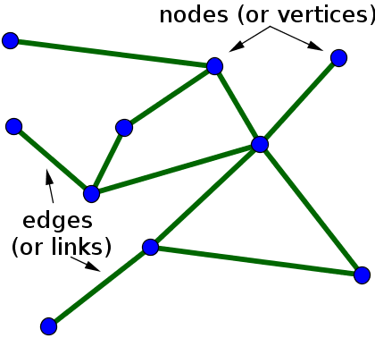
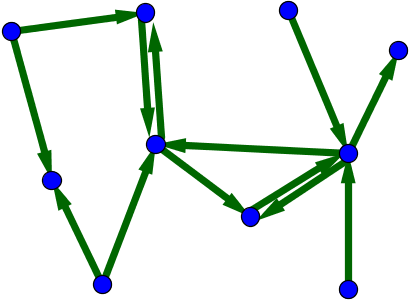
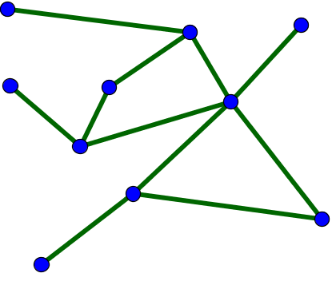
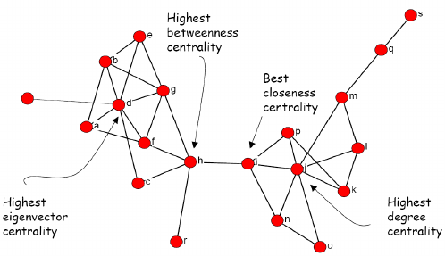

# Networks

Sometimes, we wish to measure or display how observations are linked to each other. For instance, we might want to analyze a web of social interactions, or migration flows between many entities. In these times, network analysis is what we need. We will look at some applications of networks in sociology, and cover basic ways to visualize and analyze network data. 

__Monday Readings:__

* _Optional:_ [Network Structure in Small Groups and Survival in Disasters](https://doi.org/10.1093/sf/soab036)

__Wednesday Readings:__

* [Wimmer, Andreas; Lewis, Kevin. 2010. American Journal of Sociology. Beyond and Below Racial Homophily: ERG Models of a Friendship Network Documented on Facebook.](https://www.journals.uchicago.edu/doi/10.1086/653658)

* _Optional_: [Corbera, Esteve;, Calvet-Mir, Laura; Hughes, Hannah; Paterson, Matthew. 2016. Nature Climate Change. Patterns of authorship in the IPCC Working Group III report.](https://www.nature.com/articles/nclimate2782)


## What Are Networks?

Networks have two elements: nodes and edges. _Nodes_, or vertices, are points, and _edges_, or links, are the connections between the nodes. We can illustrate these with a simple network graph: 

```{r nodesedges, echo = FALSE, fig.cap="Network example. From Nykamp DQ, An introduction to networks."}



```


Importantly, a network's edges can be directed or undirected. _Directed_ edges constitute flows from one node to another; the order matters. These could be cash payments, academic citations, school transfers, social media follows, or anything else where the direction of the edge would matter. A directed network graph could look like the figure below. Notice how each edge is unidirectional, and that a pair of nodes can have two edges between them. 

```{r directedundirected, echo = FALSE, fig.cap="Directed Network. From Nykamp DQ, An introduction to networks."}



```

_Undirected_ edges constitute bidirectional ties, in which the order does not matter. These could be friendships or romantic partnerships, classes that students have taken together, bills that congresspeople have written together, companies that share a board member, or anything else where the connection is the same for both parties. A possible undirected network is shown here: 


```{r directedundirected2, echo = FALSE, fig.cap="Undirected Network. From Nykamp DQ, An introduction to networks."}



```

For both directed and undirected networks, we may want to modify the edges according to characteristics of the ties (for example, are these strong or weak connections?), and we may want to modfiy the nodes according to their characteristics as well (for example, what group is each member from?). We can do this by changing the color, shape, line width, and so on of our network, as we might do for other types of visualization. 

## Building And Visualizing Networks

```{r migration, message = FALSE, warning = FALSE, echo = FALSE}
library(readr)
library(dplyr)
library(magrittr)

ca_migration <- read_csv("Data/county-to-county-2016-2020-ca.csv", 
                         skip = 1) %>%
  slice(-1) %>%
  select(`State Code of Geography A`, 
         `FIPS County Code of Geography A`, 
         `State/U.S. Island Area/Foreign Region Code of Geography B`,
         `FIPS County Code of Geography B`, 
         `Flow from Geography B to Geography A`,
         `Counterflow from Geography A to Geography B1`,
         `County Name of Geography A`,
         `County Name of Geography B`)


# rename columns 
names(ca_migration) <- c("state_a",
                         "fips_a",
                         "state_b",
                         "fips_b",
                         "flow_ba",
                         "flow_ab",
                         "county_a",
                         "county_b")

# filter to only california counties
ca_migration %<>%
  filter(state_b == "006")


# california county regions
ca_migration %<>%
  mutate(region_a = case_when(fips_a %in% c("015", "023", "033", "045", 
                                          "055", "097", "105") ~ "#482878FF", 
                            fips_a %in% c("001", "013", "041", 
                                                  "075", "081", "085", 
                                                  "095") ~ "#3E4A89FF",
                            fips_a %in% c("003", "005", "009", "039", 
                                          "043", "047", "051", "077",
                                          "099", "109") ~ "#31688EFF",
                            fips_a %in% c("053", "069", "079", "083",
                                          "087", "111") ~ "#26828EFF",
                            fips_a %in% c("019", "027", "029", "031", 
                                          "107") ~ "#1F9E89FF",
                            fips_a %in% c("065", "071") ~ "#35B779FF",
                            fips_a %in% c("037") ~ "#6DCD59FF",
                            fips_a %in% c("059") ~ "#B4DE2CFF",
                            fips_a %in% c("025", "073") ~ "#FDE725FF",
                            .default = "#440154FF"))

# limit to one region of ca 
ca_migration %<>%
  filter(fips_a %in% c("011",  "021",  "007", # "017", "035", "049", "093", 
                       #"057", "061", "101", "067", "089", "113", 
                       "063", "103", "091", "115") & 
           fips_b %in% c("011",  "021",  "007", # "017", "035", "049", "093", 
                       #"057", "061", "101", "067", "089", "113", 
                       "063", "103", "091", "115"))

```


Let's first create a network. We'll make a dataframe where every row represents an edge, and the two variables represent from which node the edge goes to (and from). You'll notice that the names can appear more than once - we can think about this as friendship ties, each person could have multiple friends, which would be represented as unique rows. We'll need to put the data in matrix form in order for our later network functions to perform correctly. We'll call this `el`, for "edge list."

```{r createnetwork}

el <- data.frame(person_1 = c("Lionel", "Frederica", "Garrett", "Lina",
                               "Sampson", "Garrett", "Frederica", "Lionel",
                              "Frederica", "Frederica", "Ahmad"),
                  person_2 = c("Lina", "Charlotte", "Lina", "Sampson",
                               "Charlotte", "Lionel", "Lina", "Sampson",
                               "Sampson", "Garrett", "Garrett")) %>%
  as.matrix()

# take a look
el

```


Now we can convert our data to a network with `igraph`. We can specify here whether our network is _directed_ or not. This choice is meaningful: if our network simply represents friendship ties, this would best be represented as an _undirected_ network (assuming the friendships are bidirectional). However, it could be that our network represents aid given to friends after a disaster (e.g. who let who stay at their home after a hurricane). In the latter case, `person_1` may represent the person who is displaced and `person_2` may represent the person hosting. For now, we will consider our edges to simply represent bidirectional friendships, so our network will be undirected.

```{r igraph1, message = FALSE, warning = FALSE}

library(igraph)

# create network from edge list
net <- graph_from_edgelist(el, directed = FALSE)

```

Great! Now let's try to visualize our network.

```{r igraph2}

# plot network
plot(net)
```

We can make the graph more visually appealing by changing some of the default settings. 

```{r igraph3}

# customize network plot
plot(net, vertex.size = 30, 
     vertex.color = "lavender", 
     vertex.frame.color = NA, 
     vertex.label.cex = .7, 
     edge.curved = .05, 
     edge.arrow.size = .3, 
     edge.width = .7, 
     edge.color = "gray1")

```

## Measures of Centrality

We may be interested in measuring how central each node is to the entire network. We will focus on the following four measures of network centrality: 

* Degree Centrality
* Betweenness Centrality
* Eigenvector Centrality
* Closeness Centrality

These four measures are similar, but measure slightly different concepts. These differences are illustrated here:

```{r centrality, echo = FALSE, out.width="70%"}


```


__Degree Centrality__ counts how many edges each node has. The node with the most edges, therefore, is most central. This is a straightforward approach to understanding centrality that is easily communicated: in a friendship network, the most "central" actor would simply be the person with the most friends. This would capture the most popular actor, in some sense.

We can calculate degree centrality using the `degree()` function. In our network, Lina, Frederica, Garrett, and Sampson are all tied for the highest degree centrality. 

```{r degree centrality}
degree(net)
```

__Betweenness Centrality__ considers how important nodes are to the flow of information (or other resources) between nodes.  Betweenness similarity measures the shortest path between every combination of nodes. It then counts how many "shortest paths" each node is involved in, and the node with the most is considered most central. We might want to use this measure if we are interested in actors that connect different groups: for example, it could be that the most popular politician is also immersed in an echochamber, and we would not want to consider them central to the functioning of the entire network. In this case we could use the betweenness centrality to get a sense of who is a "bridging tie" between the most members of the entire network. 

Betweenness centrality can be calculated using the `betweenness()` function. According to this metric, Garrett reigns supreme! This is mostly because Garrett has the sole tie to Ahmad, and thus is involved in every "shortest path" involving Ahmad. 

```{r betweenness centrality}
betweenness(net)
```

__Closeness Centrality__ similarly makes use of the "shortest paths" between nodes. Closeness centrality is measured by averaging the values of these shortest paths from one node to all others (farness), and then taking the reciprocal of this. We might want to use this if we are interested in not necessarily the flow of information, but in which members may have access to all other members of the network.  

Closeness centrality can be calculated using the `closeness()` function. By this metric, Lina, Frederica, and Garrett are all at equally central positions (but not Sampson, as was the case in the degree centrality measure. This is because the shortest path from Sampson to Ahmad involves 3 edges). 

```{r closeness centrality}
closeness(net)
```

__Eigenvector Centrality__ considers not only the ties of the node of interest (or ego), but also the ties of nodes that they are connected to (their alters). The Eigenvector Centrality measure rewards alters with lots of connections. Perhaps if we are looking at a network of politicians and lobbyists, we want to consider not just individual's ties, but whether they are tied to powerful people. An influential member might only have a few ties, but each of these ties would be extremely popular. 

We can calculate Eigenvector Centrality using the `evcent()` function. We also need to specify that we want the `$vector` result. According to this metric, Lina is the most central! This is because Lina is close to other popular people, who have lots of social ties themselves. 

```{r eigenvector centrality, message = FALSE, warning = FALSE}
evcent(net)$vector

```

We can compare these four measures of centrality all together with the code below:

```{r comparecentralities, message = FALSE, warning = FALSE}
library(tidyr)
library(ggplot2)
# create dataframe with similarity scores
central_df <- data.frame(degree = degree(net),
                         betweenness = betweenness(net),
                         closeness = closeness(net),
                         eigenvector = evcent(net)$vector)

# all the measures are on different scales, we can standardize them with scale()
central_df %<>%
  mutate_all(scale)

# pivot so that the type of score is a variable and the value is another variable
central_df %<>%
  mutate(name = rownames(.)) %>%
  pivot_longer(-c(name),
               names_to = "centrality",
               values_to = "standardized value")

# now plot the centrality scores
ggplot(central_df, aes(name, `standardized value`))+
  geom_point(aes(col = centrality), size = 2)+
  theme_bw()

```


There are other measures of centrality, such as Bonacich Centrality and Google's Page Rank, which go beyond the scope of this course. [Hoffman's "Methods for Network Analysis" bookdown](https://bookdown.org/markhoff/social_network_analysis/centrality.html) has more information on these. 

## Co-Authorship Patterns

We'll now turn to an example involving authors of the Intergovernmental Panel on Climate Change's (IPCC) climate reports. The IPCC has written six assessment reports since 1990, each detailing the state of climate change and governmental actions which exacerbate or mitigate its effects. These reports garner much media attention and are influential in global plans to curtain the worst effects of the changing climate. In recent years, scholars have begun to examine geographic biases in representation in authorship of these reports, with most authors coming from the Global North. 

Here, we will work with the data from [this paper](https://www.nature.com/articles/nclimate2782), which analyzes networks of co-authorship in the [fifth assessment report (AR5)](https://www.ipcc.ch/assessment-report/ar5/). Specifically, the paper examines authorship on the third working group's (WGIII) contribution to the report, which details mitigation of climate impacts. The authors of the study have calculated the number of co-authorships between the researchers on the WGIII (i.e. the number of times that these researchers published scientific papers together, outside of the AR5). I've added this data file to Canvas, but you can also download all the data from the paper in the [Supplementary Information](https://www.nature.com/articles/nclimate2782#Sec8).

```{r coauthor, message = FALSE}
library(RCurl)

# input url from github
url <- getURL("https://raw.githubusercontent.com/tylermcdaniel/css/main/Data/IPCC_co_authorship.csv")

# download authorship data (from github)
ipcc_authors <- read_csv(url, skip = 1)

# replace NA's with 0's
ipcc_authors %<>%
  mutate_all(~replace(., is.na(.), 0))
```

We can then view the co-authorship:

```{r coauthor2, echo = FALSE, message = FALSE, warning = FALSE}
library(kableExtra)
knitr::kable(
  ipcc_authors, longtable = TRUE, booktabs = TRUE,
  caption = 'IPCC AR5 Co-Authors') %>%
  scroll_box(width = "100%", height = "1000px") 


```


We notice that this network data has a different structure than the dataframe that we used earlier. This structure is called an _adjacency matrix_. It is also a _sparse_ matrix because most of the values are 0.

To create a network from these data, we'll transform it from a dataframe to a matrix object, and use `graph_from_adjacency_matrix()`. 

```{r coauthor3, message = FALSE, warning = FALSE}

# reorder column names to match rows
ipcc_authors %<>%
  select(order(colnames(.)))


# turn dataframe into matrix
ipcc_authors %<>%
  select(-Author) %>%
  as.matrix()

ipcc_net <- graph_from_adjacency_matrix(ipcc_authors,
                                        mode = "undirected")


```

Great! Let's try plotting the network.

```{r coauthor4}

plot(ipcc_net, vertex.size = 2, 
     vertex.color = "lavender", 
     vertex.frame.color = NA, 
     vertex.label.cex = .5, 
     edge.curved = .05, 
     edge.width = .1, 
     edge.color = "gray1")
```

We notice that there are several authors who have not co-authored with anyone else in the group, and then a large clump of authors who do collaborate with each other (but it is hard to tell exactly how much or who might be central players within this group). There are also many periphery authors who may have collaborated with just one or two others. 

To examine the network in further detail, we can increase the threshold for an edge: as is done in the Nature Climate Change paper, we will only consider two or more co-authorships to constitute edges. We can do this by changing all the 1's in our adjacency matrix to 0's. Since `ipcc_authors` is a matrix, we will do this using base R's index (rather than `dplyr`'s mutate functions, which only work with dataframes). 

```{r edgethreshold, message = FALSE, warning = FALSE}

# replace 1s with 0s
ipcc_authors[ipcc_authors == 1] = 0

# replace NAs with 0s
ipcc_authors[is.na(ipcc_authors)] = 0

```

We can also remove all the authors who don't collaborate with anyone else. We'll do this by creating a vector of these indices, and then removing them from both the rows and columns of the matrix (remember that the matrix is symmetric).


```{r removeentries}

# vector of authors who do not collaborate with others
no_colab <- which(apply(ipcc_authors, 1, sum, na.rm = TRUE) == 0)

# we can see the names of these authors by changing the margin to 2
which(apply(ipcc_authors, 2, sum, na.rm = TRUE) == 0)

# then we can remove these from ipcc_authors
ipcc_authors <- ipcc_authors[-no_colab,
                             -no_colab]
```


The dimensions of `ipcc_authors` have now changed from 273 x 273 to 148 x 148. 

```{r adjmatrix}

# create network, again
ipcc_net <- graph_from_adjacency_matrix(ipcc_authors,
                                        mode = "undirected")

plot(ipcc_net, vertex.size = 2, 
     vertex.color = "lavender", 
     vertex.frame.color = NA, 
     vertex.label.cex = .5, 
     edge.curved = .05, 
     edge.width = .1, 
     edge.color = "gray1")
```

This looks a bit better. We can see that there are peripheral clusters of authorship, as well as a central cluster. However, we still can't really see who the main actors may be. To make this more visible, we'll add a variable to the vertices on our network graph with their betweenness scores. We'll also standardize the betweenness scores by dividing all of them by the maximum and then multiplying by 20.


```{r adjmatrix2}

# add betweenness centrality
V(ipcc_net)$betweenness <- betweenness(ipcc_net)


plot(ipcc_net, 
     vertex.size = V(ipcc_net)$betweenness/max(V(ipcc_net)$betweenness) * 20, 
     vertex.color = "lavender", 
     vertex.frame.color = NA, 
     vertex.label.cex = .5, 
     edge.curved = .05, 
     edge.width = .1, 
     edge.color = "gray1")
```

We see that there are several "central" authors. Still, it's hard to see their names here. We can display the authors' names, in descending order based on their betweenness scores, using the following code: 

```{r ipccnetnames}

# show authors in descending order
V(ipcc_net)[order(V(ipcc_net)$betweenness, decreasing = TRUE)]

```

This reveals that Nakicenovic is the "most central" author, at least according to the betweenness metric. 


We might want to modify our graph edges to represent the _number_ of collaborations, not just the fact that two authors have collaborated. We can do this by creating a _weighted_ network, and using the weights as edge widths: 

```{r weighted edges}

# create network, again
ipcc_net <- graph_from_adjacency_matrix(ipcc_authors,
                                        mode = "undirected",
                                        weighted = TRUE)

# add betweenness centrality
V(ipcc_net)$betweenness <- betweenness(ipcc_net)

# plot network
plot(ipcc_net, 
   edge.width=(E(ipcc_net)$weight)/5,
    vertex.size = V(ipcc_net)$betweenness/max(V(ipcc_net)$betweenness) * 20, 
     vertex.color = "lavender", 
     vertex.alpha = 0.5,
     vertex.frame.color = NA, 
     vertex.label.cex = .5, 
     edge.curved = .05, 
     edge.width = .1, 
     edge.color = "gray1")


```

We may also want to modify the attributes of our nodes according to their characteristics. Since geographic biases in IPCC authorship has been raised, let's start there. We can add the countries that each author represents to our data by joining the IPCC_cv data. 

```{r join cv data, message = FALSE, warning = FALSE}

# input url from github
url <- getURL("https://raw.githubusercontent.com/tylermcdaniel/css/main/Data/IPCC_cv.csv")

# download authorship data (from github)
ipcc_cvs <- read_csv(url)

```


Great! However, remember that we removed authors with less than 2 collaborations. So let's remove these from our CV data too. We'll use the `slice()` function, and add a negative in front of `no_colab` to specify that we _don't_ want these indices. 


```{r remove nocolab}

# remove authors who did not collaborate
ipcc_cvs %<>%
  slice(-no_colab)

```

We notice that there are several variables around the country of origin, country of employment, and country representing at the IPCC, as well as other characteristics such as gender and institutional affiliations. We'll define a new variable indicating the _region_ of the world each author is representing. 

```{r region}

# define global regions
ipcc_cvs %<>%
  mutate(region = case_match(`IPCC representing country (i.e. Country of residence from IPCC doc)`,
                             # Europe will be green
                             c("Austria", "Belgium", "Denmark", "Finland", 
                               "France", "Germany", "Greece", "Hungary", "Italy",
                               "Netherlands", "Norway", "Spain", "Sweden", 
                               "Switzerland", "UK") ~ "green4", 
                             # North America will be red
                             c("Canada", "USA", "Mexico") ~ "tomato",
                             # BRICS will be blue
                             c("Brazil", "Russia", "India", "China", 
                               "South Africa") ~ "steelblue", 
                             # Other countries will be gold
                             .default = "gold"))

```


Now let's define a variable for our vertices named `region`:

```{r define country}

# define country variable
V(ipcc_net)$region <- ipcc_cvs$region
```


And let's try plotting our network with the nodes colored according to country: 

```{r weighted edges2}

# plot network
plot(ipcc_net, 
   edge.width=(E(ipcc_net)$weight)/5,
    vertex.size = V(ipcc_net)$betweenness/max(V(ipcc_net)$betweenness) * 20, 
     vertex.color = V(ipcc_net)$region, 
     vertex.alpha = 0.5,
     vertex.frame.color = NA, 
     vertex.label.cex = .5, 
     edge.curved = .05, 
     edge.width = .1, 
     edge.color = "gray1")

# add legend
legend(
  "bottomright",
  legend = c("Europe", "North America", "BRICS", "Other"),
  pt.bg  = c("green4", "tomato", "steelblue", "gold"),
  pch    = 21,
  cex    = 1,
  title  = "Region"
  )
```


## Interactive Network Visualizations

You might notice that in the previous graphs, it's still hard to read any names! If only there were a way to create an interactive chart, where one could zoom in on different parts of the network ... Here, we will use the `networkD3` package to create such an interactive visualization. The package has a `igraph_to_networkD3` function which allows us to transform our network into an object that the package can handle. We will specify the vertex feature `region` as our grouping variable, as we will want to color the nodes by this variable later (but if we were ok with the nodes all being the same color, then we wouldn't need the group argument).

```{r interactive, message = FALSE, warning = FALSE}
library(networkD3)

# create dataframe for networkD3
ipcc_d3 <- igraph_to_networkD3(ipcc_net, group = V(ipcc_net)$region)
```

Great. Next, we'll set a color scale for our visualization. part of this code draws from JavaScript, so it looks a bit different from what we've done so far. For more information, see [here](https://github.com/d3/d3/blob/main/API.md#ordinal-scales).

If you want to set different colors, just change the hex values in the range row. For a hex color finder, you can see [here](https://g.co/kgs/TsukWN). You can also label the domain row values however you like (just make sure that the number of items matches that in the range row).

```{r interactive2}

# set color scale
ColourScale <- 'd3.scaleOrdinal()
            .domain(["Europe", "North America", "BRICS", "Other"])
           .range(["#07C343", "#D2140C", "#0C4AD2", "#C7D20C"]);'

```


Now we can make our interactive network. We'll specify the nodes and links from our `ipcc_d3` object (this is easy since we have already converted it to `networkD3` format). we will also note our `nodeID`, "name" and our `Group`, "group." We'll make the font a bit larger than the default so we can read names, we'll add our color scale (which will be applied to the groups), and we'll set `zoom=TRUE` to enable this feature. 

```{r interactive3}
p <- forceNetwork(Links = ipcc_d3$links,
                  Nodes = ipcc_d3$nodes,
                  Group = "group",
                  height="400px", width="800px",
                  NodeID = "name",
                  fontSize = 14,
                  colourScale = JS(ColourScale),
                  zoom = TRUE)
```

And finally, we can plot our network! Try zooming in on different parts, and highlighting the nodes to see their names. 

```{r interactive4}
# plot
p
```

## Migration Flows

We can also display networks in other forms. For example, we might want to show reciprocal (or non-reciprocal) migration flows between counties. Here, we'll select Butte County, which experienced the 2018 Camp Fire, as well as the surrounding counties of Colusa, Glenn, Plumas, Sierra, Tehama, and Yuba. 

The `ca_migration` data below represents migration patterns between these counties, as measured by the U.S. Census' American Community Survey. The full data can be downloaded [here](https://www.census.gov/topics/population/migration/guidance/county-to-county-migration-flows.html). I use migration flows between 2016 and 2020.  

```{r circlize, message = FALSE, warning = FALSE, echo = FALSE}
library(stringr)
# format migration data to network edge list format
ca_migration %<>%
  rename(from = county_a,
         to = county_b,
         value = flow_ab) %>%
  select(from, to, value) 

# rename counties
ca_migration %<>%
  mutate_at(vars(to, from), ~str_remove_all(., " County"))

```

We can create a chord diagram using the code below. The [R Graph Gallery](https://r-graph-gallery.com) has similar examples of chord diagrams. 

```{r chorddiagram, message = FALSE, warning = FALSE}
library(circlize)
library(stringr)
library(viridis)

# create chord diagram
chordDiagram(ca_migration,
             transparency = 0.25,
              grid.col = inferno(7),
  directional = 1,
  direction.type = c("arrows", "diffHeight"), 
  diffHeight  = -0.04,
  annotationTrack = "grid", 
  annotationTrackHeight = c(0.05, 0.1),
  link.arr.type = "big.arrow", 
  link.sort = TRUE, 
  link.largest.ontop = TRUE)


# Add text and axis
circos.trackPlotRegion(
  track.index = 1, 
  bg.border = NA, 
  panel.fun = function(x, y) {
    
    xlim = get.cell.meta.data("xlim")
    sector.index = get.cell.meta.data("sector.index")
    
    # Add names to the sector. 
    circos.text(
      x = mean(xlim), 
      y = 2.2, 
      labels = sector.index, 
      facing = "bending", 
      cex = 0.8
      )

  }
)

```

We notice that the flows in and out of Butte County are fairly even, and similar to other counties in the region. Sierra County is smaller and more peripheral than the others, and therefore only has migration flows with Plumas County. 

While we might expect to see large out-migration of Butte County, this is not visible, at least in these data. Many evacuees [fled to nearby Chico within Butte County](https://theintercept.com/2021/05/07/california-fires-chico-housing-real-estate/), and others [traveled much farther](https://today.csuchico.edu/mapping-a-displaced-population/). While we know that the Camp Fire disrupted migration patterns on various scales, we don't see strong evidence of this at the county level during the 2016-2020 period. 

## Problem Set 6

Recommended Resources:

[igraph](https://r.igraph.org/articles/igraph.html)

[Methods for Network Analysis](https://bookdown.org/markhoff/social_network_analysis/)


1. Start a new document, problemset6.Rmd, in your soc10problemsets repository. (You can download a template [here](https://github.com/Soc10Spring2026/soc10problemsets_templates), but be sure to save it in your own soc10problemsets repo). Create a network based on 5 people in our class! (You can use the "class_activities.csv" file from Canvas if helpful or use the code in the template). Using `igraph`, create a network diagram based on who has worked with who in our class activities this quarter (you may want to use `graph_from_data_frame()` if you read in the csv). Then plot the network. (Note: a network with only 5 people, excluding ties to everyone outside of these 5, is sufficient). __Commit__ your changes. 

2. Choose a centrality measure, and explain how you would interpret this in the context of the class activities data. Who is/are the most central actor(s) according to this measure? __Commit__ your changes. 

3. Now download the IPCC co-authorship data (you can use the code included in the template). Using the IPCC co-authorship data, create a network graph of all co-authors who share at least 2 publications together, excluding those with no network ties, similar to what we do in section \@ref(co-authorship-patterns). Graph the data using eigenvector scores, rather than betweenness scores, to plot the vertex sizes. Does this make a difference in our interpretation of the network? __Commit__ your changes. 

4. Let's say you want to give one of the IPCC authors a memo to disseminate to the others. Who would you choose? Which measure of centrality would help you arrive at your answer? __Commit__ your changes. 

5. Finally, plot the IPCC co-authorship data, but change the color/shape of the vertices so that these correspond to authors' gender. Describe what you see. What conclusions can you make about authorship and gender? (Note that you will need the IPCC_cv.csv dataset. The code in the template has combined these datasets). __Commit__ your changes. 

