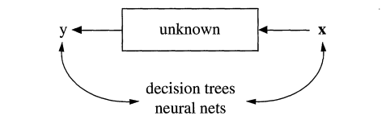
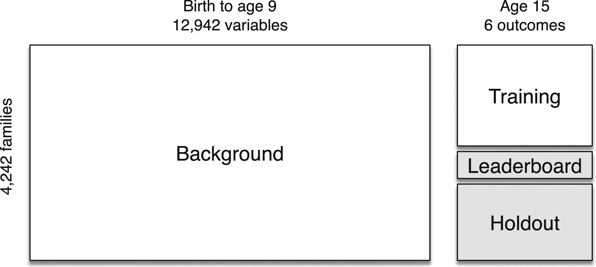
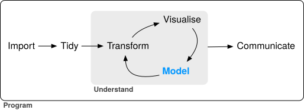
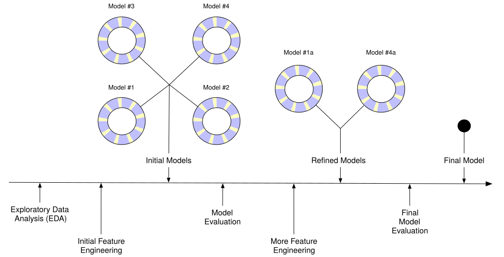
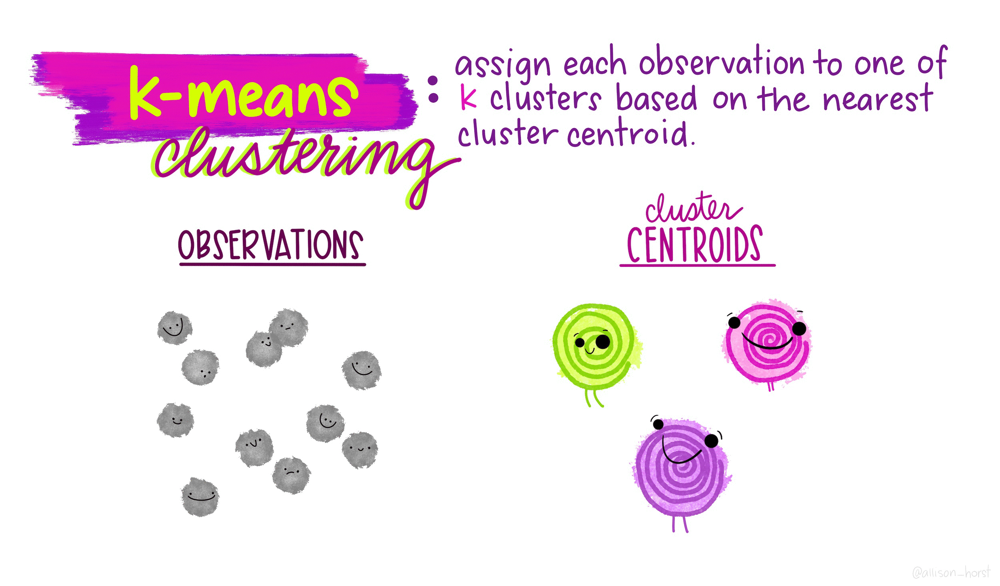
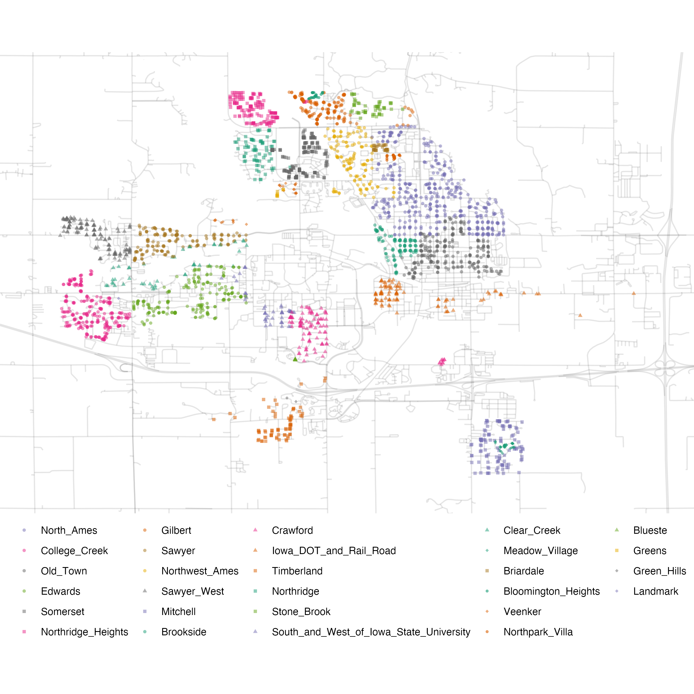
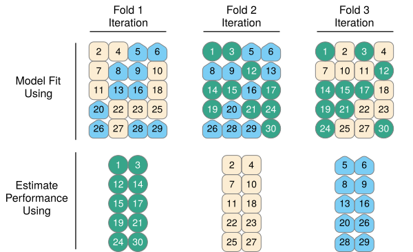

# Prediction and Machine Learning 

It's easy to understand things that have already happened, but what about future events? A new "school" of data science, which has gained popularity in recent years, seeks not just to model relationships, but to _predict_ outcomes. We'll look at what this means for the social sciences. 

__Monday Readings:__

* [Breiman, Leo. 2001. Statistical Science. The Two Cultures of Statistics.](https://www2.math.uu.se/~thulin/mm/breiman.pdf)

* [Molina, Mario; Garip, Feliz. 2019. Annual Review of Sociology. Machine Learning for Sociology.](https://www.annualreviews.org/content/journals/10.1146/annurev-soc-073117-041106)

* _Optional:_ [Surani, Faiz; Suzgun, Mirac; Raman, Vayoma; et al. 2025. AI for Scaling Legal Reform: Mapping and Redacting Racial Covenants in Santa Clara County.](https://dho.stanford.edu/wp-content/uploads/Covenants.pdf)

* _Optional:_ [Johnson, Rebecca A.; Zhang, Simone. 2015. Sociological Science. Predictive Algorithms and Perceptions of Fairness: Parent Attitudes Toward Algorithmic Resource Allocation in K-12 Education.](https://sociologicalscience.com/articles-v12-15-322/)

__Wednesday Readings:__

* _Optional_: [Jean, Neal; Burke, Marshall; Xie, Michaelk; et al. 2016. Science. Combining satellite imagery and machine learning to predict poverty.](https://www.science.org/doi/10.1126/science.aaf7894)

* _Optional:_ [Bit by Bit: Social Research in the Digital Age. Running Experiments](https://www.bitbybitbook.com/en/1st-ed/running-experiments/)

* _Optional:_ [Kiviat, Barbara. 2019. Credit Scoring in the United States.](https://www.econstor.eu/bitstream/10419/223110/1/Econsoc-NL-21-1-05.pdf)

## Data Models and Algorithmic Models

We've now spent some time understanding how to create and work with data, how to perform descriptive statistics, visualizations and maps, and how to model outcomes. 
In [Statistical Modeling: The Two Cultures](https://www2.math.uu.se/~thulin/mm/breiman.pdf), Breiman argues that there is a distinct division between researchers who use _data models_ and those who use _algorithmic models_. We can also think about this as a division between information/explanation and prediction. 

To begin, let's think about a process of interest. As social scientists, we might be interested in a sequence of events, like _what causes job loss_? (The [Fragile Families Challenge](https://ffcws.princeton.edu/news/fragile-families-challenge-mass-collaboration-paper-published) asked this, and other questions in a large competition - but more on this later!). We could even map out some kind of diagram, like Breiman does, where $x$ is represents our input variables: maybe a range of employee and employer characteristics, market features, policies and local laws, economic factors, and spatial characteristics of a place. $y$ represents whether someone lost their job or not.  

```{r nature, echo = FALSE, out.width="100%", fig.cap="Source: Breiman, 2002"}


```


Traditionally, social scientists have tried to explain these processes using what Breiman calls _data models_. In other words, the social scientist might run a linear regression with all our $x$ variables (employee education, type of occupation, whether there is a recession, etc.) and use these to _explain_ why a person lost (or didn't lose) their job. For instance, such a model might tell us that, on average, having a high school diploma lowers the probability of job loss by 4%, working in agriculture increases the probability of job loss by 10%, and a recession increases everyone's probability of job loss by 5%. For any individual, we can add all of these factors and arrive at a predicted probability. 

```{r models, echo = FALSE, out.width="100%", fig.cap="Source: Breiman, 2002"}


```

Other examples, noted by Breiman, include logistic regression and Cox models (used in survival analysis). For all of these models, there is a direct, transparent relationship between the inputs ($x$) and the output ($y$). 

_Algorithmic models_ operate differently. Rather than assuming that we can explain job loss with a linear combination of variables, the algorithmic approach assumes that there is some unknown process that predicts job loss. Maybe many things have to occur at once (recession, specific industries, specific skill levels), or maybe there are certain cutoff points that are not be obvious to researchers (for example, maybe completing 2 years of college has no effect on job loss but having 3 years lowers the probability). The process by which $y$ is predicted could be so complicated that it is nearly impossible to know why the model predicted it (as is the case in neural networks). The _algorithmic modeler_ doesn't necessarily care why all of these features (or combinations of features) are important - they just care that these can make better predictions than a data model. 


```{r algorithm, echo = FALSE, out.width = "100%", fig.cap="Source: Breiman, 2002"}


```

Why does this matter? The distinctions between these two cultures - data models and algorithmic models - have grown in recent years as social scientists think about not just explaining social processes, but predicting them, and data scientists think about not just making predictions, but explaining them. We might think that in the age of AI, we could predict lots of social outcomes with ease. But we'd be wrong. The [Fragile Families Challenge](https://ffcws.princeton.edu/news/fragile-families-challenge-mass-collaboration-paper-published) used an __open call__ (recall these from [Let's "Git" Going: Code, Collaboration, and Version Controls]) to see how well social scientists could predict individuals' GPA, high school graduation, grit, job training, and experience with eviction and job loss by age 15. They had a trove of data from surveys over these individuals' lives, with information on schooling, health, family members and economics, and more. However, overall, they were not able to predict these outcomes much better than data models (or random chance for that matter). This highlights some of the challenges that face social scientists: explaining processes, making accurate predictions, and finding truth in a world of big data. 


## Splitting Your Data, Setting Up Your Models

When making predictions (or evaluating any model), researchers often __split__ their data into different sets. Let's think about how this would work in a real dataset. The Fragile Families challenge included data on children from birth to age 9, all of which was already available to researchers. What wasn't yet available to researchers (as of 2017), was data for these children at age 15. So the challenge split this data into three parts: _training data_ for teams to modify their models, _leaderboard data_ to evaluate teams' predictions in real time, and finally, a _holdout set_ to perform a final evaluation of the best models. 

```{r splittingdata, echo=FALSE}


```


The data split raises an important question about the modeling process: how do researchers actually create their models? If you read a social science article, you might believe that researchers carefully ajudicate between all potential decisions _prior_ to running their models, and then select the best one and present the results. This is _rarely_ the case. New developments in social science research, such as pre-registration, are designed to prevent researchers from trying many possible models and only sharing the best ones (sometimes called p-hacking). 

In [Tidy Modeling With R](https://www.tmwr.org/software-modeling), Kuhn and Silge recommend the following workflow for social scientists. It starts with importing data, and includes tidying (or cleaning) the data, then an interative loop between transforming, visualizing, and modeling the data resulting in some gained understanding. Finally, the research team communicates their findings. 

```{r datasciencemodel, echo = FALSE, fig.cap="A tidy modeling process."}



```

Kuhn and Silge offer a second visualization for how the modeling process may look. In the figure below, the research team conducts exploratory analysis, initially "engineers features" or sets their model parameters, and then evaluates possible models, before refining them and trying the adjusted models. Ultimately, the team comes up with a "final model."


```{r modelingprocess, echo = FALSE, fig.cap="An example modeling process."}



```

The modeling process may look different for every research team. In most cases, there are bound to be more decisions, and more challenges, than the researchers initially anticipate. This is ok! However, because of all these decisions, researchers sometimes (intentionally or unintentionally) present only the results that look the best for their research agenda. Some have called this problem [the garden of forking paths](https://sites.stat.columbia.edu/gelman/research/unpublished/p_hacking.pdf). 

The "holdout" set in the Fragile Families Challenge helps to avoid issues like this. If you want to work with the Fragile Families Challenge data, you can find it [here](https://www.icpsr.umich.edu/web/DSDR/studies/31622/publications#)!


## Unsupervised Machine Learning with K-Means Clustering

We'll begin with the first part of Figure \@ref(fig:modelingprocess), Exploratory Data Analysis (EDA). We've done some exploratory data analysis already, through plotting and visualization. But what if we want to do some more advanced categorization of our data? For example, we might want to define categories like neighborhoods, which are based more on social histories than rigid boundaries. 

To model with some real data, we return to the `tidymodels` package. Librarying `tidymodels` will automatically load datasets like the `ames` housing data, which describes houses in Ames, Iowa. We can load the data into our environment with `data(ames)`. 

```{r ames, message=FALSE}

# load tidymodels
library(tidymodels)


```

The astute observer might notice that the `ames` data has `Longitude` and `Latitude` columns. Recall that we can use `st_as_sf()` to make this data spatial! We will need to specify the coordinates using `coords`. 

```{r ames2, message = FALSE}

library(sf)

ames_spatial <- ames %>%
  st_as_sf(coords = c("Longitude", "Latitude"))


```

Now that we've created a spatial dataset, we can plot it! Without any additional information, how would you describe the neighborhoods?


```{r ames3}

ggplot(ames_spatial) + 
  geom_sf()


```


We're going to use __k-means clustering__ to try to identify potential neighborhoods. K-means is an _unsupervised_ machine learning algorithm, meaning it identifies clusters from unlabeled data. We can contrast this with _supervised_ learning, which attempts to label data correctly (for exmaple, if we had "ground truth" neighborhood labels and wanted to predict these - but more on that later!). 

The basic steps to _k-means_ are as follows:

1. Pick _k_ points (centroids) at random
2. Assign all data points to closest centroid
3. Re-calculate centroids, based on points in group
4. Re-assign points to nearest centroid
5. Repeat 3-4 until no points switch groups

These are represented much more elegently in the following illustration by [Allison Horst](https://allisonhorst.com/k-means-clustering):

```{r kmeans, echo = FALSE, out.width="100%"}



```


```{r ames4}


kclust <- kmeans(ames %>%
                   select(Longitude, Latitude), centers = 3)


```


Now let's look at our clusters! We will use `mutate` to add a cluster column to the `ames_spatial` dataset, and then we will plot it again. What do you notice?

```{r ames5, message = FALSE, warning = FALSE}
library(magrittr)

# add clusters
ames_spatial %<>% 
  mutate(cluster = as.character(kclust$cluster))

ggplot(ames_spatial) + 
  geom_sf(aes(col = cluster))


```

Our model is working, but it's not perfect. That means we can jump into the next step of modeling, or _feature engineering_! We will try modifying our settings and see if we can come up with a better clustering algorithm. For example, maybe we want to try 6 cluster centers. 

```{r ames6}


kclust <- kmeans(ames %>%
                   select(Longitude, Latitude), centers = 6)


# add clusters
ames_spatial %<>% 
  mutate(cluster = as.character(kclust$cluster))

ggplot(ames_spatial) + 
  geom_sf(aes(col = cluster))


```

Looking a bit better! We are still far from the neighborhoods identified in the ames data:

```{r amesfigure, echo = FALSE, fig.cap="Neighborhood identifiers in Ames data."}


```

However, by adding more features to the data, and trying different $k$ values, we might be able to get closer to the "true" neighborhoods. 


## Supervised Machine Learning with Random Forests

We might be interested in creating a model that can _predict_ housing characteristics, such as sales price. Using `ggplot2`, we can begin to explore the data - for example, by looking at descriptive statistics on home sale prices:  


```{r exploreames}

# examine ames housing data
ggplot(ames, aes(x = Sale_Price)) + 
  geom_histogram(bins = 50, col= "white")

```


Because this is a prediction task, we begin by splitting our data so that we can evaluate training and test sets. We might be concerned about some portions of the data not being represented well in our training or test data. For example, in the figure above, we can see that housing price data is skewed with a "long tail," meaning that while most houses sell within the \$50,000-\$400,000 range, there are several houses that sell for much much higher values. To make sure both our training and test sets are representative among neighborhoods, we include `strata = Sale_Price` below. 

```{r randomforest0, message = FALSE, warning = FALSE}

library(tidymodels)

ames_split <- initial_split(ames, prop = 0.80, strata = Sale_Price)
ames_train <- training(ames_split)
ames_test  <-  testing(ames_split)


```


We've used `tidymodels` to create linear models (in [Gathering and Modeling Data]), but now we will try creating a common machine learning algorithm: the "random forest" model. To do so, we will first define our models and parameters. We will begin with a simple decision tree. Notice the parameters, such as the number of trees and minimum n value. 


```{r randomforest2, echo = TRUE, warning = FALSE}

# create a decision tree
tree_model <- 
  decision_tree(min_n = 2) %>% 
  set_engine("rpart") %>% 
  set_mode("regression")

# define the tree's model fit
tree_fit <- 
  tree_model %>% 
  fit(Sale_Price ~ Longitude + Latitude + Neighborhood, 
      data = ames_train)

ames_test_small <- ames_test %>% slice(1:10)

# combine predictions with our data
ames_test_small %>% 
  select(Sale_Price) %>% 
  bind_cols(predict(tree_fit, ames_test_small))

```


Our estimates are close, in some cases! Is there anything that you notice about the `.pred` values? There are a few repeated values, likely for houses that follow the same decision point logic. This is probably not ideal - with more trees, we might be able to use more information to differentiate these houses. We will now move on to the forest. Below, we create the random forest model, define its "workflow" (this is a modeling strategy within `tidymodels`), and then fit the model.

```{r rfworkflow, echo = TRUE}

# create a random forest
rf_model <- 
  rand_forest(trees = 1000) %>% 
  set_engine("ranger") %>% 
  set_mode("regression")

# define the random forest workflow
rf_wflow <- 
  workflow() %>% 
  add_formula(
    Sale_Price ~ Gr_Liv_Area + Year_Built + Bldg_Type + Neighborhood + 
      Latitude + Longitude) %>% 
  add_model(rf_model) 

# fit the random forest model
rf_fit <- rf_wflow %>% fit(data = ames_train)

```

We can now estimate the _performance_ of our models! The following function takes in a `model` and `dat` (or data), and returns an output with performance metrics.


```{r estimateperformance, echo = TRUE}

estimate_perf <- function(model, dat) {
  # Capture the names of the `model` and `dat` objects
  cl <- match.call()
  obj_name <- as.character(cl$model)
  data_name <- as.character(cl$dat)
  data_name <- gsub("ames_", "", data_name)
  
  # Estimate these metrics:
  reg_metrics <- metric_set(rmse, rsq)
  
  # output our model
  output <- model %>%
    predict(dat) %>%
    bind_cols(dat %>% select(Sale_Price)) %>%
    reg_metrics(Sale_Price, .pred) %>%
    select(-.estimator) %>%
    mutate(object = obj_name, data = data_name)
  
  return(output)
}


```

We can evaluate the performance of both the `tree_fit` and `rf_fit`. The performance metrics include "rmse" or root mean squared error (where a higher value indicates more errors) and "rsq" or $R^2$ where a value closer to 1 indicates a better model fit. What do you notice, comparing our two models?


```{r estimateperfomrance2, echo = TRUE}

# first examine tree performance
estimate_perf(tree_fit, ames_train)

# now examine random forest performance
estimate_perf(rf_fit, ames_train)


```

Now, we can evaluate the predictions on the test set. What do you notice, comparing these to the training set performance above?

```{r finalrf, echo = TRUE}

# final rf model
final_rf_res <- last_fit(rf_wflow, ames_split)

# get model metrics
collect_metrics(final_rf_res)

```

The models perform worse on the test set because the data may have been _overfitted_ to the training data. In other words, by relying on patterns in the training data, we may have become overconfident in our models ability to make predictions. So how can we use the training data without overfitting? One approach is to split the training data and repeatedly re-sample within the training data. This is known as __cross validation__. 

## Re-Sample Your Data with Cross Validation

With algorithmic approaches, we've seen some of the benefits of splitting our data to find patterns that might generalize to other parts of our data. However, what if within our training set, we were also able to fine-tune our models by looking at different slices of data? This is how __cross validation__ works. In the figure below, we see 30 data points split into three different colors. In each of three _folds_ (one in each column), the researcher splits the data into one section used to fit their model and one to evaluate the model's performance. (Does this remind us of anything, like the initial split?) Then, the researcher can see what model performs well _across_ folds, which may help us guess which models will perform well in other settings too. 

```{r cvfigure, echo = FALSE, fig.cap="Cross validation. Source: Kuhn and Silge, 2023."}

```


To set up cross validation, we can use the `vfold_cv` command. We will need to a pick a number of folds, $v$, for how many times we want our data to be cross-validated. The standard choice is 10: if a model performs well across 10 subsamples, it will probably generalize to other data too. 

```{r cv, echo = TRUE}

# set up cross validation
ames_folds <- vfold_cv(ames_train, v = 10)
ames_folds

```

Now that we have our cross validation object set up, we will create a resample object with `rf_wflow` from before. 

```{r crossvalidation, echo = TRUE}

keep_pred <- control_resamples(save_pred = TRUE, save_workflow = TRUE)


# create resample object
rf_res <- 
  rf_wflow %>% 
  fit_resamples(resamples = ames_folds, control = keep_pred)


# look at resample object
rf_res

```

Finally, we can measure how our model performs across the 10 folds. 


```{r crossvalidation2, echo = TRUE}

# examine model metrics
collect_metrics(rf_res)

```

We find that on average, our model performs similarly _within the training sample_ during cross validation as it did _in the test set_ earlier. 


## Predictions, Bias, and Social Implications

We've seen how algorithms can make predictions by finding hidden patterns in data. We've also seen that algorithms can be _biased_, and are sometimes intentionally biased, in order to increase accuracy. This is due to the bias-variance tradeoff: accuracy is a combination of bias and variance; to achieve better accuracy, machine learning models can sometimes trade in a little bias for large decreases in variance. By bias, I mean bias in the statistical sense (an average prediction that is different from the true estimand over time, even under perfect conditions). But that bias can also be true in the social sense: algorithms can be biased against certain groups or places. 

For example, credit scores are often based on opaque algorithms that take in a huge amount of consumer data and translate it into an output with ramifications for stratification and inequality. [Kiviat (2019)](https://www.econstor.eu/bitstream/10419/223110/1/Econsoc-NL-21-1-05.pdf) calls credit scoring the "paradigmatic example of algorithmic governance." Thinking back to [Breiman's]() distinction between data models and algorithmic models, it is clear that credit scores fall into the second camp: there is no explainable process by which credit scores are generated, instead, they are the combination of many different slices and pieces of data, engineered to find patterns and make predictions at scale. 

Social scientists have highlighted inequalities in how algorithms like credit scores operate. For example, credit scores have been reported to use features like gender and neighborhood to make predictions, which could entrench discrimination or inequalities along these lines. Removing these inequities from the way algorithms operate, however, may be challenging. [Molia and Garip](https://www.annualreviews.org/content/journals/10.1146/annurev-soc-073117-041106#right-ref-B86) note that if researchers remove a feature like gender from credit score prediction data, the algorithms could still use other data as proxies for gender. If the researcher specifies that genders must have equal credit scores, on average, the algorithm might begin to discriminate on another variable. If the researcher specifies that hypothetical individuals of different genders must have the same opportunity to accrue good credit, this could be more fair. In short, the question of algorithmic fairness depends not just on the specifications of the algorithm, but also on our conceptions of fairness. 

## Problem Set 7

Recommended Resources:

[K-means clustering with tidy data principles](https://www.tidymodels.org/learn/statistics/k-means/)

[Tidy Modeling With R](https://www.tmwr.org/)


1. Start a new document, problemset7.Rmd, in your soc10problemsets repository. (You can download a template [here](https://github.com/Soc10Spring2026/soc10problemsets_templates), but be sure to save it in your own soc10problemsets repo). Create a map of the `ames` data, but change the cluster specifications to try to get closer to the "true" neighborhoods shown in Figure \@ref(fig:amesfigure).  Describe the benefits and limitations of your approach. __Commit__ your changes. 

2. Using the `tigris` package, download roads data for the county of Story, IA. Add roads to your plot. __Commit__ your changes. 

3.  Try to train an algorithm to predict housing sales prices. Create a random forest to predict the sales price, using some new or different variables than the model above. Create a model that _better_ predicts sales price, and explain why it is better. __Commit__ your changes. 

4. Perhaps the model could be better trained using Cross Validation. Set up a 10-fold cross validation model, and predict sales prices again. Compare these results to your prior results. Are they similar or different, and what does this mean?   __Commit__ your changes. 

5. If a real estate company used algorithms to determine home values, could this have any societal implications? Walk the reader through why the data could induce biases and how you might try to resolve these potential problems.  __Commit__ your changes. 


