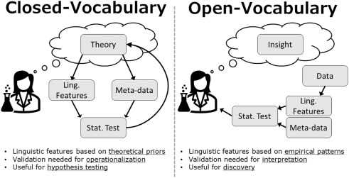
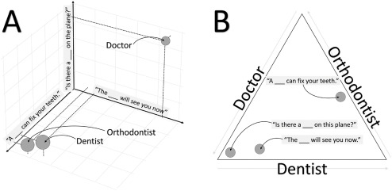
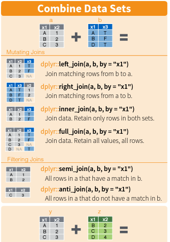

# Text Analysis Tools, Part I: Text Mining, Sentiment Analysis

Text data contains multitudes of information, and can be leveraged to do some powerful things in these times. To gear up for an expidition into text analysis, we will start by learning about text mining. 


__Monday Readings:__

* _Optional:_ [Van Loon, Austin. 2023. Social Science Research.The Three Families of Automated Text Analysis.](https://www.sciencedirect.com/science/article/pii/S0049089X22001090)

* _Optional:_ [Canales, Kristine L.; Pope, JoEllen V.; Maestas, Cherie D. 2019. Social Science Quarterly. Tweeting Blame in a Federalist System: Attributions for Disaster Response in Social Media Following Hurricane Sandy.](https://onlinelibrary.wiley.com/doi/full/10.1111/ssqu.12669)

__Wednesday Readings:__

* _Optional_: [Text Mining in R: A Tidy Format. Chapter 1. The Tidy Text Format.](https://www.tidytextmining.com/tidytext)

* _Optional:_ [Baker, Dominique J., Karly Ford, Samantha Viano, and Marc Johnson-Guerrero. Racial Category Usage in Education Research: Examining the Publications from AERA Journals](https://www.edworkingpapers.com/sites/default/files/ai22-596.pdf)


## Text As Data

We live in a world that increasingly produces text. People are increasingly literate, able to write down their thoughts, and able to share these with the world. 

Researchers can use online text data from sources like social media, blogs and news sites, and scientific articles to analyze patterns of human behavior in ways that were not possible just decades ago. Many books and historical information are also digitized, which allows for analysis of archives at scales that were previously impossible. 

Unlike the types of data we have examined up to this point (numeric, spatial, categorical), it is not always clear how the researcher should interpret text data. For example, a word like "lead" could take on very different meanings, depending on what it is followed by ("a retreat" vs. "climbing" vs. "pipe"). This means that text data comes with a variety of challenges that were not present for the other types of data we've seen. To make meaning of text data, researchers use a variety of strategies, many of which are rapidly changing. 

### "Families" of Text Analysis


[van Loon](https://www.sciencedirect.com/science/article/pii/S0049089X22001090) categorizes text analysis into three "families." Each of these families is defined in terms of its orientation towards making meaning from the text data. 


1. __Term frequency analysis__. With this approach, researchers analyze variation in how _often_ certain words appear. In __closed term frequency analysis__, researchers might define a dictionary (for instance, positive - negative words or masculine - feminine words) and examine how often these words appear in a text document. [AFINN](https://darenr.github.io/afinn/) is a common dictionary, which gives scores ranging from 5 (most positive) to -5 (most negative). This approach is useful in testing theories. In __open term frequency analysis__, the researcher looks at correlations between common words and an outcome of interest (like happiness or depression). This approach is useful in exploring data and generating new theories. Figure \@ref(fig:closedopen2) shows theoretical differences between open and closed vocabulary approaches. 
```{r closedopen2, out.width="70%", fig.cap="From van Loon 2022", echo = FALSE}



```
2. __Document structure__. In this approach, researchers seek to understand what a document is _about_. As noted earlier, words can take on very different meanings depending on the words around them. Therefore, we might want to sort words into _topics_ that make up our documents. As an example of this, [(Alvero et al, 2021)](https://www.science.org/doi/full/10.1126/sciadv.abi9031) study the topics that students write about in college applications. They find topics such as "seeking answers," "human nature," "time management," and "helping others." They find that correlations between topics and household income (0.16) are higher than the correlation between test scores and income (0.12).

3. __Semantic similarity__. Finally, researchers may wish to group words according to _semantic meaning_. Figure \@ref(fig:semantic) shows the words "doctor," "orthodontist," and "dentist" mapped onto a semantic space. Here, the researcher is thinking about not just the frequency of words, or how they are grouped with other words, but similarities in _meaning_. 
```{r semantic, out.width="100%", fig.cap="From van Loon 2022", echo = FALSE}



```


## Newspapers & Books

We will start our journey to analyzing text data with some classic sources: books and newspapers. Luckily for us, there are massive databases of these types of text. 

We can start with the `gutenbergr` R package. We can load this package and read in a book from [this list](https://www.gutenberg.org/ebooks/), most of which are in the public domain. We'll try searching for books from the sociologist Émile Durkheim. It looks like there is one: "The Elementary Forms of Religious Life."

```{r gutenbergr, message = FALSE, warning = FALSE}

#install.packages("gutenbergr")
library(gutenbergr)

# Look at Gutenberg books written by Durkheim
gutenberg_works(author == "Durkheim, Émile")

# download book - notice that we need the id number (also on the gutenberg website)
efrl <- gutenberg_download(gutenberg_id = 41360, mirror = "http://mirrors.xmission.com/gutenberg/")


```

Great! The book contains arguments on societies, symbols, and religion:


```{r pigeon, echo = FALSE, out.width="50%"}


```

But what can we actually do with the text? First, let's take a look at the first 50 rows. 

```{r vanishing, echo = FALSE, warning = FALSE, message = FALSE, fig.cap="The Elementary Forms of Religious Life"}

library(kableExtra)

knitr::kable(
  head(efrl, 50), longtable = TRUE, booktabs = TRUE,
 # caption = 'The Elementary Forms of Religious Life'
) %>%
  scroll_box(width = "100%", height = "1000px")

```

It's a bit of a mess! But that's alright, we can clean it up. We'll start by using the `unnest_tokens()` function from the `tidytext` package (remember that you need to install and library this package before using it!). We will also use the `dplyr` package, which I'll elaborate on below. The first argument in `unnest_tokens()`, `word`, means we want to create a new variable called "word." The second argument, `text`, means we want to use the old variable called "text."

```{r tokenize, warning = FALSE, message=FALSE}
library(tidytext)
library(dplyr)

# try to tokenize into single words
efrl %>%
  unnest_tokens(word, text)

```

It's still a bit of a mess! Maybe even more so. But we are on our way to organizing this dataframe. Notice that in the "text" column, each row contains just one word now, rather than chunks of sentences. We will run this code again with the magrittr pipe to permanently change our dataframe.


```{r tokenize2, warning = FALSE}

library(magrittr)

# try to tokenize into single words
efrl %<>%
  unnest_tokens(word, text)

```

Great! Now we can do things like look at the frequency of word lengths:

```{r wordlengths}
library(stringr)

# table of wordlengths
efrl$word %>%
  str_length() %>%
  table()

```

So we see that the majority of words have between 2 and 5 letters, which is probably what we would expect. This is not super interesting, but it's always good to do data checks like this to catch if anything is seriously wrong! Notice that the `$` sign tells the dataframe that we want to select a particular variable, or vector. We could also have used the `select()` command from `dplyr`. 

Next, we can search for the frequency of particular words or parts of words. For example, maybe we want to know how times the book mentions words like "society" or "religion." The "|" symbol below denotes "or."

```{r wordlaw}

# count of words that contain "law"
efrl %>% 
  filter(word == "moral" | word == "symbol" | word == "totem" | word == "society" | word == "religion") %>% 
  count(word, sort = T)

```

We notice that the book mentions "totem" 482 times, but only mentions "symbol" 18 times. This reveals the central role that "totems" play in the book. Whereas a word like "society" might be common in many social science books, "totem" seems more unique. Could we quantify this? More on this later ... For now, try running similar code on your own to look at other words! You can use `str_starts()` and `str_ends()` to capture words that start or end with certain strings (groups of letters).

## Using APIs to Gather Text Data


We've seen one example of an API that runs straight out of an R package, no registration or setup required. However, most take a bit more work on the front end. To get a sense of what this can look like, we'll try using the API for the newspaper The Guardian. 

First, we'll need a key to access the API. You can obtain one [here](https://open-platform.theguardian.com/) by clicking "Register for a Developer Key." 

Next, we can install and library the `guardianapi` R package. There is another R package, "guardian" which also works with this API, but it is not on CRAN, so it is a little trickier to set up. It is often the case that multiple R packages can perform a single task, so we may want to try the other one if we are running into difficulties. 

```{r guardian, message = FALSE, warning = FALSE}

library(guardianapi)

```

```{r apikey, echo = FALSE, warning = FALSE, message = FALSE}
library(readr)
guardian <- read_csv("guardian.csv")

```

You will also need to run the `gu_api_key()` command and enter your API key. The Guardian API will let us pull the full newspaper text from Guardian articles within topics and date ranges that we specify. For example, we can pull articles on local issues with the following code: 

```{r canadafires, message = FALSE, eval = FALSE}

guardian <- gu_content('"San Jose" AND "California"',
                         from_date = "2025-01-1",
                         to_date = "2026-05-11")

```


Let's take a look at what's in our dataframe. 


```{r canadafires2, echo=FALSE}

guardian %>%
  head()

#knitr::kable(
#  ca_wf, longtable = TRUE, booktabs = TRUE,
#  caption = 'Guardian Articles on Canadian Wildfires and Smoke in New York City from June #2023'
#) %>%
#  scroll_box(width = "100%", height = "1000px")

```

We notice there are lots of variables! We can take a closer look at a few by using the `select()` function. For example, you could run the following code to view what we see in the table below:

```{r select, eval = FALSE}
guardian %>%
  select(headline, byline, web_publication_date, body_text) %>%
  View()

```


```{r canadafires3, echo = FALSE, fig.cap='Guardian Articles on California and San Jose Since 2025'}
knitr::kable(
  guardian %>% select(headline, byline, web_publication_date, body_text), longtable = TRUE, booktabs = TRUE,
  #caption = 'Guardian Articles on California and San Jose Since 2025'
) %>%
  scroll_box(width = "100%", height = "1000px")

```

Fantastic, this illustrates one way that we can download a lot of text data from newspapers. How we analyze this is a separate question, which we will get to in later weeks!


Lastly, there are many ways to gather text data from social media sites. At the moment, the most accessible of these might be the site [Reddit](https://www.reddit.com/). We can use the R package `RedditExtractoR` to gather posts and comments from Reddit.  


```{r reddit, message = FALSE, warning = FALSE}

library(RedditExtractoR)

```

We can now do things like pull all the subreddits about specific topics. For example, we might be interested in posts that mention the word "San Jose":

```{r reddit2, eval = FALSE}
# extract sj subreddits
sj_subreddits <- find_subreddits("san jose")

```


Great! If we want to extract the comments in these subreddits, we first find the urls of the above pages, and then plug these into the `get_thread_content()` function. Let's see what we get in return. There are two ways to find the urls, either by searching the subreddits or the keywords themselves. With the former approach, you can only search one subreddit at a time. The latter generally returns more results, since it includes lots of different subreddits. However, getting the urls this way sometimes returns `NA`, so you may want to use the subreddit method. Both methods are shown below. 

```{r extract urls, eval = FALSE, message = FALSE, warning = FALSE}

# we can get urls of the san jose subreddit
sj_urls <- find_thread_urls(subreddit = "SanJose",
                                 period = "day")

# alternatively, we can find urls of all pages related to san jose
#sj_urls <- find_thread_urls(keywords = "san jose")

# extract comments from these pages
sj_comments <- get_thread_content(sj_urls$url)

# take a look 
sj_comments$threads

sj_comments$comments

```

```{r extract urls real, echo = FALSE, warning = FALSE, message = FALSE}
library(readr)

# get sj comments - threads
sj_comments_threads <- read_csv("sj_comments_threads.csv")

# get sj comments - comments
sj_comments_comments <- read_csv("sj_comments_comments.csv")

# put in list
sj_comments <- list(threads = sj_comments_threads,
                         comments = sj_comments_comments)

# get sj comments 
sj_comments$threads

sj_comments$comments

```

Let's look at the comments first. We'll want to use the `unnest_tokens()` function to put the data in tidytext format. We can also remove the stop words. 

```{r reddit tidytext, warning = FALSE, message = FALSE}
library(dplyr)
library(tidytext)

tidy_comments <- sj_comments$comments %>%
   unnest_tokens(word, comment) %>%
  anti_join(stop_words)

# look at words and timestamps
tidy_comments %>%
  select(timestamp, word)

```

## Working with Text Data in R

Let's dig in a little more to into how to handle text data in R. We'll first introduce a concept called **tidytext**. [Silge and Robinson](https://www.tidytextmining.com/tidytext.html) define tidytext as text data in which each row is a _token_. Tokens are meaningful groups of text, such as words, sentences, or n-grams (groups of n words or letters). This concept is borrowed from [Wickam's](https://www.jstatsoft.org/article/view/v059i10) concept of tidy data, which says that each observation should be a row, each variable a column, and each type of observational unit a table. 

In other words, tidy data could look something like this:

Row  | Person | Birthday | Occupation
:-----|:------- |:--------|:---------|
1 | Joe       | 12/3/1963| Carpenter| 
2 | Malik     | 6/8/1978 | Architect| 
3 | Suzanna   | 4/3/2001 | Student  | 

Or this: 

Row  | County | Temperature | PM2.5
:-----|:------- |:------- |:-------|
1 | Santa Clara | 78.1 |  12.1 | 
2 | San Mateo | 82.3 | 32.1 | 
3 | San Francisco | 65.4 | 44.7  | 

While tidy text would look something like this:

Row  | Paper | Article | Text
:-----|:------- |:------- |:-------|
1 | New York Times | Study Compares Gas Stove Pollu... |  Using  | 
2 | New York Times | Study Compares Gas Stove Pollu... | a | 
3 | New York Times | Study Compares Gas Stove Pollu... | single  | 

Or this:

Row  | Paper | Article | Text
:-----|:------- |:------- |:-------|
1 | New York Times | Study Compares Gas Stove Pollution to Secondhand Cigarette Smoke |  Using a single gas-stove burner can raise indoor concentrations of benzene, which is linked to cancer risk, above levels that have prompted investigations when detected outdoors.  | 
2 | New York Times | Study Compares Gas Stove Pollution to Secondhand Cigarette Smoke | For the peer-reviewed study, researchers at Stanford's Doerr School of Sustainability measured benzene emissions from stoves at 87 homes in California and Colorado and found that natural gas and propane stoves emitted benzene at rates that frequently reached indoor concentrations above health benchmarks set by the World Health Organization and other public agencies. | 
3 | New York Times | Study Compares Gas Stove Pollution to Secondhand Cigarette Smoke | In about a third of the homes, a single gas burner on high or an oven set at 350 degrees for 45 minutes raised benzene levels above the upper range of indoor concentrations seen in secondhand tobacco smoke, researchers found.  | 

What about the Guardian news data that we pulled earlier - is this in tidy text format? Read it in to your R environment, and if not, try to convert it into a tidy text table.

```{r guardian tidytext, message = FALSE, warning = FALSE}

library(readr)
guardian <- read_csv("guardian.csv")

```

One of the first questions that comes up when trying to convert a document into tidytext format is _what is our unit of analysis?_ This is an important question for any research project, and should be given careful thought.

Perhaps we want to study whether there are differences in how blogs and news articles write about San Jose events. Using the Guardian dataset from earlier, we can create two dataframes of the following forms:


```{r guardian katrina, warning = FALSE, message = FALSE}
library(tidytext)
library(dplyr)

# first, set up liveblog dataframe
tidy_blogs <- guardian %>%
  filter(type == "liveblog")

# unnest tokens
tidy_blogs %<>%
  unnest_tokens(word, body_text) %>%
  anti_join(stop_words)

# look at examples
tidy_blogs %>%
  select(type, word) %>%
  head()

```


```{r guardian liveblog, warning = FALSE, message = FALSE}
library(tidytext)
library(dplyr)

# first, set up liveblog dataframe
tidy_blogs <- guardian %>%
  filter(type == "liveblog")

# unnest tokens
tidy_blogs %<>%
  unnest_tokens(word, body_text) %>%
  anti_join(stop_words)

# look at examples
tidy_blogs %>%
  select(type, word) %>%
  head()

```


```{r guardian news, warning = FALSE, message = FALSE}

tidy_articles <- guardian %>%
  filter(type == "article")


tidy_articles %<>%
  unnest_tokens(word, body_text) %>%
  anti_join(stop_words)


tidy_articles %>%
  select(type, word) %>%
  head()

```

We've used `unnest_tokens()` before. But notice the `anti_join(stop_words)`? What do you think is happening here? 


First, let's take a look at `stop_words`. You can run `View(stop_words)`, once `tidytext` is already in your library, to do the same on your machine. We see that these stop words come free three different lexicons: SMART, snowball, and onix. Stop words are essentially words that are not useful for our analyses, such as "the." Are there any words in these lists that you are surprised to see? 

```{r stopwords, echo = FALSE}

library(kableExtra)

knitr::kable(
  stop_words, longtable = TRUE, booktabs = TRUE,
  caption = 'Stop Words from the TidyText Package') %>%
  scroll_box(width = "100%", height = "1000px")


```

Next, let's make sure we understand what the `anti_join` is doing. When merging two different dataframes, it is common to use "join" functions. There are two major types of joins in R: _mutating_ joins and _filtering_ joins. We'll use mutating joins for most instances where we want to combine two sets of information, but in this case, the filtering `anti_join()` allows us to remove all the stop words from our dataframe. The table below is a helpful guide (this is taken from a `dplyr` cheat sheet, you can see cheat sheets for various R packages [here](https://posit.co/resources/cheatsheets/). 


```{r joins, echo = FALSE, out.width= "50%"}



```

Now that we have removed stop words and organized our data, we can do things like examine the word frequencies in articles and blogs. 

```{r frequencies}

# look at blog word frequencies
tidy_blogs %>%
  count(word, sort = TRUE)

# look at article frequencies
tidy_articles %>%
  count(word, sort = TRUE)

```

The articles contain more words related to place ("san", "california") and events ("team", "world", "cup"). In this small sample, the blogs contain more words like "administration," "trump," and "president," suggesting that these news stories may be more political than the articles. 

```{r frequencies2, warning = FALSE, message = FALSE}
library(tidyr)
frequency <- bind_rows(tidy_blogs,
                       tidy_articles) %>% 
  count(type, word) %>%
  group_by(type) %>%
  mutate(proportion = n / sum(n)) %>% 
  select(-n) %>% 
  pivot_wider(names_from = type, values_from = proportion) 

frequency %>%
  head()

```


```{r frequencies3, warning = FALSE, message = FALSE, fig.cap="Word Frequency Comparison"}

library(scales)
library(ggplot2)

# expect a warning about rows with missing values being removed
ggplot(frequency, aes(x = article, y = liveblog, 
                      color = abs(article - liveblog))) +
  geom_abline(color = "gray40", lty = 2) +
  geom_jitter(alpha = 0.1, size = 2.5, width = 0.3, height = 0.3) +
  geom_text(aes(label = word), check_overlap = TRUE, vjust = 1.5) +
  scale_x_log10(labels = percent_format()) +
  scale_y_log10(labels = percent_format()) +
  scale_color_gradient(limits = c(0, 0.001), 
                       low = "darkslategray4", high = "gray75") +
  theme(legend.position="none") +
  labs(x = "Articles", y = "Blogs")

```

## Comparing Word and Document Frequencies

Extending the previous example, we might want to compare word frequencies across documents. 

We've looked at word frequencies in the previous sections, but these frequencies do not account for words that are common _across_ documents, such as "it's" or "office." We might instead be interested in words that are uniquely prevalent in each document. To examine this, we will use Text Frequency-Inverse Document Frequency, or TF-IDF. The IDF part of this concept can be calculated as follows: 

$$ IDF(term) = ln\bigg(\frac{n_{documents}}{n_{documents containing term}}\bigg)  $$
And the TF part of the equation, which we have already used, can be represented as $TF(term) = \frac{n_{term}}{n_{alltermsindocument}}$, or the proportion of all terms in the document that are the term of interest. When we combine these, we have:

$$TFIDF = TF \cdot IDF$$
Intuitively, we can think of this as a measure of popularity of a term in a document, which adjusts (inversely) for how popular this term is in other documents. So if a term like "ai" is popular in the articles but does not appear very much in other blogs, we would expect this to have a high TF-IDF score, whereas a term like "war," which appears in all the documents, would have a lower TF-IDF score. This allows us, in theory, to isolate the words that convey the most meaning about the individual content of each document.  

```{r tfidf, message = FALSE, warning = FALSE, eval = TRUE}


# summarize total words in each section
tf_articles <- tidy_articles %>%
  select(section_name, word) %>%
  count(section_name, word, sort = TRUE)


```

Similarly to above, there are a lot of "junk words" in our `hearing_words` dataframe now. Note that we have not removed stop words here. I will look through `hearing_words` to define the junk words, and I'll remove these junk words as follows: 

```{r remove junk words hearings, message = FALSE, eval = TRUE}
junk_words <- c("it's")

# turn to datafrmae
junk_words <- data.frame(word = junk_words)

# anti join with dataset
tf_articles %<>%
  anti_join(junk_words)

```

Finally, we can calculate the TF-IDF for this group of documents. 

```{r tfidf bind, message = FALSE, warning = FALSE, eval = TRUE}

articles_tf_idf <- tf_articles %>%
  bind_tf_idf(word, section_name, n)

```


We can then plot the top 10 (or any number) of words for each document according to the TF-IDF. 

```{r tfidf plot, message = FALSE, warning = FALSE, eval = TRUE}

library(forcats)

# limit to 10 words 
articles_tf_idf_10 <- articles_tf_idf %>%
  group_by(section_name) %>%
  slice_max(tf_idf, n = 10) %>%
  ungroup()

# plot results
ggplot(articles_tf_idf_10,
       aes(tf_idf, fct_reorder(word, tf_idf), fill = section_name)) +
geom_col(show.legend = FALSE) +
facet_wrap(~section_name, ncol = 4, scales = "free") +
labs(x = "tf-idf", y = NULL)

```

What do we notice? There are a lot of proper nouns and other words specific to each news area. This is how TF-IDF works. It identifies the words that are uniquely important to each document, which, in these cases, tend to be sports terms, names and places, environmental terms, and so on. This is no replacement for in-depth reading and analysis, but it does give us a cursory summary of what each hearing focused on. 


## Sentiment Analysis

Sentiment analysis is just what is sounds like - analyzing the emotions and feelings that language conveys. The `tidytext` package comes with three general-purpose sentiment lexicons. Let's explore these three a little bit. Note that before you can view these lexicons, you may need to install packages such as `textdata` and answer some prompts in R. 

```{r sentiment lexicons, warning = FALSE}

# look at afinn lexicon
get_sentiments("afinn")

# look at bing lexicon
get_sentiments("bing")

# look at nrc lexicon
get_sentiments("nrc")

```

Let's take a look at what emotions from the NRC lexicon show up in our dataset of guardian articles. 

```{r nrc lexicon, message = FALSE, warning = FALSE}
# join nrc with tidy comments
tidy_articles %<>%
  inner_join(get_sentiments("nrc"))

# take a look
tidy_articles %>%
  select(word, sentiment)

# in table form
table(tidy_articles$sentiment)
```


We can also look at the sentiments in the form of a graph. 

```{r sentimentgraph, message = FALSE, warning = FALSE, fig.cap="Sentiments in Guardian Articles"}
library(ggplot2)
ggplot(tidy_articles, aes(y = sentiment))+
  geom_bar(aes(fill = sentiment))+
  theme_minimal()+
  labs(title = "Sentiments in Guardian Articles about San Jose")

```

Is this surprising at all? Perhaps, but it is a little difficult to know what to make of this analysis without a good comparison. We can look at how sentiments in different news sections. 

```{r sentimentcomparisongraph, message = FALSE, warning = FALSE, fig.cap="Sentiment Comparison Across Articles"}

library(ggplot2)

ggplot(tidy_articles, aes(y = sentiment))+
  geom_bar(aes(fill = sentiment))+
  theme_minimal()+
  labs(title = "Sentiments in Articles about San Jose")+
  facet_wrap(~section_name, scales = "free_x")

```

We see some small differences in sentiment across news stories. For example, "The Filter US," which covers consumer news, shows very positive sentiments and low anger. Football, sports, and technology score highly on anticipation. World news and the environment appear to have the highest frequencies of negative words. 


## Problem Set 8

Recommended Resources:

[Text Mining with R: A Tidy Approach](https://www.tidytextmining.com/index.html)

1. Start a new document, problemset8.Rmd, in your soc10problemsets repository. (You can download a template [here](https://github.com/Soc10Spring2026/soc10problemsets_templates), but be sure to save it in your own soc10problemsets repo). Use the Guardian API to download news stories related to the the World Cup. Put the data in `tidytext` format (each row should have a single word). __Commit your changes__. 

2. Use `RedditExtractoR` to download Reddit comments (or threads) for a topic of interest. Explain how you picked the topic and what we might learn from it. Be sure that you download data from multiple subreddits, and describe each briefly. __Commit your changes__.  

3. Choose two subreddits, and compare the frequencies of words between them. (Similar to what is done in Figure \@ref(fig:frequencies3)). __Commit your changes__. 

4. Create a plot comparing sentiment across two or more subreddits. (Similar to what is done in Figure \@ref(fig:sentimentcomparisongraph)). __Commit your changes__. 

5. Which of the "families" of text analysis do your analyses from the prior questions work fall under? Describe how you might incorporate methods from the other families in your analysis. __Commit your changes__. 


